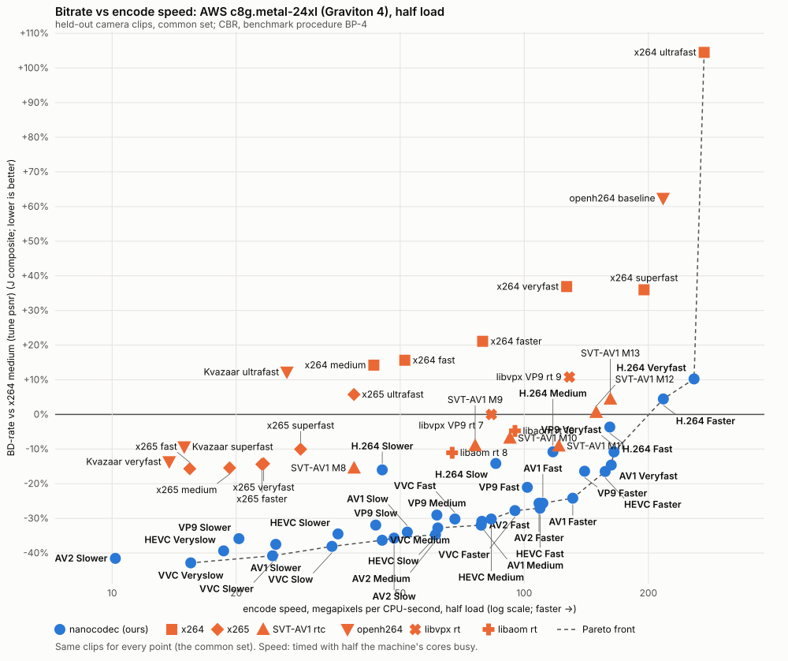

# nanocodec

[](https://crates.io/crates/nanocodec) [](https://docs.rs/nanocodec) [](LICENSE)

An experimental, low-delay video encoder for live camera footage, with matching decoders, written in
Rust. One shared engine drives six formats: **H.264, HEVC, VVC (H.266), AV1, VP9 and AV2**. It aims at streaming
from small edge devices (cameras, bodycams, drones, robots) at low bitrate to the cloud or a browser, where our
own decoders run as WebAssembly.

**[Try the browser demo](https://cribbinsb.github.io/nanocodec/)** · **[Benchmark results, interactive](https://cribbinsb.github.io/nanocodec/results/)** ·
**[Usage docs](https://cribbinsb.github.io/nanocodec/docs/)** ·
[FAQ](docs/FAQ.md) · [Architecture](docs/ARCHITECTURE.md) · [Benchmark procedure](docs/benchmark-procedure.md) ·
[Credits, licences, patents](docs/LEGAL.md)

## Is this for you?

If you are looking for a low-delay video encoder and decoder for live camera streams at low bitrate, you may
be in the right place:

- **BSD-licensed:** BSD 3-Clause code (no patent licence; see [Licence and patents](#licence-and-patents)).
- **Safe Rust:** written in Rust; `unsafe` is confined to the SIMD kernels and the C API.
- **Six formats, one engine:** H.264, HEVC, VVC (H.266), AV1, VP9 and AV2 encoders, each with its own
  decoder; the same rate control, analysis and mode decision drive all six.
- **Decoders that run in any browser:** all six decoders compile to WebAssembly (SIMD128), so a web page can
  play H.264, HEVC, VVC, AV1, VP9 and AV2 streams without WebCodecs, a plug-in or a native decoder for the
  format. They decode other encoders' streams, 8-bit and 10-bit, natively and in the browser (10-bit output
  as 16-bit samples, or converted to 8-bit for display). Official conformance streams, decoded natively and
  compared picture by picture with the reference decoder named, on 2026-11-23 at 98069a8b3
  ([record](docs/results/conformance-2026-11-23/summary.json)):
  - **HEVC** (Main, Main Still Picture, Main 10): 147/147, the whole JCT-VC HEVC_v1 set (136 8-bit, 11
    10-bit), against HM.
  - **AV1** (Main, 8- and 10-bit): 242/242 libaom v3.15.3 test vectors (176 8-bit, 66 10-bit), against aomdec.
  - **VP9** (profiles 0 and 2, 8- to 12-bit): 305/305 libvpx v1.16.0 vectors (303 8-bit, one 10-bit, one
    12-bit), against vpxdec; profiles 1 and 3 are not listed.
  - **VVC** (Main 10 and Main 10 Still Picture, 4:2:0 and 4:0:0): 226/226 of the 283 first-edition H.266.1
    streams (9 8-bit, 217 10-bit), against VTM 24.0. The other 57 are 4:2:2 / 4:4:4, multilayer, palette and
    ACT streams, plus HRD_B_2 (VTM itself fails it) and VPS_C_2; STILL_B_1 is compared with VTM's output, which
    differs from the MD5 in its zip. Also 138 of 138 short 8-bit streams we coded with VTM and VVenC to cover
    the tools one by one ([what passes](docs/handoff/vvc-foreign-corpus.md)).
  - **H.264** (High and High 10, frames only): 110 of the 190 streams of the H.264.1 AVCv1, FRExt and High 10
    sets we fetch, against JM; the 80 others use field pictures, MBAFF, FMO or SP/SI slices, which are not
    supported. The suite's 4:2:2, 4:4:4, MVC and SVC streams are not fetched.
  - **AV2** (a draft standard): all 30 of 30 foreign test streams (12 dav2d 8-bit test vectors, 18 avmenc
    v1.0.0 streams), bit-exact against avmdec v1.0.0 and dav2d (re-run on 2026-11-23 against AVM's frame hashes: 30/30).

  In the browser (the WebAssembly module, plain and relaxed SIMD), on the suites' 4:2:0 progressive streams:
  HEVC 147/147, AV1 240/240, VP9 305/305 (10- and 12-bit included) and H.264 108/113 (same record), and VVC
  221/221 by whole-output MD5 against VTM (d010259d0: the record's 214/221 was a runner fault on seven streams
  whose picture size changes or whose fields are output as frames). The 5 H.264 streams not decoded use FMO or
  SP/SI slices, which the native decoder does not support either and which are not among the required
  streams.

  Browser decode time against ffmpeg.wasm 0.12.10 (the official build: FFmpeg 5.1.4 with `--disable-asm`, so
  without FFmpeg's hand-written SIMD kernels), decode alone on both sides, stream by stream, is recorded in
  [docs/results/wasm-yardstick-2026-11-23](docs/results/wasm-yardstick-2026-11-23/). 10-bit decoding has SIMD on
  AVX2, AVX-512, NEON and WASM for AV1 and VP9, plus WASM for the kernels HEVC and VVC share; VVC's native (x86/Arm) and H.264's 10-bit paths
  are scalar so far.
- **Low-delay codecs:** single-thread, low delay (no B-frames, no lookahead, CBR with a 1 s buffer). Speed
  depends heavily on content; measured speeds are in [Benchmark results](#benchmark-results).
- **VVC and AV2:** single-thread, low-delay encoders and decoders for VVC (H.266) and AV2 (a draft,
  tracking the AOM reference software AVM), natively and in the browser.
- **Optimised for x86, Arm and WebAssembly:** hand-written SIMD kernels for AVX2 / AVX-512, NEON and WASM
  SIMD128; the encoders and decoders run in the browser ([demo](https://cribbinsb.github.io/nanocodec/)).
- **Error resilience:** temporal layers, long-term references, key frames on request and intra refresh (H.264,
  HEVC, VVC, AV1).
- **SVC:** spatial and temporal scalability for AV1 and VP9, including the WebRTC-style K-SVC and L1T2 / L1T3
  modes.
- **Standard bitstreams only:** on every landing, short purpose-made streams of every shipped preset (layers,
  holds, intra refresh, starved keys, the main coding tools) are checked to decode bit-exactly in two
  independent decoders per format. The encoders code 8-bit 4:2:0; the decoders also decode 10-bit
  (and VP9 12-bit) 4:2:0.

## Benchmark results

From the reports of 27 November 2026, benchmark procedure BP-4.0 ([docs/benchmark-procedure.md](docs/benchmark-procedure.md)),
CBR only, on development build 23c962d8b (crate version 0.6.0, PGO build). Every figure below is from the
procedure's own reports; the [results pages](https://cribbinsb.github.io/nanocodec/results/) show every preset
and every reference on every dataset, both machines, per metric.



Lower is fewer bits for the same score than x264 `medium --tune zerolatency,psnr` (the zero line); right is
faster. Lines join each format's nanocodec presets; grey circles are the reference encoders' settings. Held-out
clips ("ours" dataset), common set; drawn from the reports by `tools/bench/readme_chart.py`.

**Bits for the same score (BD-J), each format's `medium` preset and some reference settings**, against x264
`medium --tune zerolatency,psnr`; negative is fewer bits. Speed is on the held-out clips.

| Encoder | Held-out (92 clips) | VC-1K video calls (99) | AOM CTC (34) | Speed, Mpx/CPU-s, x86 / Arm |
|---|---:|---:|---:|---:|
| nanocodec VVC `medium` | −36.3 % | −33.9 % | −42.9 % | 58 / 45 |
| nanocodec AV2 `medium` | −34.7 % | −35.1 % | −40.0 % | 74 / 61 |
| nanocodec AV1 `medium` | −30.9 % | −30.8 % | −36.6 % | 91 / 79 |
| nanocodec HEVC `medium` | −30.2 % | −26.3 % | −36.4 % | 96 / 83 |
| nanocodec VP9 `medium` | −29.1 % | −25.0 % | −33.9 % | 78 / 61 |
| nanocodec H.264 `medium` | −10.8 % | +7.3 % | −3.4 % | 136 / 117 |
| x265 `medium` | −15.4 % | −27.4 % | −23.8 % | 25 / 19 |
| SVT-AV1 M10 (`--rtc`) | −6.8 % | −18.1 % | −18.0 % | 134 / 92 |
| SVT-AV1 M12 (`--rtc`) | +0.6 % | −4.2 % | −7.1 % | 215 / 149 |
| libaom `--rt` cpu-used 10 | −4.8 % | −5.6 % | −10.1 % | 129 / 95 |
| libvpx VP9 `--rt` cpu-used 9 | +10.8 % | +15.5 % | +12.6 % | 170 / 129 |
| x264 `medium` (default tune) | +14.2 % | +23.8 % | +16.0 % | 60 / 43 |
| openh264, camera real-time, CABAC | +38.9 % | +37.2 % | +40.7 % | 310 / 203 |
| openh264, camera real-time, CAVLC (Constrained Baseline) | +62.4 % | +81.2 % | +80.0 % | 342 / 217 |

- **Score (BD-J):** the mean of the BD-rates on PSNR-YUV, VMAF v1 and MS-SSIM, over the clips every charted
  encoder shares (the common set). The BD
  figures are the x86 run's; the Arm run's agree within 0.3 points. No subjective test was run.
- **Clips:** "held-out" is the project's 97 held-out camera clips, of which 92 are in the common set (150-frame
  windows, plus 600-frame windows where the source allows); VC-1K is 100 video calls (numbers only, never
  shown); AOM CTC is 34 sequences of the AOM common test conditions (130 frames). Our presets were tuned on
  other clips, at these rates; no reference was tuned.
- **Conditions:** every encoder in its own low-delay real-time CBR: a 1 s buffer starting full, peak rate
  equal to the target, no B-frames, no lookahead, one thread, a key frame every 150 frames, 8-bit. nanocodec
  holds the buffer strictly (`--strict-buffer`); each encoder's buffer use is on the
  [rate compliance page](https://cribbinsb.github.io/nanocodec/results/compliance.html). Rate ladder
  300/500/800/1200 kbps at 720p30, scaled per clip by picture size and frame rate; nothing above that is
  measured.
- **Speed:** megapixels per CPU-second (geometric mean over clips), each encode timed while half of the
  machine's physical cores run the same encoder; this is not single-encode speed on an idle core. x86: AWS
  c8i.metal-48xl (Intel Xeon 6975P-C, Granite Rapids); Arm: AWS c8g.metal-24xl (Graviton 4).
- **References:** x264, x265 4.2, SVT-AV1 v4.3.0, libaom v3.15.3, libvpx v1.16.0, Kvazaar v2.3.2 and openh264
  v2.7.0, each built with LTO and PGO where its build allows, at its own real-time settings. These are their
  low-delay, one-thread modes only; their other modes (lookahead, B-frames, threads) may do better. Exact
  versions and command lines are on the [method page](https://cribbinsb.github.io/nanocodec/results/method.html).
- **Where we are behind:** our H.264 `medium` needs 7.3 % more bits than the zero line on VC-1K and is within a
  few points of it on AOM CTC; our fastest H.264 rungs (`faster`, `veryfast`) need more bits than it on every
  dataset. Several reference settings (SVT-AV1 M12, libvpx cpu-used 9, openh264, x264's fastest presets) are
  faster than any of our `medium` presets on both machines. The [by-codec page](https://cribbinsb.github.io/nanocodec/results/codecs.html)
  shows each format against its references.
- **Our own measurements**, not an independent benchmark. The procedure's own list of limitations is in
  [section 16](docs/benchmark-procedure.md#16-known-limitations); how results changed from build to build is on
  the [history page](https://cribbinsb.github.io/nanocodec/results/history.html).

## Built on others' work

Most of what works here was learned from, or ported from, open-source codecs and the standards behind them:
above all [SVT-AV1](https://gitlab.com/AOMediaCodec/SVT-AV1), whose real-time pipeline is our main design guide,
and also [libaom](https://aomedia.googlesource.com/aom/), [dav1d](https://code.videolan.org/videolan/dav1d),
[libvpx](https://chromium.googlesource.com/webm/libvpx), [openh264](https://github.com/cisco/openh264),
[kvazaar](https://github.com/ultravideo/kvazaar), [VVenC](https://github.com/fraunhoferhhi/vvenc) /
[VVdeC](https://github.com/fraunhoferhhi/vvdec), [AVM](https://gitlab.com/AOMediaCodec/avm),
[Thor](https://github.com/cisco/thor), [libyuv](https://chromium.googlesource.com/libyuv/libyuv),
[libvmaf](https://github.com/Netflix/vmaf) and the JM / HM / VTM reference software; and on the ITU-T, ISO/IEC
and Alliance for Open Media experts who wrote the standards. x264, x265, SVT-AV1, libaom, libvpx,
Kvazaar and openh264 are the benchmark's comparison points (FFmpeg and NVENC were in earlier comparisons); JM,
HM, VTM, VVdeC, dav1d, dav2d, aomdec, avmdec, vpxdec and FFmpeg are the independent decoders that check our
streams. Module-by-module credits: [THIRD_PARTY.md](THIRD_PARTY.md).

The code was written and is maintained by AI coding agents (mostly Anthropic's Claude, also OpenAI's Codex and
Google's Gemini) under the direction of one person. All of it was written in fifteen days, from the first commit on
6 November 2026 to release 0.5.0 on 20 November 2026: about 4,000 commits and about 510,000 lines of Rust,
tests and tables included, in the development history. How it is checked is in the [FAQ](docs/FAQ.md#ai-authorship). The rules the agents work under are in [docs/agent-rules.md](docs/agent-rules.md), and what they tried
is summarised in [docs/ideas-ledger-summary.md](docs/ideas-ledger-summary.md).

## Quick start

From [crates.io](https://crates.io/crates/nanocodec-cli):

```sh
cargo install nanocodec-cli
nanocodec encode --codec av1 --input input.yuv --width 1280 --height 720 \
  --fps 30 --frames 150 --bitrate 600 --buffer-ms 1000 --output video.ivf
nanocodec decode --codec av1 --input video.ivf --output decoded.yuv
```

Or from this repository:

```sh
cargo build --release
target/release/nanocodec encode --codec av1 --input input.yuv --width 1280 --height 720 \
  --fps 30 --frames 150 --bitrate 600 --buffer-ms 1000 --output video.ivf
target/release/nanocodec decode --codec av1 --input video.ivf --output decoded.yuv
```

On x86_64, builds in this repository use `-C target-cpu=x86-64-v3` (`.cargo/config.toml`: AVX2/BMI2/FMA code
generation, Haswell or Zen 1 and later; SIMD kernels are still chosen at run time). Cargo does not apply that file
to `cargo install` or to crates that depend on ours: set `RUSTFLAGS="-C target-cpu=x86-64-v3"` (or `native`)
yourself to get the same code. For an older CPU, build here with `RUSTFLAGS="-C target-cpu=x86-64"`.

`--codec h264 | hevc | vvc | av1 | vp9 | av2`. The [usage docs](https://cribbinsb.github.io/nanocodec/docs/)
cover building for x86_64, aarch64 and wasm32, every command-line option, the C API, the Rust API, the browser
module and the presets; more CLI detail: [crates/nc-cli/README.md](crates/nc-cli/README.md).

## Use from Rust

`cargo add nanocodec` ([crates.io](https://crates.io/crates/nanocodec), [docs](https://docs.rs/nanocodec)).
Each codec is a cargo feature (`h264`, `hevc`, `vvc`, `av1`, `vp9`, `av2`; all on by default), and the crate
documentation has an encode and decode example. The engine, codecs, C API and browser bindings are also published
separately as `nanocodec-*` crates.

## Presets

One preset ladder for every codec, chosen with `--codec X --preset NAME` (preset files are in
[crates/nc-encoder/presets/](crates/nc-encoder/presets/)):

| Preset | Codecs | Preset file |
|---|---|---|
| `veryslow` | HEVC, VVC | `presets/slowest.toml` (shared) then `presets/<codec>/veryslow.toml` |
| `slower` | all six | `presets/<codec>/slower.toml` (the slowest rung of H.264, AV1, VP9 and AV2, after `presets/slowest.toml`) |
| `slow` | all six | `presets/<codec>/slow.toml` |
| `medium` (the default when no `--preset` is given) | all six | built in (each codec's Default) |
| `fast` | all six | `presets/<codec>/fast.toml` |
| `faster` | H.264, HEVC, VVC, AV1, VP9, AV2 | `presets/<codec>/faster.toml` |
| `veryfast` | H.264, AV1, VP9 | `presets/<codec>/veryfast.toml` |

The names rank our own presets for each codec relative to that codec's Default (`medium`). They are **not**
speed-equivalent to x264's presets of the same name, and the ladders of different codecs do not line up with
each other; the [results pages](https://cribbinsb.github.io/nanocodec/results/) give measured speeds. A codec's rungs are points on its
own speed/quality front, spaced roughly evenly in log(speed); a name is a position on that codec's ladder, always
in the order veryfast, faster, fast, medium, slow, slower, veryslow, and a codec may lack some names (`nanocodec
params --codec C` lists them). The slowest rungs trade the most CPU for compression, still low delay. Renames of
2026-11-21: `slow` became `slower` in every codec; HEVC and VVC then gained a rung between `slow` and `slower`, so their old
`slower` is `veryslow`; VVC and H.264 `fast` became `faster` (H.264's old `faster` was retired).

Spatial SVC (AV1 and VP9) is a mode, not a speed: `--scalability L2T1` or `L3T1` (also L2T3, L3T3 and the
`_KEY` variants) with `--preset medium` or `--preset fast`, from `presets/<codec>/{l2,l3}-{medium,fast}.toml`.

Old names (2026-11-15 and earlier) are rejected with a list of the new ones; there are no aliases:

| Old `--preset` | New |
|---|---|
| `default` | `medium` (or no `--preset`) |
| `h264-fastest`, `vp9-fastest` | `--preset veryfast` |
| `<codec>-faster` (av1, hevc, vp9, h264) | `--preset faster` |
| `<codec>-fast` (all six) | `--preset fast` |
| `av1-svc`, `vp9-svc` | `--scalability L2T1 --preset medium` |
| `av1-svc-fast`, `vp9-svc-fast` | `--scalability L2T1 --preset fast` |
| `av1-svc3`, `vp9-svc3` | `--scalability L3T1 --preset medium` |
| `av1-svc3-fast`, `vp9-svc3-fast` | `--scalability L3T1 --preset fast` |
| `h264-balanced` | removed (a stale snapshot of an old H.264 Default) |
| `hevc-better` | `--preset slower` (the old file was tuned against a much older Default) |
| `slow` (until 2026-11-21) | `--preset slower` (HEVC, VVC: `--preset veryslow`) |
| VVC and H.264 `fast` (until 2026-11-21) | `--preset faster` |
| H.264 `faster` (until 2026-11-21) | retired; nearest `--preset veryfast` or `--preset faster` |

## Licence and patents

BSD 3-Clause ([LICENSE](LICENSE)), a copyright licence only: **it grants no patent rights, and using nanocodec or
its demo does not license you under any patent on H.264, HEVC, VVC, AV1, VP9 or AV2.** Experimental software,
provided "as is". GPL and LGPL tools (x264, x265, FFmpeg) are only run as separate programs for comparison; none
of their code is in nanocodec. Details: [Credits, licences, patents and disclaimers](docs/LEGAL.md).

Contact: <bernandocribbenza@gmail.com>, or open an issue on GitHub.
