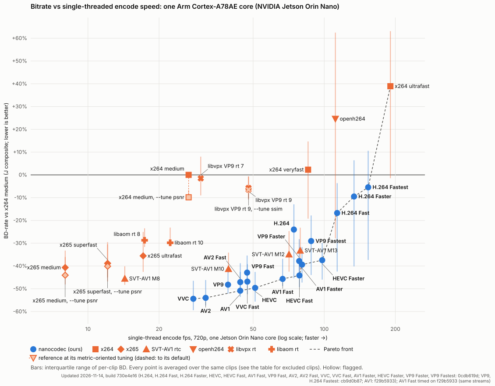
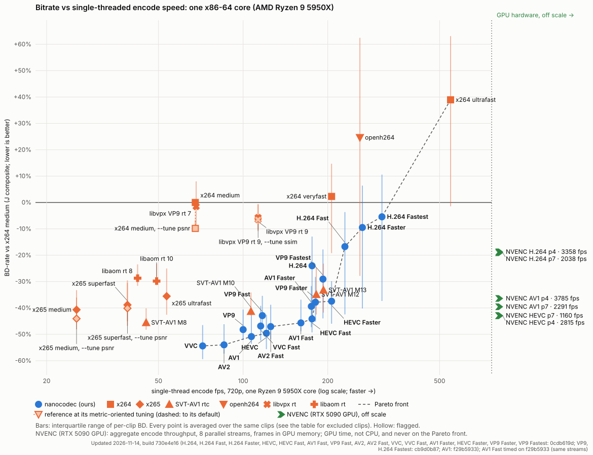
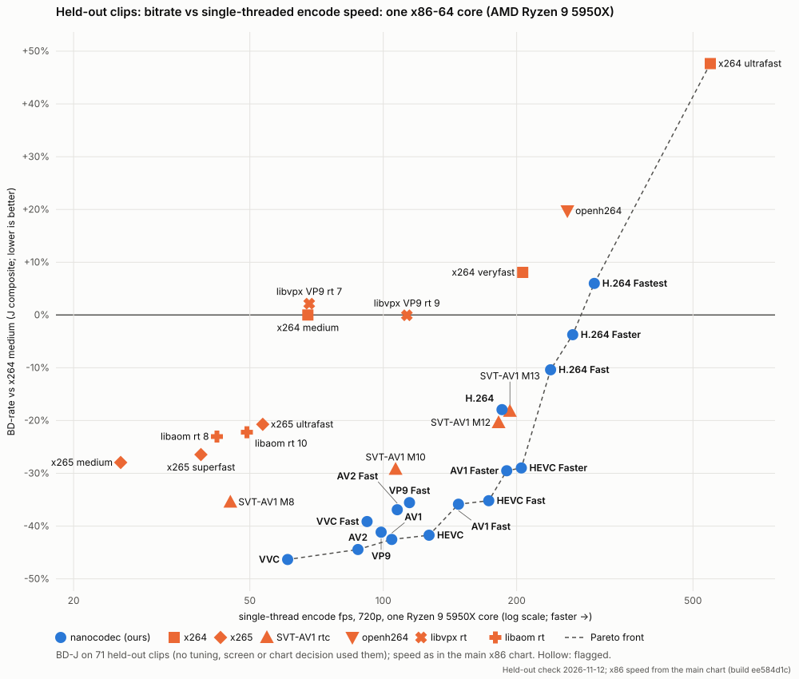
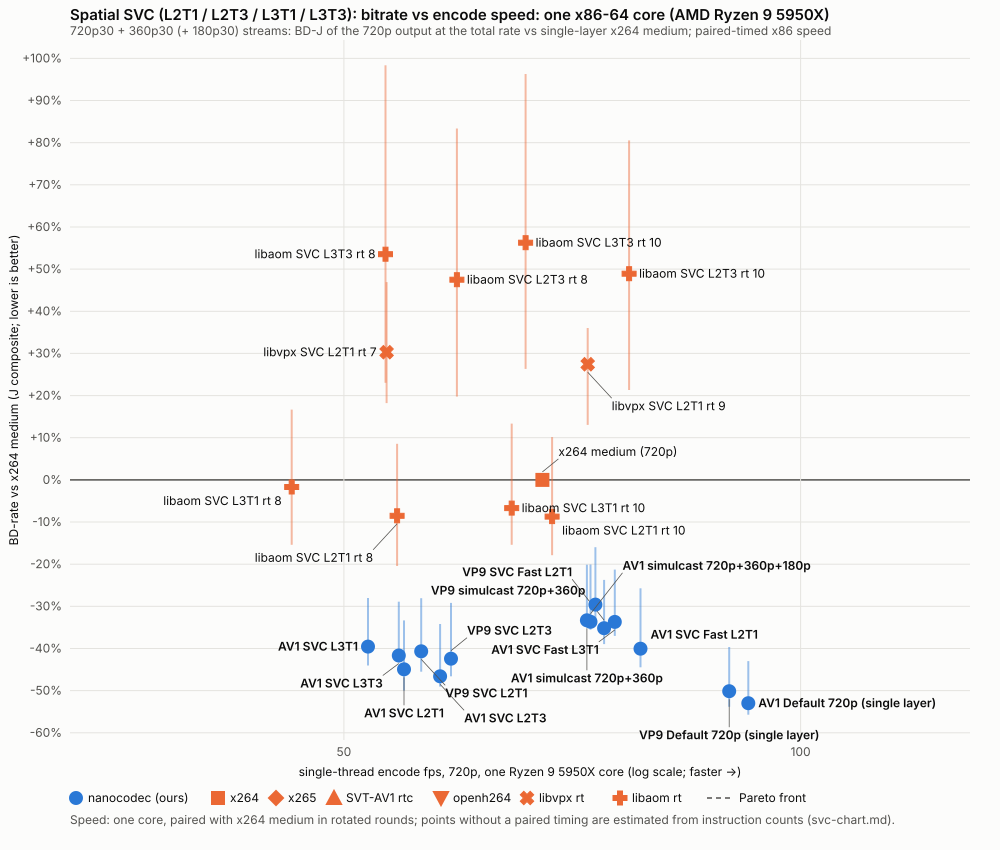

# nanocodec

**Real-time video streaming from edge devices to the cloud and the browser.** nanocodec encodes live camera video
on small, power-limited devices (cameras, bodycams, drones, robots) with low delay and few bits, and decodes it
anywhere, including in a web page through our own WebAssembly decoders.

Six codecs share one Rust engine: **H.264, HEVC, AV1, VP9, AV2 and VVC (H.266)**.

**[Try the live browser demo](https://cribbinsb.github.io/nanocodec/)**: compare two codecs side by side on your
webcam or a built-in scene. Encoding and decoding both run locally in your browser.

> **Notice.** nanocodec is experimental software, provided "as is". It builds on ideas from permissively
> licensed projects, above all the excellent [SVT-AV1](https://gitlab.com/AOMediaCodec/SVT-AV1); GPL tools are
> only compared against, never copied. The codecs it implements are covered by third-party patents: neither
> this code nor the demo gives you any patent licence.
> **[Credits, licences, patents and disclaimers](docs/LEGAL.md)**.

**Read more:** [how it is built](docs/ARCHITECTURE.md) · [the story of building it: what worked, what didn't,
and how much comes from the engine versus the codec standard](docs/RETROSPECTIVE.md) ·
[detailed results and method](docs/results/README.md).

## Why it exists

- **Encode on the edge.** Real time on one core of an embedded ARM CPU (NVIDIA Jetson class) as well as x86.
  Forward prediction only, no lookahead, CBR within a 1 s buffer (the first key frame may borrow up to about 1.4 buffers and repays it over the next seconds; `rate.key_repay_seconds` and `rate.recode_overflow` make it stricter), and resilience for lossy links
  (temporal layers, long-term references, intra refresh, keyframe on request).
- **Decode anywhere, especially the browser.** Our decoders compile to WebAssembly with SIMD, so a page can play our
  streams with no plugin and no dependence on the browser's own codecs. Natively, H.264, HEVC, VVC and AV2 decode
  faster than the single-threaded reference decoders; WASM decode takes 1.2–2.1x the native time
  ([decoder speeds](#decoders), [browser speeds](#in-the-browser-webassembly)).
- **One engine, six codecs.** Motion search, mode decision, partitioning, rate control and temporal structure are
  shared; each codec adds only its syntax, transforms, entropy coding and loop filters. An engine improvement lands
  in every codec at once.
- **Standards-strict.** No custom syntax, ever. Every stream we report decodes bit-exactly in the standard decoders.

## Quality and speed





<sub>Test conditions: 11 natural camera clips (validation set) at 720p (one 1884×720), 24–30 fps, 150 frames each; real-time CBR at 150–1200 kbps (scaled to each clip's pixel rate, capped at half the source bitrate), 1 s buffer, one key frame. BD-J = mean BD-rate over PSNR-YUV, VMAF v1 and MS-SSIM against x264 `medium`; speed = one core, single thread.</sub><br>
<sub>Updated 2026-11-13: quality and timing of H.264 Default at build 399e5c44 (BD-J vs x264 medium −20.4% → −23.0%, Jetson 83.0 → 74.4 fps), quality of VVC Default at build 5a825a5b, of H.264 Fast, VP9, VP9 Fast and AV2 Fast at 7eb909e8, of the other 13 presets at earlier builds (their streams are byte-identical at 5a825a5b, checked by hash); every nanocodec row timed at 5a825a5b, MS-SSIM on every frame; reference encoders keep their stored results; PC fps from the profile-guided build, every run divided by the x264 `medium` and SVT-AV1 M13 runs of its own round (11 rounds), at load ~40–60: see [Caveats](docs/results/README.md#caveats)</sub>

<details><summary>Independent check for overfitting</summary>



**Method:** all 31 chart families re-measured on 71 clips from 21 datasets that no tuning, screen or chart decision
has used, with the same ladders and rules (BD-J vs x264 `medium`); encoded on AWS, scored with VMAF v1, MS-SSIM and
PSNR on every frame. Speed as in the x86 chart above.

**Result:** every family's BD-J shifted by a common +7.6 points, because x264 `medium` does relatively better on
these clips. Our presets other than H.264 stay within about ±2 points of that shift (median of all ours −0.4)
and hold their ranks within one place or improve them; SVT-AV1 M12/M13 and x265 lose 5–7 points more. The H.264 encoders (ours 3–5 points, openh264
12) gain more than the shift, partly because many held-out sources were themselves H.264-encoded, which favours
H.264. Details: [heldout-chart-2026-11-12.md](docs/results/heldout-chart-2026-11-12.md).

</details>

How to read the charts, the full table and the method: **[docs/results/](docs/results/README.md)**.

### Spatial scalability (SVC)

One AV1 or VP9 stream carrying a 360p30 base layer and the 720p30 picture (L2T1 / L2T3), so a receiver or relay can
drop to the base without a second encode: `--preset av1-svc` / `vp9-svc` (quality) and `--preset av1-svc-fast` /
`vp9-svc-fast` (speed). AV1 also codes three layers, 180p30 + 360p30 + 720p30 (L3T1 / L3T3, the WebRTC ladder):
`--preset av1-svc3` / `av1-svc3-fast`. Rate is the **total** stream rate, quality the 720p output (BD-J vs single-layer x264
`medium`, the scale above); speed is one core, timed in pairs with x264 `medium`.



| Encoder | BD-J (720p, total rate) | base layer BD-J vs the codec's 360p alone | fps (Jetson, 1 core) | fps (x86, 1 core) |
|---|---:|---:|---:|---:|
| **AV1 SVC L2T3** (`av1-svc`, 3 temporal layers) | -46.6% | -8.6% | 25.5 | 57.9 |
| **AV1 SVC L2T1** (`av1-svc`) | -44.9% | -6.5% | 24.0 | 54.8 |
| **AV1 SVC Fast L2T1** (`av1-svc-fast`) | -40.1% | +7.0% | 42.4 | 78.4 |
| **VP9 SVC L2T3** (`vp9-svc`, 3 temporal layers) | -42.4% | -3.1% | 23.4 | 58.8 |
| **VP9 SVC L2T1** (`vp9-svc`) | -40.7% | -0.7% | 22.3 | 56.2 |
| **VP9 SVC Fast L2T1** (`vp9-svc-fast`) | -35.2% | +16.4% | 33.7 | 74.2 |
| **AV1 SVC L3T3** (`av1-svc3`, 3 temporal layers) | -41.7% | +17.5% (360p op) | 23.3 | 54.3 |
| **AV1 SVC L3T1** (`av1-svc3`) | -39.6% | +20.5% (360p op) | 22.3 | 51.9 |
| **AV1 SVC Fast L3T1** (`av1-svc3-fast`) | -33.7% | +37.2% (360p op) | 39.9 | 75.4 |
| **AV1 / VP9 simulcast 720p + 360p** (ours, two streams) | -33.3% / -29.6% | | | 72.3 / 73.2 |
| **AV1 simulcast 720p + 360p + 180p** (ours, three streams) | -33.7% | | | 72.7 |
| libaom SVC L3T1 rt 10 | -6.7% | +80.3% | 27.6 | 64.5 |
| libaom SVC L2T1 rt 10 (`svc_encoder_rtc`) | -8.7% | +42.6% | 30.6 | 68.6 |
| libvpx SVC L2T1 rt 9 (`vp9_spatial_svc_encoder`) | +27.4% | +108.2% | 37.6 | 72.4 |
| libvpx SVC L2T1 rt 7 | +30.3% | +114.8% | 22.9 | 53.3 |
| libaom SVC L2T3 rt 10 | +48.9% | +101.9% | 32.8 | 77.1 |

Single-layer AV1 / VP9 Default on the same clips: -53.0% / -50.1%. The three-layer streams' 180p operating point
is +4.9% (L3T1) against AV1 Default coded alone at 180p. Full table and the method:
[docs/results/svc-chart.md](docs/results/svc-chart.md).

### In the browser (WebAssembly)

Frames per second of the browser build on one PC core (AMD Ryzen 9 5950X), single-threaded (the WebAssembly module
has no threads), under V8 (node 22, cross-checked in headless Chromium). Decode: our CBR streams at 600 kbps (720p) and
300 kbps (360p). Encode: the demo's settings, Default / Fast preset (VP9 and AV2 have no Fast in the demo).

<sub>Updated 2026-11-10, builds f2f7a221 (H.264–AV2) and bcbc5601 (VVC)</sub>

| Codec | Decode 720p | Decode 360p | Encode 720p | Encode 360p |
|---|---:|---:|---:|---:|
| H.264 | 650 | 1774 | 89 / 96 | 283 / 333 |
| HEVC | 428 | 1177 | 47 / 72 | 150 / 260 |
| AV1 | 276 | 727 | 26 / 46 | 75 / 160 |
| VP9 | 336 | 942 | 24 | 70 |
| AV2 | 224 | 677 | 18 | 56 |
| VVC | 214 | 585 | 35 / 50 | 112 / 170 |

WebAssembly takes 1.2–1.8x the native time to decode and 1.7–3.0x to encode (2026-11-10 builds). Since then,
the native decoders have gained more than SIMD128 has, so decode is now 1.2–2.1x (median about 1.7x; 2026-11-13,
[decoder close-out](docs/results/wasm-speed.md#decoder-close-out-2026-11-13-dec-winddown)). Our HEVC WASM
decoder is faster than Antare's `hevc.wasm` on all five of their test rows. Method, both SIMD modules and raw
data: [docs/results/](docs/results/README.md#in-the-browser-webassembly).

## Presets

Each codec has a **Default** (quality point) and a **Fast** preset (speed point):
`--preset h264-fast | hevc-fast | av1-fast | vp9-fast | av2-fast | vvc-fast`. H.264 Fast runs close to openh264's
speed (114 vs 111 fps on one Jetson core) and still uses about 26% fewer bits.
H.264 also has a third, **Faster** point (`--preset h264-faster`): 1.2x Fast's speed (134 vs 114 fps on one Jetson
core) for about 11% more bits, still 9% ahead of x264 `medium` and 40% ahead of x264 `ultrafast`. AV1 likewise has a **Faster** point
(`--preset av1-faster`): faster than SVT-AV1 M12 `--rtc` (81 vs 71 fps on one Jetson core) with 7% fewer bits. HEVC has
one too (`--preset hevc-faster`): faster than SVT-AV1 M13 `--rtc` on one core of both the Jetson (98 vs 79 fps) and the PC (0.89x M13's time in the same rounds) with 4% fewer bits.

AV1 adds an optional, experimental **film grain** option on top of any preset (`--film-grain [STRENGTH]`, the C
API's `film_grain`, a checkbox in the browser demo): decoders re-synthesize the texture coding smoothed away. It is
off by default, since it lowers PSNR and VMAF and suits stochastic texture best.

## Decoders

Our own Rust decoders, natively and in WebAssembly. 8-bit only (no 10-bit).

| Codec | Status | Speed vs reference, x86 / Jetson |
|---|---|---|
| H.264 | Constrained High profile: 65/65 conformance streams MD5-exact | FFmpeg: 0.88–1.00x / 0.77–0.85x |
| HEVC | Main profile: 136/136 conformance streams exact | FFmpeg: 0.57–0.94x / 0.72–0.92x |
| AV1 | Main profile, 8-bit 4:2:0: 176/176 libaom conformance vectors | dav1d: 1.13–1.58x / 1.09–1.43x |
| VP9 | Profile 0: 303/303 conformance vectors | vpxdec: 1.32–1.41x / 1.14–1.24x (FFmpeg: 0.98–1.10x) |
| AV2 | Our streams, bit-exact with avmdec and dav2d | avmdec: 0.33–0.39x / 0.31–0.32x |
| VVC | 8-bit Main: 9/9 official 8-bit conformance streams (ITU H.266.1) | VVdeC: 0.39–0.47x / 0.63–0.70x |

Speed is our decode time ÷ the reference's, single-threaded on the same streams: ours at 720p and 1080p, plus
third-party streams (x264, openh264, x265 with B-frames, IP cameras, SVT-AV1, libaom, vpxenc). Below 1 means we are
faster. The PC was a loaded Ryzen 9 5950X, so read x86 ratios as about ±10 %; the Jetson is one Orin Nano core.
Measured 2026-11-13 at d007869b
([table](docs/results/wasm-speed.md#decoder-close-out-2026-11-13-dec-winddown)).

Encoder output is also checked against the standard decoders (H.264: JM and FFmpeg; HEVC: HM and FFmpeg; AV1: aomdec
and dav1d; VP9: vpxdec and FFmpeg; AV2: avmdec and dav2d; VVC: VVdeC and FFmpeg) by per-frame hashes against the
encoder's reconstruction, plus a randomized syntax-stress test that forces random legal coding decisions.

## Quick start

```sh
cargo build --release
cargo test --workspace
```

Encode raw I420 (or `--input-format yv12|nv12`) in real-time CBR, then decode:

```sh
target/release/nanocodec encode --codec av1 --input input.yuv --width 1280 --height 720 \
  --fps 30 --frames 150 --bitrate 600 --buffer-ms 1000 --output video.ivf
target/release/nanocodec decode --codec av1 --input video.ivf --output decoded.yuv
```

`--codec h264 | hevc | av1 | vp9 | av2 | vvc`. H.264, HEVC and VVC use Annex-B; AV1, VP9 and AV2 use IVF. Fixed
quantizer, temporal layers, timestamps, intra refresh and the rate-control options are in
[CLI usage](crates/nc-cli/README.md). Libraries expose `Decoder::decode(packet)`; a C API (static or dynamic
library) is in `crates/nc-capi`.

### Browser demo

**Live: https://cribbinsb.github.io/nanocodec/**. Two independent encoder/decoder workers process the same frames
(webcam, local video or the built-in scene), each with its own codec, bitrate or quantizer, preset and keyframe
interval. It shows the decoded pixels, bitrate, timing and PSNR, and can download the real streams. Nothing leaves
the browser. All six codecs run in the demo.

```sh
rustup target add wasm32-unknown-unknown
cargo install wasm-bindgen-cli --version 0.2.105 --locked
tools/web/build.sh
python3 -m http.server 8765 --bind 127.0.0.1 --directory web   # open http://localhost:8765
```

See [the demo guide](web/README.md).

## Project layout

```
crates/
  nc-common/     planes, bit I/O, YUV I/O, errors
  nc-dsp/        pixel kernels: scalar reference + AVX2 / NEON / WASM SIMD128 (the only unsafe code)
  nc-analysis/   pyramid, motion estimation, pre-analysis, adaptive quantisation
  nc-encoder/    shared engine: mode decision, rate control, references, the CodecBackend trait
  nc-h264/ nc-hevc/ nc-av1/ nc-vp9/ nc-av2/ nc-vvc/   one backend + subset decoder per codec
  nc-capi/       C ABI          nc-cli/  command line          nc-web/  WASM bindings
  nc-checkasm/   SIMD-vs-reference tests and kernel benchmarks
eval/   evaluation harness       tools/   build, CI and dev scripts       web/   browser demo
```

Design: [docs/ARCHITECTURE.md](docs/ARCHITECTURE.md). The story so far: [docs/RETROSPECTIVE.md](docs/RETROSPECTIVE.md).

## Licence, credits and patents

BSD 3-Clause; see [LICENSE](LICENSE). This is a copyright licence only: **it grants no patent rights, and using
nanocodec or its demo does not license you under any patent on H.264, HEVC, VVC, AV1, VP9 or AV2.** Obtaining
any patent licence your use needs is your responsibility.

nanocodec reimplements ideas and code from BSD-style and other permissively licensed projects, in particular
SVT-AV1, and also libaom, dav1d, libvpx, openh264, kvazaar, VVenC, VVdeC and AVM; each is attributed in
[THIRD_PARTY.md](THIRD_PARTY.md). GPL and LGPL tools (x264, x265, FFmpeg) are used only as external comparison
and verification programs; none of their code is copied into or distributed with nanocodec.

The full explanation, with links to the patent licensing bodies, is in
**[Credits, licences, patents and disclaimers](docs/LEGAL.md)**. It is general information, not legal advice.

## Contact

<bernandocribbenza@gmail.com>, or open an issue on GitHub.
