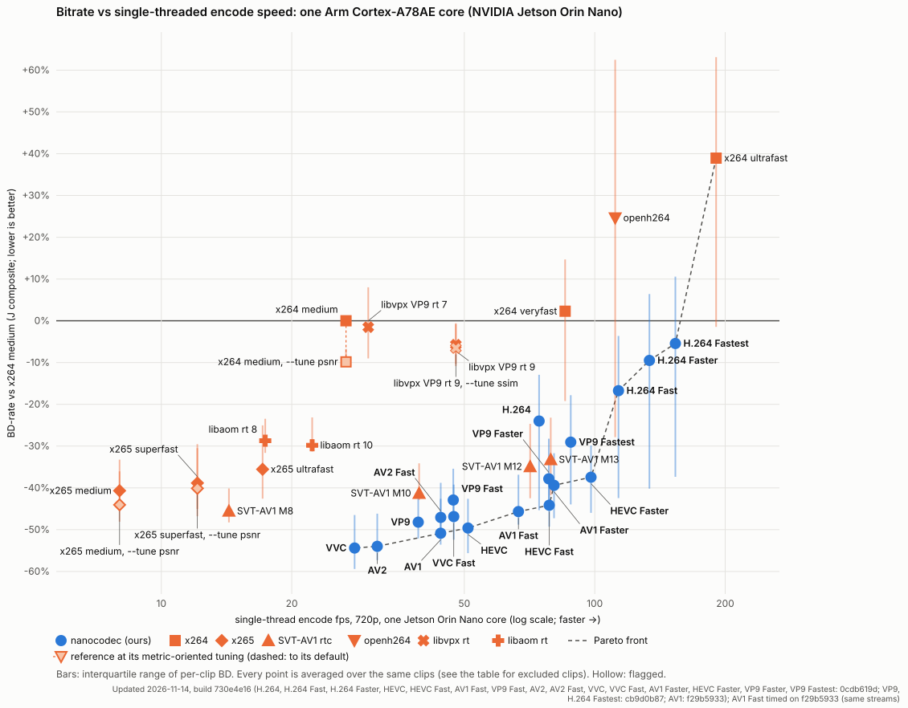
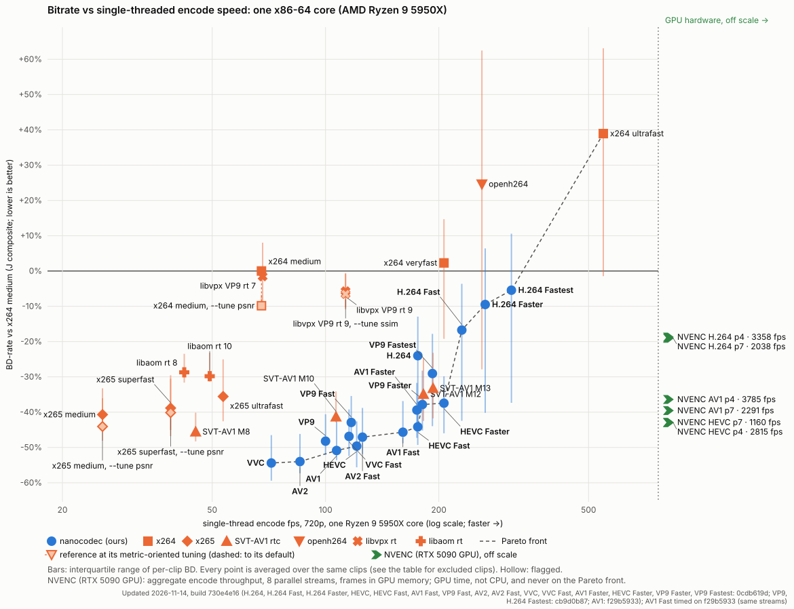

# Results

Detailed results behind the [README](../../README.md) charts: how the comparison is run, the full numbers, the
results on content we never tuned on, and the known weaknesses. Negative BD-rate always means fewer bits than the
comparison encoder for the same quality.

- [Bitrate vs speed](#bitrate-vs-speed)
- [Spatial scalability (SVC)](#spatial-scalability-svc)
- [In the browser (WebAssembly)](#in-the-browser-webassembly)
- [Per metric](#per-metric)
- [Real-use scoreboard (J_real)](#real-use-scoreboard-j_real)
- [Per content class](#per-content-class)
- [Content we never tuned on](#content-we-never-tuned-on)
- [Known weaknesses](#known-weaknesses)
- [Method](#method)
- [Caveats](#caveats)

## Bitrate vs speed

**Headline (held-out):** the README's charts are on 138 clips from never-used sources:
[bd-vs-speed-independent_fresh_2026-11-13.md](bd-vs-speed-independent_fresh_2026-11-13.md) (137 scored) and the
209-clip set [bd-vs-speed-independent_2026-11-13.md](bd-vs-speed-independent_2026-11-13.md), commit 8b492382.
The charts and tables below are the **development chart** on the 11 clips we tune beside
([development-chart.md](development-chart.md)); for most of our presets they are more favourable than the held-out
numbers.





**How to read the charts:** up is fewer bits for the same quality (class-balanced BD-rate against x264 `medium`,
lower is better; bars are the per-clip interquartile range), right is faster (single-thread encode frames per
second at 720p). Top: one Arm Cortex-A78AE core (NVIDIA Jetson Orin Nano); bottom: one x86-64 core (AMD Ryzen 9
5950X). Every encoder, ours and the references, runs its own real-time CBR on the same ladder (150–1200 kbps at
720p30, the 11 natural camera clips of our VAL set, which were also used to rank candidate changes during
development; see the held-out check below); quality is the mean of PSNR-YUV, VMAF v1 and MS-SSIM.

<sub>Updated 2026-11-13: quality of VVC Default at build 5a825a5b, of H.264 Fast, VP9, VP9 Fast and AV2 Fast at 7eb909e8 (the presets whose streams changed since the last refresh, found by hash), of the other 13 presets at their earlier builds (streams byte-identical at 5a825a5b, checked by hash); every nanocodec row timed at 5a825a5b on both machines, after the CLI input-buffer fix (0c2ad202: a 1 MiB input buffer had made every x86 encode 12–22 % slower); MS-SSIM on every frame; reference encoders keep their stored results; PC fps from the profile-guided build, every run divided by the x264 `medium` and SVT-AV1 M13 runs of its own round (11 rounds), at load ~40–60: see Caveats</sub>

### Held-out check

**Why:** the chart's 11 clips (VAL) were used to rank candidate changes, so the chart is not independent of the
tuning. **Method (independent re-run, 2026-11-13):** every chart family at the chart's builds and settings
(150 frames, one key frame, the same ladder and low-rung rule), encoded on rented cloud machines and scored with
VMAF v1, MS-SSIM and PSNR on every frame, on 209 clips: 138 **fresh** clips from sources no clip set of ours had
ever used (`eval/clipset/select_independent.py`: a fixed, seeded draw, one source per family, excluding every
source and family in any clip set or selection file; checked against all 18 clip-set files) and the 71 **pool**
clips of the 2026-11-12 check (held out from the fixed tuning sets, but in the rotating adoption screens since
2026-11-11). The fresh set is not part of any screening pool. BD-J vs x264 `medium`, 95% bootstrap intervals:

| Encoder | Chart (11) | Fresh (138) | Pool (71) | All (209) | All (209) vs x264 `medium --tune psnr` |
|---|---:|---:|---:|---:|---:|
| VVC | −54.0% | −51.1% [−53.5, −48.7] | −47.6% [−50.0, −45.4] | −49.6% [−51.6, −47.7] | −42.9% [−45.2, −40.9] |
| AV2 | −53.7% | −49.2% [−51.6, −46.5] | −45.4% [−47.6, −43.2] | −47.1% [−48.8, −45.2] | −40.2% [−42.1, −38.4] |
| AV1 | −50.9% | −45.6% [−47.8, −43.5] | −43.4% [−46.0, −41.2] | −44.8% [−46.9, −42.9] | −37.5% [−39.8, −35.5] |
| HEVC | −49.3% | −46.9% [−49.2, −44.6] | −41.9% [−43.9, −40.0] | −44.2% [−45.7, −42.6] | −36.9% [−38.5, −35.5] |
| VP9 | −48.1% | −45.4% [−47.8, −42.9] | −42.4% [−44.5, −40.4] | −44.1% [−45.9, −42.5] | −36.8% [−38.7, −35.0] |
| H.264 | −23.0% | −28.5% [−30.9, −26.3] | −19.8% [−23.8, −16.3] | −25.1% [−27.9, −22.3] | −15.6% [−18.4, −12.8] |
| H.264 Faster | −8.5% | −14.3% [−17.6, −11.1] | −3.0% [−7.8, +1.7] | −10.4% [−13.9, −7.0] | +0.7% [−2.7, +4.2] |
| H.264 Fastest | −0.8% | −6.8% [−10.6, −3.2] | +7.2% [+1.3, +13.0] | −1.4% [−5.8, +2.9] | +10.7% [+6.1, +15.3] |
| SVT-AV1 M8 | −45.5% | −42.7% [−45.0, −40.5] | −35.5% [−37.7, −33.1] | −36.9% [−38.8, −34.8] | −27.9% [−30.9, −24.9] |
| x265 `medium` | −40.7% | −30.6% [−32.4, −28.7] | −29.2% [−32.2, −26.3] | −29.2% [−32.0, −26.6] | −19.8% [−23.0, −16.3] |
| x265 `medium --tune psnr` | −44.1% | −33.9% [−35.8, −31.8] | −32.6% [−35.5, −29.6] | −32.3% [−35.0, −29.7] | −23.7% [−26.8, −20.5] |
| SVT-AV1 M12 `--rtc` | −34.9% | −29.7% [−32.8, −26.6] | −22.0% [−25.9, −18.4] | −24.0% [−27.5, −20.9] | −13.8% [−17.9, −9.9] |
| x264 `medium --tune psnr` | −9.8% | −10.2% [−11.1, −9.2] | −9.6% [−10.9, −8.2] | −9.8% [−10.8, −8.7] | 0 |

The full table (every family, per metric, per class): the independent re-run's report. Notes: "All" is
class-balanced over 7 classes, so drone and texture (3 clips each, all in the pool group) weigh as much as crowd
(57 clips); the fresh set has 5 classes and is concentrated in a few datasets (PersonPath22 35, JAAD 26,
BDD100K 24). Our encoders held 0.2% of input frames on these clips (0 on the chart's). The earlier 71-clip check
is kept at [heldout-chart-2026-11-12.md](heldout-chart-2026-11-12.md).

**Result:** the saving against x264 `medium` depends on the clip set. On the fresh clips our Defaults are 2–5
points less ahead than on the chart's clips and our H.264 presets 5–6 points further ahead; the references moved
more (SVT-AV1 M12 5 points, x265 `medium` 10). Against the PSNR-tuned x264 `medium` on all 209 clips our H.264
Faster is not ahead and H.264 Fastest needs more bits.

### Window length

Every BD number here comes from 150-frame windows with one key frame (5 s at 30 fps); our presets were tuned on
such windows. In 5 s our first key frame takes 8–10% of the bits and our streams end 5–6% over target (the key
frame's loan, repaid over 10 s at the builds measured, is still outstanding), so a short single-key window favours our first-key
investment. Over 600 frames (20 s, a key every 10 s) on 71 fresh held-out sources at commit 8b492382, our
savings against x264 `medium` are 6–10 points smaller (AV1 −47.1% → −40.8%, H.264 −29.8% → −19.8%), the
references move less or gain (SVT-AV1 M8 −43.8% → −41.1%, x265 `medium` −30.4% → −32.2%), and SVT-AV1 M8 becomes
level with our AV1, HEVC and VP9 Defaults at well under half their speed. Our rate is on target there (median
0.988–0.989); 74–94 of 252 points per Default still peak above a strict 1 s buffer (x264 `medium` 10, SVT-AV1
20–27). Full table: [README](../../README.md#window-length) and the
[independent report](independent-2026-11-13.md#update-2026-11-13-later-the-new-rate-control-and-a-20-s-window).

### Bitrate range

The charts cover 150–1200 kbps at 720p30 (pixel-rate scaled, capped at half the source's bitrate, plus 40/75 kbps
where curves need them). On the 30-clip held-out subset of the independent audit, 10–11 clips had room for 2,400
and 4,000 kbps rungs; over the upper range (the top two ladder rungs plus those, 600 kbps–4 Mbps at 720p30) BD-J vs
x264 `medium` was AV1 −24.8% [−27.9, −21.8], HEVC −26.9%, VP9 −22.5%, AV2 −26.9%, VVC −30.4%, H.264 −9.3%
[−13.5, −5.4], against −47.2%, −48.1%, −47.8%, −50.5%, −53.4% and −29.0% by the chart's rule on the same 30 clips;
x265 `medium` −22.6% (−30.8%), SVT-AV1 M12 −4.2% (−28.2%). Our savings are largest at the low rates the charts
target, and so are the references'. Details:
[rate-control audit §5](rate-control-audit-2026-11-13.md#5-rate-ladder-the-low-rungs-favour-everyone-against-x264-higher-rates-shrink-every-gap).

### The anchor's settings

The chart's anchor is x264 `medium` with its default psychovisual settings (psy-rd, AQ), which favour how the
picture looks over PSNR, VMAF and MS-SSIM; our presets were tuned on that metric mix. An independent re-run on the
chart's clips and streams (2026-11-13) added x264 `medium --tune zerolatency,psnr` and `--tune zerolatency,ssim`
with otherwise identical settings. `--tune psnr` needs 9.8% [7.6, 12.0] fewer bits than the default anchor on
BD-J (PSNR-Y −13.8%, PSNR-YUV −8.3%, VMAF v1 −19.4%, MS-SSIM −1.8%); `--tune ssim` −1.4%. The charts now also
plot each reference's metric-oriented tuning where it is distinguishably better for that encoder than its charted
setting (direct paired BD-J, 95% bootstrap interval excluding zero): x264 medium, x265 medium and x265 superfast
with `--tune psnr`, libvpx rt 9 with `--tune ssim`. x264 ultrafast / veryfast, x265 ultrafast, libaom, libvpx rt 7
and openh264 alternatives were within the noise of their charted settings. Every variant per metric with its
interval, and every point against the PSNR-tuned x264 medium, are in
[bd-vs-speed.md](bd-vs-speed.md#metric-tuned-references). x264 and x265 defaults are tuned for how
the picture looks, which these metrics cannot judge, and no subjective test was run. BD-J against the PSNR-tuned
x264:

| Encoder | BD-J vs x264 `medium` (default psy settings, the chart's anchor) | BD-J vs x264 `medium --tune psnr` |
|---|---:|---:|
| nanocodec VVC Default | −54.0% | −47.1% |
| nanocodec AV2 Default | −53.7% | −46.8% |
| nanocodec AV1 Default | −50.9% | −43.6% |
| nanocodec HEVC Default | −49.3% | −41.7% |
| nanocodec VP9 Default | −48.1% | −40.2% |
| nanocodec AV1 Fast | −44.9% | −36.7% |
| x265 4.2 `medium` | −40.7% | −31.6% |
| SVT-AV1 v4.3.0 M12 `--rtc` | −34.9% | −25.1% |
| nanocodec H.264 Default | −23.0% | −13.3% (95% interval −20.7 to −5.4) |
| nanocodec H.264 Fast | −16.2% | −5.8% (−13.5 to +2.1) |
| nanocodec H.264 Faster | −8.5% | +2.5% (−5.0 to +9.8) |
| nanocodec H.264 Fastest | −0.8% | +10.7% (+3.8 to +17.6) |
| x264 0.165 `medium --tune psnr` itself | −9.8% | 0 |
| openh264 v2.7.0 | +24.6% | +42.8% |

Brackets: 95% bootstrap intervals, clips resampled within content class (2–3 clips per class, so approximate).
Against the PSNR-tuned anchor every saving is 7–12 points smaller (ours and the references alike), our H.264 Default
still saves 13%, H.264 Fast 6% (interval spans zero), and H.264 Faster and Fastest save nothing.

### Hardware encoders (NVENC on an RTX 5090 GPU)

NVIDIA NVENC on the PC's RTX 5090 GPU (ffmpeg `h264_nvenc` / `hevc_nvenc` / `av1_nvenc`, driver 610.57.04), in the
same low-delay CBR as every point above: same clips, rungs, 1 s buffer and key interval, no B-frames, no lookahead,
scored the same way. P4 `-tune ll` is the usual real-time streaming setting; P7 `-tune hq` is NVENC's best
forward-only quality. NVENC is fixed-function hardware, so its speed is RTX 5090 wall-clock time at 720p, not CPU
time: frames already in GPU memory (uploaded once, looped there; start-up and upload cancel out of a timing
difference), one stream and the aggregate of 1, 2, 4 or 8 parallel streams (the best was 8 for every row). Only the
x86 chart shows these points, by their aggregate throughput, past its right edge (it exceeds the axis), never on the
Pareto front. The earlier "via ffmpeg pipeline" figure (one ffmpeg process reading, converting and uploading every
frame) was bound by that pipeline, 2–4x below the encoder.

| Encoder (RTX 5090 GPU) | Bits vs x264 medium | Aggregate fps (8 streams) | 1-stream encode fps | 1-stream fps via ffmpeg pipeline | Ours, same codec (Default / fastest preset) |
|---|---:|---:|---:|---:|---|
| NVENC H.264 P4 `ll` | −18.7% | 3358 | 949 | 352 | H.264 −23.0% / Fastest −0.8% |
| NVENC H.264 P7 `hq` | −19.1% | 2038 | 548 | 319 | |
| NVENC HEVC P4 `ll` | −43.0% | 2815 | 798 | 328 | HEVC −49.3% / Faster −36.0% |
| NVENC HEVC P7 `hq` | −42.9% | 1160 | 336 | 224 | |
| NVENC AV1 P4 `ll` | −36.4%‡ | 3785 | 1065 | 249 | AV1 −50.9% / Faster −38.8% |
| NVENC AV1 P7 `hq` | −39.6%‡ | 2291 | 679 | 202 | |

‡ one clip chained through an intermediate encoder (no direct overlap with x264 `medium`). NVENC's CBR misses
some targets (H.264 and AV1: 8–9 of 50 points rate-invalid, HEVC 3, x264 `medium` 4; all on the lowest rungs, a
rate floor; they stay on their curves, as for every encoder). **Sanity check** against NVIDIA's published 1080p
8-bit 4:2:0 rates, single stream, same method (CBR 1.2 Mbps, while the GPU also scored VMAF), H.264 / HEVC fps:
P1-LL 791 / 886 (NVIDIA 977 / 1134), P5-LL 303 / 448 (323 / 506), P7-LL 256 / 406 (264 / 464), P1-HQ 845 / 979
(948 / 1119), P5-HQ 273 / 390 (317 / 521), P7-HQ 282 / 169 (227 / 181): within 75–124 % of NVIDIA's figures.
Details: [bd-vs-speed.md](bd-vs-speed.md#hardware-encoders), data:
[bd-vs-speed-hardware.csv](bd-vs-speed-hardware.csv), timing
[bd-vs-speed-timing-nvenc.json](bd-vs-speed-timing-nvenc.json) (`tools/dev/nvenc_timing.py`).

**Builds (refresh of 2026-11-11, a33c299d).** Every nanocodec row (H.264, HEVC and AV1 with their Fast and
Faster presets; VP9, AV2 and VVC with their Fast presets) was rebuilt, measured and timed at a33c299d, after the
planner speed-ups, the H.264 and HEVC/AV2 cadence changes, the H.264 layer gate and the CLI PSNR change. Quality is
PSNR-YUV, VMAF v1 and MS-SSIM in equal thirds, MS-SSIM on every frame. Reference encoders' points and timings are
from the earlier sessions. Jetson fps were timed under the board lock against the stored anchor. PC fps: timed on the
reserved timing cores while the PC was loaded (1-min load ~30–36), scaled to the reference session's x264 `medium`
times ([bd-vs-speed.md](bd-vs-speed.md#method)); treat PC differences of a few percent as noise.

The full table for every encoder and preset, the head-to-head pairs measured on the same points and the exact
command lines are in **[bd-vs-speed.md](bd-vs-speed.md)** (data:
[bd-vs-speed.csv](bd-vs-speed.csv)); see also [Caveats](#caveats).

## Spatial scalability (SVC)

Two-layer streams (720p30 over a 360p30 base) are their own optimisation target, with their own chart:
**[svc-chart.md](svc-chart.md)** (table, base-layer table, method; `svc-chart.csv`, `svc-chart.svg`). Rate is the
total stream rate, quality J_real of the 720p output (operating point 0), BD-J against single-layer x264 `medium`
as on the chart above, so the points sit on the same scale; the base layer (operating point 1) has its own table.
References: libaom's real-time SVC encoder (`examples/svc_encoder_rtc`, what WebRTC's AV1 SVC follows) at rt 8 and
10, and simulcast of our AV1 Default (720p + 360p, rate summed). SVT-AV1 has no spatial SVC.

```sh
cd eval
python3 -m nceval.svc_chart measure --binary BIN --part 1/2   # then 2/2; each under 30 min
../tools/dev/host-timed.sh python3 -m nceval.svc_chart time-host --binary BIN   # paired x86 timing
python3 -m nceval.svc_chart plan --binary BIN                 # svc-chart-plan.json for the Jetson
# Jetson: jetson-timed.sh python3 anchor_chart_timing.py time --plan svc-chart-plan.json --point P ...
python3 -m nceval.svc_chart merge-jetson --binary BIN t-*.json
python3 -m nceval.svc_chart render --binary BIN               # docs/results/svc-chart.{md,csv,svg}
```

Our points are the `av1-svc` preset (L2T1; L2T3 adds `--temporal-layers 3` with `layers.adaptive=0`) and its
speed point `av1-svc-fast`, so the tuner can optimise them like any preset: objective the chart's BD-J of operating point 0, with the base layer's BD-J
as a guard, plus CPU.

## In the browser (WebAssembly)

The browser build (`tools/web/build.sh`, what the [demo](../../web/README.md) runs) on one core of the PC (AMD Ryzen 9
5950X), single-threaded: the WebAssembly module has no threads. Decode: our own CBR streams at 600 kbps (720p) and
300 kbps (360p). Encode: the demo's settings (15 fps, CBR 300 kbps at 360p, 600 kbps at 720p, 2x peak, 1 s buffer).
fps are frame-weighted over three clips (crowd, pan, static; 150 frames each). WASM/native is the time ratio
against our native build of the same code on the same core (the range over the two resolutions).

<sub>Updated 2026-11-10, builds f2f7a221 (H.264–AV2) and bcbc5601 (VVC)</sub>

| Codec | Decode 720p | Decode 360p | WASM/native | Encode 720p | Encode 360p | WASM/native |
|---|---:|---:|---:|---:|---:|---:|
| H.264 Default | 650 | 1774 | 1.35–1.36x | 89 | 283 | 1.90–2.01x |
| H.264 Fast² | | | | 96 | 333 | 2.07–2.33x |
| HEVC Default | 428 | 1177 | 1.36–1.37x | 47 | 150 | 1.70–1.83x |
| HEVC Fast | | | | 72 | 260 | 1.95–2.16x |
| AV1 Default | 276 | 727 | 1.49–1.54x | 26 | 75 | 2.33–2.36x |
| AV1 Fast | | | | 46 | 160 | 2.71–2.96x |
| VP9 Default | 336 | 942 | 1.43x | 24 | 70 | 2.46–2.59x |
| AV2 Default | 224 | 677 | 1.64–1.78x | 18 | 56 | 2.47–2.74x |
| VVC Default | 214 | 585 | 1.17–1.32x | 35 | 112 | 1.71–1.91x |
| VVC Fast | | | | 50 | 170 | 1.76–2.09x |

Decode is a stream's decode alone (fps); the demo's CPU display path adds an I420-to-RGBA hand-off of about 0.5 ms
per 720p frame and 0.1 ms per 360p frame (WebGL: 0.15–0.3 ms at 720p; conversion vs libyuv in
[competitor-yardsticks.md](competitor-yardsticks.md#31-display-conversion-after-the-fix-2026-11-12)). The demo has no Fast preset for VP9 and AV2.
² Measured with the earlier H.264 Fast settings (the Default without trellis); since 2026-11-10 Fast also
takes the two H.264 Fast speed levers, so it encodes a few percent faster.
Every module's decoded output is bit-exact with the native decoder on every stream.

- **Module.** The figures are for the relaxed-SIMD module, which the page loads where the browser supports relaxed
  SIMD (Chromium, node 22). The plain SIMD128 module is mostly within ±4 % of it; the largest gaps are AV1 720p
  decode (10 % slower), H.264 720p Default and AV1 360p Fast encode (7 % slower) and AV2 720p decode (5 % faster).
  Both modules are in [wasm-speed.md](wasm-speed.md).
- **Engine.** Timed under node 22 (V8, the engine in Chrome). A headless Chromium 148 cross-check, with the demo's
  module worker, matches node's decode within −5 to +9 % at 360p and runs 20–29 % slower at 720p, where the pinned
  core also carries the page's frame transfer and software-GL drawing.
- **Method.** Every timed process (node and native) pinned to one core, three interleaved rounds (every stream once
  per module and once natively per round), best round counts; native is process wall time. The PC was shared (load
  8.7–17.9; VVC was measured later at 4.0–11.0 and at a later build, bcbc5601 vs f2f7a221 for the rest), so absolute
  fps carry about ±10 %; an HEVC control in the VVC run repeated decode within 2 % and encode 7–11 % faster.
- **Raw data:** [wasm-speed.md](wasm-speed.md) (both modules, demo-path fps, per clip, Chromium cross-check,
  commands) and [wasm-speed.csv](wasm-speed.csv).

## Per metric

The chart's head-to-head pairs split by metric: class-balanced full-overlap BD-rate on the same points as the charts (11 VAL clips, CBR ladder plus the 40/75 kbps rungs on four clips, full gate). Ours-vs-ours rows drop any rung either side overshot. Bold: wins on every headline metric.

<sub>Updated 2026-11-11, build 730e4e16 (H.264 rows d316e2d6 = landed 14fc126b; AV1 Default 730e4e16 + 843a2d4a)</sub>

| Ours | vs | PSNR-YUV | VMAF v1 | MS-SSIM | worst-1% Y | worst-1% VMAF v1 |
|---|---|---:|---:|---:|---:|---:|
| H.264 | openh264 | **−31.1%** | **−39.0%** | **−31.1%** | −23.4% | −26.3% |
| HEVC | SVT-AV1 M12 `--rtc` | **−23.1%** | **−27.8%** | **−22.9%** | −43.3% | −53.3% |
| AV1 | SVT-AV1 M12 `--rtc` | **−34.5%** | **−33.1%** | **−26.3%** | −42.8% | −48.0% |
| VP9 | our HEVC | +0.2% | +14.6% | +9.1% | +2.8% | +15.1% |
| AV2 | our AV1 | +1.9% | +3.5% | −3.8% | −3.2% | +7.3% |
| H.264 | x264 `veryfast` | **−25.9%** | **−33.9%** | **−24.4%** | −28.8% | −37.3% |
| HEVC | x265 `superfast` | **−20.3%** | **−23.4%** | **−19.2%** | −22.5% | −34.4% |
| HEVC Fast | x265 `superfast` | **−9.8%** | **−14.9%** | **−9.7%** | −14.9% | −28.8% |
| H.264 Fast | openh264 | **−24.2%** | **−35.6%** | **−24.5%** | −16.3% | −23.6% |
| H.264 Faster | openh264 | **−14.5%** | **−27.3%** | **−10.0%** | −6.3% | −15.1% |
| H.264 Faster | x264 `ultrafast` | **−45.2%** | **−30.0%** | **−43.7%** | −39.7% | −28.2% |
| H.264 Fast | x264 `veryfast` | **−19.8%** | **−31.0%** | **−18.8%** | −27.3% | −32.2% |
| VVC | our HEVC | **−11.5%** | **−11.0%** | **−13.4%** | −13.7% | −9.3% |
| VVC | x265 `medium` | **−24.5%** | **−32.5%** | **−20.9%** | −31.2% | −40.0% |
| AV2 | SVT-AV1 M12 `--rtc` | **−33.6%** | **−30.4%** | **−30.3%** | −45.2% | −45.1% |
| VVC | our AV2 | +0.8% | −8.3% | −7.3% | −2.0% | −9.3% |
| AV1 Fast | SVT-AV1 M12 `--rtc` | **−17.1%** | **−24.7%** | **−13.0%** | −38.4% | −41.8% |

### Our codecs head to head

Default presets on the J_real VAL board (11 clips, 150 frames, CBR ladder, full gate), each pair on the same points with overshooting rungs dropped; J_real and class-balanced BD per metric (negative: the first codec needs fewer bits).

<sub>Updated 2026-11-11, build 730e4e16 (H.264 rows d316e2d6 = landed 14fc126b; AV1 Default 730e4e16 + 843a2d4a)</sub>

| Pair | J_real | PSNR-YUV | VMAF v1 | MS-SSIM | bodycam | crowd | lowlight | pan | static |
|---|---:|---:|---:|---:|---:|---:|---:|---:|---:|
| VVC vs AV2 | **−3.2%** | +0.8% | −2.7% | −8.6% | +9.3% | −13.2% | −5.8% | −6.7% | +0.3% |
| VVC vs AV1 | **−4.9%** | +0.1% | −4.3% | −11.1% | −0.9% | −10.8% | −4.9% | −5.0% | −2.8% |
| VVC vs HEVC | **−12.0%** | −11.6% | −8.8% | −13.9% | −13.6% | −11.6% | −5.2% | −14.1% | −15.4% |
| AV2 vs AV1 | **−1.3%** | −0.5% | +0.3% | −2.8% | −8.5% | +2.8% | +0.8% | +1.4% | −2.8% |
| AV2 vs HEVC | **−7.7%** | −11.9% | −3.0% | −5.4% | −18.9% | +2.3% | +0.8% | −7.7% | −14.8% |
| AV1 vs HEVC | **−6.7%** | −11.3% | −3.8% | −2.8% | −12.0% | −0.3% | +0.4% | −8.6% | −13.1% |

The class columns are J_real per class (mean of the full and low-rate halves).

## Real-use scoreboard (J_real)

The scoreboard each encoder change is judged against (it adds the low-rate half, flicker and key-frame pulse terms, and the Fast presets). Each of our encoders is compared with a reference: openh264 for H.264, SVT-AV1 M12 `--rtc` for HEVC and AV1, and our own encoders for VP9 (vs our HEVC), AV2 (vs our AV1) and VVC (vs our HEVC, same preset class). x264 `veryfast` and x265 `superfast` rows are context.

Board of 2026-11-11 08:05: 11 natural VAL clips, 150 frames, CBR ladder, full conformance gate, the charts' builds. Class-balanced BD-rate:

<sub>Updated 2026-11-11, build 730e4e16 (H.264 rows d316e2d6 = landed 14fc126b; AV1 Default 730e4e16 + 843a2d4a)</sub>

| Ours | vs | J_real | PSNR-YUV | VMAF v1 | MS-SSIM | worst-1% Y | Δflicker | rate-invalid (ours / theirs) |
|---|---|---:|---:|---:|---:|---:|---:|---:|
| H.264 Default | openh264 | **−33.8%** | −31.5% | −38.9% | −31.2% | −23.4% | −0.02dB | 0 / 15 |
| H.264 Default | x264 `veryfast` | −26.2% | −25.9% | −30.3% | −24.2% | −25.5% | +0.12dB | 0 / 0 |
| H.264 Fast | openh264 | **−29.2%** | −24.5% | −35.0% | −25.0% | −16.2% | −0.02dB | 0 / 16 |
| H.264 Fast | x264 `veryfast` | −22.6% | −19.2% | −27.0% | −18.4% | −23.5% | +0.12dB | 0 / 0 |
| H.264 Faster | openh264 | **−18.6%** | −14.1% | −25.3% | −10.3% | −5.0% | +0.00dB | 0 / 16 |
| H.264 Faster | x264 `veryfast` | −12.7% | −10.5% | −16.0% | −5.3% | −16.2% | +0.13dB | 0 / 0 |
| HEVC Default | SVT-AV1 M12 | **−28.0%** | −27.4% | −30.8% | −26.4% | −38.3% | −0.05dB | 0 / 1 |
| HEVC Default | x265 `superfast` | −23.7% | −22.2% | −25.5% | −21.2% | −16.4% | +0.09dB | 0 / 0 |
| HEVC Fast | SVT-AV1 M12 | **−19.0%** | −17.7% | −22.9% | −17.7% | −32.3% | −0.07dB | 0 / 1 |
| HEVC Fast | x265 `superfast` | −14.4% | −12.2% | −17.3% | −11.8% | −8.5% | +0.06dB | 0 / 0 |
| AV1 Default | SVT-AV1 M12 | **−33.0%** | −36.9% | −33.6% | −29.2% | −43.2% | −0.04dB | 0 / 1 |
| AV1 Fast | SVT-AV1 M12 | **−20.2%** | −18.5% | −25.0% | −15.1% | −32.4% | −0.03dB | 0 / 1 |
| VP9 Default | our HEVC | +7.7% | −0.3% | +15.7% | +9.3% | +2.7% | −0.01dB | 0 / 0 |
| VP9 Fast | our HEVC Fast | +5.3% | +2.0% | +8.2% | +9.3% | +1.7% | −0.02dB | 0 / 0 |
| AV2 Default | our AV1 | **−1.3%** | −0.5% | +0.3% | −2.8% | −4.1% | −0.03dB | 0 / 0 |
| AV2 Fast | our AV1 Fast | **−5.7%** | +0.6% | +1.5% | −7.4% | −8.8% | −0.04dB | 0 / 0 |
| VVC Default | our HEVC | **−12.0%** | −11.6% | −8.8% | −13.9% | −13.9% | +0.00dB | 0 / 0 |
| VVC Fast | our HEVC Fast | **−5.7%** | −2.7% | −6.1% | −7.4% | −12.5% | −0.00dB | 0 / 0 |

J_real is the mean of the full-range and low-rate-half BD of (PSNR-YUV + VMAF v1 + MS-SSIM) / 3; see [Method](#method). Δflicker is ours minus theirs in mean frame-to-frame PSNR-Y change (positive = more flicker). The board scores the real-use ladder only (no 40/75 kbps rungs), so bodycam_airport has no J against SVT-AV1 and openh264.

## Per content class

J full / J low (class-balanced BD-rate against the bar anchor above), same board:

<sub>Updated 2026-11-11, build 730e4e16 (H.264 rows d316e2d6 = landed 14fc126b; AV1 Default 730e4e16 + 843a2d4a)</sub>

| Ours | bodycam | crowd | lowlight | pan | static |
|---|---|---|---|---|---|
| H.264 Default | −34.8% / −35.2% | −42.4% / −44.8% | −36.0% / −39.7% | −41.0% / −42.0% | −20.5% / −1.8% |
| H.264 Fast | −30.7% / −34.9% | −37.8% / −41.9% | −26.5% / −33.6% | −36.9% / −39.1% | −14.6% / +4.3% |
| H.264 Faster | −15.6% / −22.4% | −28.1% / −34.0% | −10.3% / −22.4% | −26.4% / −30.2% | −8.1% / +11.9% |
| HEVC Default | −20.3% / −21.8% | −27.3% / −29.7% | −28.7% / −28.9% | −24.4% / −24.6% | −38.6% / −36.1% |
| HEVC Fast | −13.1% / −13.3% | −19.5% / −22.2% | −15.9% / −17.7% | −16.2% / −15.0% | −30.8% / −26.0% |
| AV1 Default | −28.3% / −29.1% | −27.4% / −30.6% | −29.1% / −29.0% | −31.3% / −31.8% | −47.3% / −46.0% |
| AV1 Fast | −15.3% / −16.3% | −13.0% / −17.3% | −9.5% / −11.9% | −19.4% / −19.0% | −40.4% / −39.6% |
| VP9 Default | +4.1% / +3.3% | +12.7% / +11.1% | +17.6% / +14.3% | +6.3% / +6.9% | +0.5% / +0.3% |
| VP9 Fast | +7.3% / +4.7% | +12.0% / +9.1% | +9.9% / +8.2% | +4.1% / +2.0% | −0.9% / −3.2% |
| AV2 Default | −9.9% / −7.2% | +3.9% / +1.7% | +2.4% / −0.8% | +2.6% / +0.3% | −4.1% / −1.6% |
| AV2 Fast | −4.9% / −8.2% | −5.5% / −9.2% | −0.4% / −7.0% | −2.1% / −5.5% | −8.9% / −5.3% |
| VVC Default | −12.7% / −14.6% | −11.1% / −12.1% | −4.4% / −5.9% | −13.7% / −14.5% | −15.2% / −15.5% |
| VVC Fast | −4.2% / −5.2% | −5.7% / −6.7% | −6.3% / −4.7% | −4.5% / −6.7% | −6.3% / −7.1% |

## Independent test, settings audit and reproduction (2026-11-13)

- [independent-2026-11-13.md](independent-2026-11-13.md): every chart family at the current code, compared with
  x264 medium, per metric and as BD-J with 95% bootstrap intervals. 209 clips the chart never used: 138
  never-used sources and 71 screening-pool clips (the pool clips are not independent of tuning since 2026-11-11).
  On these clips our BD-J vs x264 medium is 1.4–6.6 points less favourable than on the chart for every preset
  except H.264; the reference encoders' gaps shrink more.
- [rate-control-audit-2026-11-13.md](rate-control-audit-2026-11-13.md): how much of each gap depends on how it
  is measured. Rate counting, buffer, frame holds, decode vs reconstruction, window length, rate ladder, and
  reference settings. With x264 at `--tune psnr` our gaps are 6–10 points smaller; strict buffer settings cost
  us 2–4 points; a 20 s window costs 6–10 points (71 fresh sources, update section of the independent report).
- [reproducibility.md](reproducibility.md): how to reproduce one chart number, the independent test, and a run on
  openly licensed clips in this repository that anyone can run end to end.

The 2026-11-12 check ([heldout-chart-2026-11-12.md](heldout-chart-2026-11-12.md)) is kept as it was.

## Content we never tuned on

12 pristine AOM test sequences that nobody tunes or screens on (CrowdRun, ParkJoy, Riverbed, RushFieldCuts, MountainBike, TreesAndGrass, MeridianTalk, DinnerScene, Johnny, DrivingPOV, TouchdownPass, FourPeople; 270p to 1080p, 130 frames), same real-use CBR method and full conformance gate, all six codecs at Default, the charts' builds (board of 2026-11-11 07:58).

<sub>Updated 2026-11-11, build 730e4e16 (H.264 rows d316e2d6 = landed 14fc126b; AV1 Default 730e4e16 + 843a2d4a)</sub>

| Ours | vs | J_real | PSNR-YUV | VMAF v1 | MS-SSIM | worst-1% Y |
|---|---|---:|---:|---:|---:|---:|
| H.264 | openh264 | **−42.7%** | −34.4% | −47.3% | −48.1% | −32.9% |
| H.264 | x264 `veryfast` | −21.6% | −16.4% | −22.1% | −26.1% | +3.4% |
| HEVC | SVT-AV1 M12 | **−23.1%** | −22.6% | −24.6% | −17.2% | −15.8% |
| HEVC | x265 `superfast` | −16.3% | −20.0% | −3.9% | −16.7% | −10.2% |
| AV1 | SVT-AV1 M12 | **−22.7%** | −34.7% | −21.2% | −12.2% | −49.4% |
| VP9 | our HEVC | +10.5% | −0.2% | +29.7% | +4.5% | +10.8% |
| AV2 | our AV1 | **−8.8%** | −0.4% | −7.1% | −15.8% | −13.3% |
| VVC | our HEVC | **−21.1%** | −17.4% | −21.6% | −22.1% | −22.3% |

On this set our HEVC and AV1 Defaults need fewer bits than SVT-AV1 M12 `--rtc` at the settings above (HEVC −23.1%,
AV1 −22.7%; smaller than on VAL), and the ranking among our codecs matches VAL: VVC well ahead of our HEVC (−21.1%), AV2 ahead of our AV1 (−8.8%, mostly
MS-SSIM), VP9 behind our HEVC (+10.5%, VMAF v1 +29.7%). The per-clip board pages are internal working files
and are not published.

## Known weaknesses

- **Fine pristine texture** (water, foliage, grass), above all against x264 and x265; HEVC, AV1, VP9, AV2 and
  VVC also lost Riverbed to SVT-AV1 M12 (+5 to +21%, 2026-11-10 board, previous score).
- **Flicker:** our H.264 (all three presets) flickers more than x264 `veryfast` (+0.12 to +0.13 dB mean
  frame-to-frame PSNR-Y change), though no longer more than openh264 (−0.02 to 0.00 dB).
- **Panning key frames** stand out more than SVT-AV1's (pan-class periodic-key pulse +2.4 to +3.4 dB, against an anchor
  that breaks the buffer on one of the two pan clips).
- **Bodycam worst frames under CBR:** on bodycam_bc1 our worst-1% P-frame PSNR-Y is 20–24% worse than SVT-AV1 M12's
  (AV1 and HEVC, Default and Fast; 2026-11-09), while the class average wins.
- **VP9** trails our HEVC (J_real +7.7% on VAL, +10.5% on the never-tuned set), most on crowd and low light and on
  VMAF v1.
- **VVC** is young: rate control and quality work are ongoing, and its decoder is a subset decoder for our own
  streams (Main-profile conformance in progress).

## Method

**Real-use rate control.** Every encoder runs its own real-time rate control at the same targets: 150, 300, 600 and
1200 kbps at 720p30, scaled by pixel rate for other sizes and capped at half the source bitrate (many clips are
already compressed); the charts add 40 and 75 kbps rungs for every encoder on four clips (see [Caveats](#caveats));
1 s buffer; intra period 300, 150 frames (one key frame per clip). Ours in CBR; openh264 realtime (medium
complexity, CAVLC, frame skip off); SVT-AV1 `--rtc --rc 2` with a 1 s buffer; x264 / x265
`--tune zerolatency --bframes 0 --rc-lookahead 0 --no-scenecut` ABR with a 1 s VBV, one thread; libvpx VP9 and
libaom AV1 in realtime CBR (`--rt --end-usage=cbr --lag-in-frames=0 --threads=1`). Anchor versions: openh264
v2.7.0, x264 0.165, x265 4.2, SVT-AV1 v4.3.0, libvpx v1.16.0, libaom v3.15.3; command lines in
[tools/anchors/README.md](../../tools/anchors/README.md).

**Metrics.** Per frame PSNR (per plane; PSNR-YUV weights Y:U:V 6:1:1 as is usual in codec evaluation) and VMAF v1
(the `vmaf_v1.0.16` 3d0h model, at native geometry), MS-SSIM on every frame (every 4th frame before 2026-11-11).
VMAF and MS-SSIM are computed either by libvmaf v3.2.1 on the CPU or by VMAFx, a GPU implementation, with our
patches. On a 200-point sample, an independent cross-check of 200 held-out points (stock libvmaf 3.2.1 on CPU with `vmaf_v1.0.16_3d0h.json`, plus our MS-SSIM, against the GPU path on the same streams) found PSNR-YUV within 7e-15 dB, VMAF identical, MS-SSIM within 3.9e-6 and identical packet sizes. One caveat: the GPU scorer was not run-to-run reproducible on 8 of 144 chart points (sequence VMAF moved by up to 0.037, single frames by up to 5.5, on bit-identical pictures), so scores are reproducible to about 0.04 VMAF at sequence level; this is a known, open scorer issue. Since 2026-11-11 (owner decision) the score uses VMAF v1 in place of the legacy VMAF v0.6.1 NEG: v1's ADM
already caps the enhancement gain (`adm_enhn_gain_limit` 1.0). NEG is no longer measured or reported.

**BD-rate** on the rates actually achieved (PCHIP, reliable-overlap rule, at least three points; never extrapolated).
**J_real** = (CB(Q_full) + CB(Q_low)) / 2, where Q is the mean BD of PSNR-YUV, VMAF v1 and MS-SSIM (equal thirds), Q_low uses only
the lower-rate half of the overlap (we target low rates), and CB is the class-balanced mean: the mean over content
classes (bodycam, crowd, lowlight, pan, static) of the mean over each class's clips, so no single class dominates.
The chart's BD-J is the same quantity against x264 `medium`.

**Guards** (an encoder change is rejected whatever J_real says): any class worse than +3%; worst-1% frames worse
than +2%; flicker worse than +0.05 dB; periodic-key pulse worse than +0.25 dB; more buffer-non-compliant points than
the anchor. Worst-1% is the lowest 1% of P-frame PSNR-Y and VMAF v1; the periodic-key pulse comes from an extra pass
with 2 s key periods.

**Rate behaviour now.** Since 2026-11-13 (62788659, 71cad753) our controller works like this: from about 5 s into a stream, the stream
so far is at or under the target on average and stays there (it aims 1% under); the first key frame may borrow
bits (it is not capped at one buffer: up to about 1.4 buffers) and repays them within 5 s; any other spend above
the target line is repaid too. Measured limits on long single-key clips: single seconds holding a key frame, or a
refinement burst on a static scene, can reach about 2× the target; 5–10 s windows on static scenes +8% to +20%;
windows of 30 s at most about 1% over, and whole streams at or under the target. Motion content stays within a few percent
over any 5 s window. Strict buffer settings (`rate.recode_overflow=1 rate.key_cap_buffer=1`) keep every frame,
keys included, inside a one-buffer receiver, at a quality cost on static scenes.

**Rate and buffer behaviour as measured (independent audit, 2026-11-13, the chart's 42 ladder points per encoder,
at the chart's builds, before the change above).** Our streams end a median 3–5% above target over 150 frames
(the first key frame's loan, then repaid over 10 s;
about 1.00× once the outstanding loan is excluded); x264 and x265 end 3–10% below target; SVT-AV1 at target. In a
strict 1 s leaky bucket, 5–12 of 42 points per preset of ours peak above the buffer (at most 1.40 buffers, at the
first key frame); x264 `medium` 2 points (at most 2.11 buffers), SVT-AV1 1–2 (at most 2.35), x265 none;
libaom, libvpx and openh264 6–17 points, at most 9.6, 13.6 and 22.5 buffers. With strict settings
(`rate.recode_overflow=1`, `rate.recode_overflow_inter=1`, `rate.key_cap_buffer=1`, `rate.key_repay_seconds=1`)
no point of ours exceeds the bucket (peak ≤ 1.00) and our Defaults need 4.7–6.9% more bits at equal quality, which
moves BD-J against x264 by about 2 points (AV1 −50.9% → −49.0%, HEVC −49.3% → −47.6%, H.264 −23.0% → −20.7%,
VVC −54.0% → −52.3%). BD uses every encoder's actual bytes. No frame was held on any chart point.

**Rate validity and buffer.** Every point is replayed through a strict 1 s leaky bucket (drain = target). A point is
rate-invalid when its bucket peaks above 1.5× the buffer, or its average overshoots the target by more than 10% plus
the buffer's share of the window (+30% at 150 frames, 30 fps). Against external anchors a rate-invalid point stays on
its curve (it is a real rate/quality point, usually a rate floor) and is counted in the table; between two of our own
builds, the rung is dropped from both curves.

**TRAIN, VAL and held-out.** Changes were tuned and screened on TRAIN clips (15 camera clips plus a pristine texture
class) and confirmed on the 11 natural VAL clips, so VAL (the charts' clips) has influenced which changes were
kept. Since 2026-11-11 adoption screens use rotating draws from a ~190-clip pool. The pristine set above and the
[held-out check](#held-out-check) are the less tuning-exposed numbers.

**Conformance.** Every stream on the board passed the full gate: both standard decoders, bit-exact with our
encoder's reconstruction and our own decoder (per-frame hashes). The chart's streams are scored on the encoder's
reconstruction; their builds passed the landing conformance check (short streams of every preset, two standard
decoders each), but the chart streams themselves were not each decoded.

**Speed.** Single-thread encode CPU time per frame (rusage), 150 frames of 720p, on the same streams as the quality
axis: each encoder runs at a fixed quantizer chosen to land it at about 600 kbps on three clips
(lowlight_city_night, crowd_mot17_09, bodycam_bc1). fps = 1000 / geometric-mean ms per frame; speed relative to
x264 `medium` is the geometric mean of the per-clip time ratios.
- **Jetson** Orin Nano: one Cortex-A78AE core, clock locked at 1.728 GHz; median of three rotated rounds after a
  warm-up, the anchor timed in the same lock window (or reused across windows, since it repeats within ~0.3 ms/frame).
- **PC** Ryzen 9 5950X (AVX2), a shared machine: each run pinned to one core and paired with an x264 `medium` run on
  the same core back to back with an x264 `medium` run and an SVT-AV1 M13 run, eleven rounds in rotated order after a
  warm-up; per clip the median of the per-round time ratios to x264 `medium`, times the stored x264 `medium` time.
  The ratio to M13 from the same rounds is kept as a direct comparison (`same_session_time_ratio` in
  [bd-vs-speed-timing-x86.json](bd-vs-speed-timing-x86.json)).

Exact settings are in [bd-vs-speed.md](bd-vs-speed.md).

## Caveats

- 11 short clips (150 frames, one key frame): differences of a few percent are within the per-clip spread, and
  longer windows give smaller savings (see [Window length](#window-length)).
- The charts (2026-11-11 refresh, new score) and the tables marked "previous score" (earlier builds, VMAF NEG)
  use different builds and scores; compare within one table, not across them.
- Where some encoder's curve had no reliable rate overlap with x264 `medium` on the real-use ladder (the three
  static clips, where x264 undershoots its targets, about 90 kbps at the 150 kbps rung, and bodycam_airport, where
  most encoders sit 3–10 dB above x264 at the same rate), **every** encoder, ours and the references alike, also
  ran 40 and 75 kbps rungs on that clip, so that every curve reaches down into x264's quality range. With them all
  encoders are scored directly on all 11 clips (nothing chained or left out; the fallbacks are described in
  [bd-vs-speed.md](bd-vs-speed.md)). The low rungs also enter the head-to-head pairs on those four clips.
- Several reference encoders have rate-invalid points (openh264 22, libvpx 15–16, libaom 6–8; the low rungs added
  up to seven each): they cannot reach the lowest rungs or break the 1 s buffer. They stay on their curves.
- PC fps are sensitive to the session. The timing cores boost (amd-pstate, 1.7–5.1 GHz) and their clock follows
  the whole machine's load, within a session too. Until 2026-11-12 each encoder's minimum was scaled by the x264
  `medium` minimum, taken from other rounds; that anchor minimum varied 1.4–1.6x between the points of one session,
  and PC fps moved by up to 25% between sessions. Since then every run is divided by the anchor runs of its own
  round: two sessions of the same build agree within 2.1% RMS (4.2% at most) per row, against 12–16% swings in
  the raw times. Reference rows re-timed this way: SVT-AV1 M12 and M13, x264 `ultrafast` and `veryfast`,
  openh264; the other references keep their older PC times.
  Heavy load still moves the anchors more than our encoders: the ee584d1c session (load ~42) put every row
  5–33% faster against x264 `medium` and 3–27% faster against M13 than the e122b42b session (load ~14), more
  than its exact speed-ups explain. Compare PC rows within one session; across sessions only at similar load.
- Speed is timed at a fixed quantizer, which switches x264/x265 adaptive quantisation off and is a few percent cheaper
  than their CBR mode. Our encoders take a median about 2% more CPU in CBR (0–7% by preset, three clips at
  600 kbps, x86); the references' CBR cost was not measured.
- The reference encoders' real-time modes are tuned for latency, not for these metrics. x264 and x265 run with
  their default psychovisual settings (no `--tune psnr` / `ssim`), which trade some PSNR and MS-SSIM for
  perceived detail; our encoders were tuned for exactly this composite of PSNR-YUV, VMAF v1 and MS-SSIM.
- **Rate control is not identical.** Our controller may let the first key frame borrow up to about 1.4 buffers and
  repay it over the following seconds; the references run with a strict 1 s VBV. The rates on the BD axis include
  every bit (the loan too); the "rate-invalid" rule (bucket peak above 1.5× the buffer, or an average more than
  10% plus the buffer's share of the window over the target) is looser than a strict 1 s VBV, and is applied to
  every encoder alike. Strict-bucket results for every encoder are under Method ("Rate and buffer behaviour").
- **Holds.** Our encoders do not code input frames that would not change the picture (exact or near-exact
  repeats); held frames cost no bits and no encode time and are scored as the repeated picture. The references
  code every frame. On the chart's points no frame was held (independent audit, 2026-11-13).
- Our points are scored on the encoder's reconstruction, the references' on their standard-decoded output.
