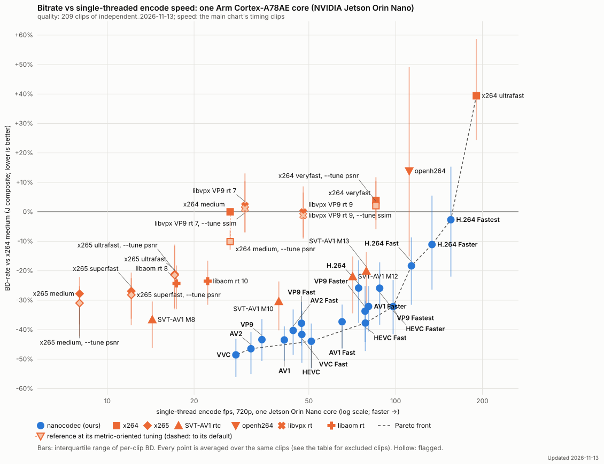
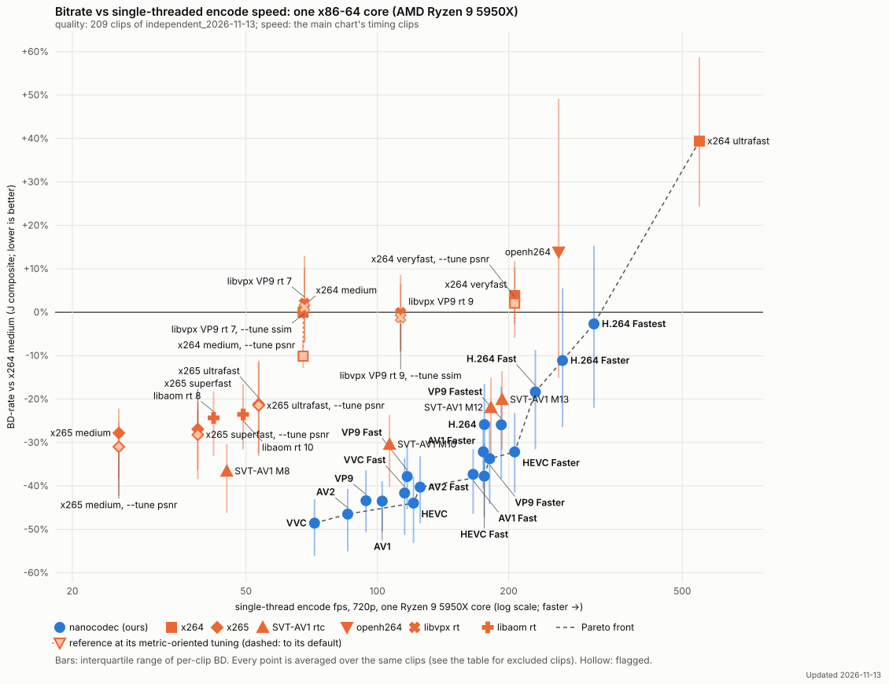

# Bitrate vs encode speed, held-out clips (independent_2026-11-13)

Updated 2026-11-13

Our encoders at the verified head 8b492382 (with the rate-control change 62788659 + 71cad753; scoring build stamped 0cdb619d, identical encoder sources); reference encoders as in the main chart. Points scored on rented machines (stock libvmaf v3.2.1 on the CPU) and here (VMAFx on the GPU); the two agree at stored precision (rate-control-audit-2026-11-13.md). Clips: [independent-2026-11-13.md](independent-2026-11-13.md).

Quality on the 209 clips of `independent_2026-11-13`. Speed is the main chart's: timed on its three timing clips (lowlight_city_night, crowd_mot17_09, bodycam_bc1; tools/dev/anchor_chart_timing.py), not on these clips.

The same on x86 (one Ryzen 9 5950X core):

| Encoder | BD-J | BD-PSNR-YUV | BD-VMAF v1 | per-clip IQR (BD-J) | fps (Jetson, 1 core) | speed vs x264 medium | fps (x86, 1 core) | x86 speed vs x264 medium | clips | notes |
|---|---:|---:|---:|---|---:|---:|---:|---:|---:|---|
| **VVC** | -48.6% | -50.5% | -52.0% | -56.1 … -43.1 | 27.9 | 1.05× | 71.8 | 1.06× | 207/207 | Pareto; Pareto x86 |
| **AV2** | -46.5% | -51.4% | -49.3% | -55.0 … -40.7 | 31.5 | 1.18× | 85.5 | 1.27× | 207/207 | Pareto; Pareto x86 |
| **HEVC** | -43.9% | -45.4% | -47.8% | -53.1 … -37.9 | 51.0 | 1.91× | 121.0 | 1.79× | 207/207 | Pareto; Pareto x86 |
| **AV1** | -43.5% | -48.1% | -44.5% | -50.6 … -38.9 | 41.1 | 1.54× | 102.6 | 1.52× | 207/207 | 1 rate-invalid pts |
| **VP9** | -43.4% | -46.4% | -45.3% | -50.7 … -36.4 | 34.4 | 1.29× | 94.2 | 1.39× | 207/207 | 2 rate-invalid pts |
| **VVC Fast** | -41.6% | -41.4% | -44.8% | -51.2 … -33.6 | 47.3 | 1.77× | 115.4 | 1.71× | 207/207 |  |
| **AV2 Fast** | -40.3% | -42.9% | -42.1% | -48.6 … -33.2 | 44.1 | 1.65× | 125.4 | 1.86× | 207/207 | Pareto x86 |
| **VP9 Fast** | -37.8% | -39.0% | -40.9% | -45.4 … -30.5 | 47.2 | 1.77× | 117.0 | 1.73× | 207/207 | 1 rate-invalid pts |
| **HEVC Fast** | -37.7% | -39.0% | -41.0% | -47.2 … -30.3 | 78.5 | 2.94× | 175.8 | 2.60× | 207/207 | Pareto; Pareto x86 |
| **AV1 Fast** | -37.3% | -37.9% | -39.9% | -46.4 … -31.5 | 65.2 | 2.44× | 165.8 | 2.45× | 207/207 |  |
| SVT-AV1 M8 | -36.6% | -41.8% | -32.0% | -46.2 … -30.4 | 14.3 | 0.53× | 45.2 | 0.62× | 207/207 | 31 rate-invalid pts |
| **VP9 Faster** | -33.7% | -33.4% | -37.3% | -44.1 … -25.2 | 78.4 | 2.94× | 180.9 | 2.68× | 207/207 | Pareto x86; 1 rate-invalid pts |
| **HEVC Faster** | -32.2% | -32.1% | -34.2% | -41.5 … -23.2 | 98.0 | 3.67× | 206.4 | 3.05× | 207/207 | Pareto; Pareto x86 |
| **AV1 Faster** | -32.1% | -32.1% | -34.5% | -40.6 … -25.2 | 80.5 | 3.02× | 174.9 | 2.59× | 207/207 |  |
| x265 medium, metric-tuned (--tune psnr) | -31.0% | -33.4% | -32.0% | -42.3 … -25.3 | 8.0 | 0.30× | 25.6 | 0.37× | 207/207 | 32 rate-invalid pts; fps of the default-tuned run; re-timing pending |
| SVT-AV1 M10 | -30.4% | -34.0% | -28.0% | -40.2 … -23.6 | 39.3 | 1.47× | 106.6 | 1.58× | 207/207 | 27 rate-invalid pts |
| x265 superfast, metric-tuned (--tune psnr) | -28.2% | -29.7% | -29.3% | -38.4 … -22.5 | 12.1 | 0.45× | 38.8 | 0.54× | 207/207 | 30 rate-invalid pts; fps of the default-tuned run; re-timing pending |
| x265 medium | -27.8% | -27.8% | -26.7% | -38.2 … -22.2 | 8.0 | 0.30× | 25.6 | 0.37× | 207/207 | 34 rate-invalid pts |
| x265 superfast | -26.9% | -26.8% | -28.6% | -36.3 … -20.6 | 12.1 | 0.45× | 38.8 | 0.54× | 207/207 | 31 rate-invalid pts |
| **VP9 Fastest** | -25.9% | -25.2% | -32.5% | -38.3 … -17.1 | 88.0 | 3.30× | 192.4 | 2.85× | 207/207 |  |
| **H.264** | -25.8% | -29.1% | -30.2% | -37.7 … -16.5 | 74.4 | 2.79× | 175.9 | 2.60× | 207/207 |  |
| libaom rt 8 | -24.3% | -23.7% | -25.9% | -33.1 … -18.2 | 17.4 | 0.65× | 42.1 | 0.61× | 207/207 | 113 rate-invalid pts |
| libaom rt 10 | -23.5% | -24.7% | -23.8% | -31.6 … -16.6 | 22.3 | 0.83× | 49.2 | 0.74× | 207/207 | 123 rate-invalid pts |
| SVT-AV1 M12 | -22.0% | -23.5% | -21.1% | -34.5 … -15.1 | 70.9 | 2.67× | 182.1 | 2.69× | 207/207 | 24 rate-invalid pts |
| x265 ultrafast, metric-tuned (--tune psnr) | -21.5% | -22.1% | -23.0% | -33.1 … -11.5 | 17.1 | 0.64× | 53.5 | 0.78× | 207/207 | 30 rate-invalid pts; fps of the default-tuned run; re-timing pending |
| x265 ultrafast | -21.1% | -20.3% | -23.1% | -32.6 … -11.1 | 17.1 | 0.64× | 53.5 | 0.78× | 207/207 | 30 rate-invalid pts |
| SVT-AV1 M13 | -20.1% | -21.0% | -19.5% | -31.7 … -13.6 | 79.2 | 2.96× | 193.1 | 2.86× | 207/207 | 24 rate-invalid pts |
| **H.264 Fast** | -18.3% | -21.4% | -24.0% | -31.6 … -8.7 | 113.5 | 4.25× | 230.2 | 3.41× | 207/207 | Pareto; Pareto x86 |
| **H.264 Faster** | -11.1% | -14.9% | -15.9% | -26.4 … +5.5 | 133.7 | 5.01× | 265.7 | 3.93× | 207/207 | Pareto; Pareto x86 |
| x264 medium, metric-tuned (--tune psnr) | -10.1% | -10.4% | -19.1% | -12.9 … -6.3 | 26.7 | 1.00× | 67.6 | 1.00× | 207/207 | 44 rate-invalid pts; fps of the default-tuned run; re-timing pending |
| **H.264 Fastest** | -2.7% | -7.3% | -8.7% | -22.0 … +15.3 | 155.4 | 5.83× | 313.7 | 4.64× | 207/207 | Pareto; Pareto x86 |
| libvpx VP9 rt 9, metric-tuned (--tune ssim) | -1.2% | +4.9% | -5.7% | -9.1 … +6.6 | 47.8 | 1.78× | 113.0 | 1.53× | 207/207 | 206 rate-invalid pts; fps of the default-tuned run; re-timing pending |
| libvpx VP9 rt 9 | -0.1% | +5.3% | -5.2% | -8.7 … +8.6 | 47.8 | 1.78× | 113.0 | 1.53× | 207/207 | 207 rate-invalid pts |
| x264 medium | +0.0% | +0.0% | +0.0% | +0.0 … +0.0 | 26.7 | 1.00× | 67.6 | 1.00× | 207/207 | 40 rate-invalid pts |
| libvpx VP9 rt 7, metric-tuned (--tune ssim) | +1.1% | +5.7% | +0.7% | -6.9 … +10.4 | 30.0 | 1.12× | 68.1 | 1.06× | 207/207 | 169 rate-invalid pts; fps of the default-tuned run; re-timing pending |
| libvpx VP9 rt 7 | +2.1% | +6.4% | -3.4% | -7.1 … +13.0 | 30.0 | 1.12× | 68.1 | 1.06× | 207/207 | 198 rate-invalid pts |
| x264 veryfast, metric-tuned (--tune psnr) | +2.1% | -0.0% | -8.6% | -5.9 … +11.8 | 85.4 | 3.18× | 206.4 | 3.05× | 207/207 | 1 rate-invalid pts; fps of the default-tuned run; re-timing pending |
| x264 veryfast | +3.9% | +1.5% | +5.2% | -2.8 … +10.4 | 85.4 | 3.18× | 206.4 | 3.05× | 207/207 | 1 rate-invalid pts |
| openh264 | +13.9% | +9.5% | +12.8% | -15.1 … +49.1 | 111.5 | 4.17× | 260.3 | 3.85× | 207/207 | 331 rate-invalid pts |
| x264 ultrafast | +39.4% | +53.0% | +14.5% | +24.4 … +58.7 | 190.5 | 7.11× | 547.1 | 8.09× | 207/207 | Pareto; Pareto x86; 1 rate-invalid pts |

Low rungs (40 / 75 kbps, every encoder) on: pool_barscene_pristine, pool_bodycam_bwc_video118, pool_crowd_mot_mot17_04, pool_crowd_person_uid_vid_00210, pool_ducks_take_off_pristine, pool_meva_hospital_g301, pool_static_chirla_chirla_seq_024_camera_7_2023, ind_bdd100k_mot_bdd_00cea101_06f21d5e, ind_bdd100k_mot_bdd_00d1bafa_1b47b41c, ind_bwc_videotext_video219, ind_bwc_videotext_video28, ind_bwc_videotext_video295, ind_bwc_videotext_video321, ind_bwc_videotext_video33, ind_bwc_videotext_video345, ind_bwc_videotext_video347, ind_bwc_videotext_video354, ind_bwc_videotext_video61, ind_bwc_videotext_video88, ind_cctv_inof_ld_out_light_ffcam_002, ind_cevo_april25_inof_ld_in_light_ffcam_002, ind_cevo_april25_inof_ld_outld_light_ffcam_001, ind_jaad_video_0018, ind_jaad_video_0019, ind_jaad_video_0042, ind_jaad_video_0051, ind_jaad_video_0076, ind_jaad_video_0102, ind_meva_2018_03_07_17_00_00_17_05_00_bus_g508, ind_meva_2018_03_07_17_05_00_17_10_00_bus_g508, ind_meva_2018_03_13_16_10_00_16_15_00_bus_g505, ind_mot_mot20_01, ind_mp4_waiting_area1, ind_otw_homes_00310, ind_otw_homes_00394, ind_personpath22_uid_vid_00106, ind_personpath22_uid_vid_00142, ind_personpath22_uid_vid_00172, ind_personpath22_uid_vid_00173, ind_personpath22_uid_vid_00177, ind_personpath22_uid_vid_00195, ind_personpath22_uid_vid_00200, ind_personpath22_uid_vid_00208, ind_personpath22_uid_vid_00216, ind_uvg_vcm_uvgvcm_jobfair. Clips left out for every encoder: 2; chained (point, clip) pairs: 0.

## Class-weighted and clip-weighted BD-J

The chart's BD-J weights every content class equally (bodycam 22, crowd 57, drone 3, lowlight 15, pan 53, static 55, texture 2 clips); clip-weighted counts every clip equally. Same clips and rungs; the clip-weighted mean is over the directly compared clips (no chained rows).

| Point | BD-J class-weighted | BD-J clip-weighted |
|---|---:|---:|
| H.264 | -25.8% | -26.1% |
| H.264 Fast | -18.3% | -18.1% |
| H.264 Faster | -11.1% | -10.2% |
| H.264 Fastest | -2.7% | -2.3% |
| HEVC | -43.9% | -45.3% |
| HEVC Fast | -37.7% | -38.6% |
| HEVC Faster | -32.2% | -32.4% |
| AV1 | -43.5% | -45.2% |
| AV1 Fast | -37.3% | -39.6% |
| AV1 Faster | -32.1% | -33.9% |
| VP9 | -43.4% | -44.0% |
| VP9 Fast | -37.8% | -38.2% |
| VP9 Faster | -33.7% | -34.1% |
| VP9 Fastest | -25.9% | -27.3% |
| AV2 | -46.5% | -48.1% |
| AV2 Fast | -40.3% | -41.4% |
| VVC | -48.6% | -49.6% |
| VVC Fast | -41.6% | -42.3% |
| openh264 | +13.9% | +17.1% |
| x264 ultrafast | +39.4% | +42.3% |
| x264 veryfast | +3.9% | +3.8% |
| x265 ultrafast | -21.1% | -21.6% |
| x265 superfast | -26.9% | -28.2% |
| x265 medium | -27.8% | -29.1% |
| SVT-AV1 M8 | -36.6% | -39.1% |
| SVT-AV1 M10 | -30.4% | -32.7% |
| SVT-AV1 M12 | -22.0% | -25.6% |
| SVT-AV1 M13 | -20.1% | -23.7% |
| libvpx VP9 rt 7 | +2.1% | +3.2% |
| libvpx VP9 rt 9 | -0.1% | -0.0% |
| libaom rt 8 | -24.3% | -25.0% |
| libaom rt 10 | -23.5% | -24.6% |

## Metric-tuned references

Each reference at its charted setting and at each alternative its documentation provides (x264 / x265: `--tune psnr`, `--tune ssim`; libaom / libvpx: `--tune ssim`; openh264: adaptive quantisation on), every other setting unchanged; BD-rate vs the chart's anchor (x264 medium, default tuning) on the chart's clips and rungs, and each alternative's direct paired BD-J against the charted setting with its 95% bootstrap interval. The chart also plots, per reference, the alternative with the largest direct gain whose interval excludes zero (●); the other rows are not distinguishable from the charted setting, or worse. The two calculations can differ by a few tenths: the left columns compare each row with the x264 anchor, the last column the two settings directly on the same points. Equal rows: the setting changes nothing there (x264 ultrafast already runs without psy and AQ; x265 ultrafast and superfast give identical results at both tunes; openh264's harness codes the same bytes with adaptive quantisation on).

| Encoder | BD-J | BD-PSNR-YUV | BD-VMAF v1 | BD-MS-SSIM | clips | BD-J vs its charted setting (direct, 95% interval) |
|---|---:|---:|---:|---:|---:|---|
| openh264 | +13.9% | +9.5% | +12.8% | +19.3% | 207/207 |  |
| openh264, adaptive quantisation on | +13.9% | +9.5% | +12.8% | +19.3% | 207/207 | +0.0 [+0.0, +0.0] not distinguishable |
| x264 ultrafast | +39.4% | +53.0% | +14.5% | +50.7% | 207/207 |  |
| x264 ultrafast, metric-tuned (--tune psnr) | +39.5% | +53.1% | +14.4% | +51.0% | 207/207 | +0.1 [-0.2, +0.3] not distinguishable |
| x264 ultrafast, metric-tuned (--tune ssim) | +36.0% | +50.8% | +28.4% | +28.8% | 207/207 | -0.1 [-1.8, +1.6] not distinguishable |
| x264 veryfast | +3.9% | +1.5% | +5.2% | +4.9% | 207/207 |  |
| x264 veryfast, metric-tuned (--tune psnr) ● | +2.1% | -0.0% | -8.6% | +14.9% | 207/207 | -1.8 [-3.1, -0.5] better |
| x264 veryfast, metric-tuned (--tune ssim) | +4.7% | +2.9% | +7.8% | +3.5% | 207/207 | +0.9 [+0.3, +1.6] worse |
| x264 medium | +0.0% | +0.0% | +0.0% | +0.0% | 207/207 |  |
| x264 medium, metric-tuned (--tune psnr) ● | -10.1% | -10.4% | -19.1% | -0.7% | 207/207 | -10.1 [-11.2, -8.9] better |
| x264 medium, metric-tuned (--tune ssim) | -2.4% | -2.8% | -0.0% | -4.5% | 207/207 | -2.4 [-3.2, -1.7] better |
| x265 ultrafast | -21.1% | -20.3% | -23.1% | -20.0% | 207/207 |  |
| x265 ultrafast, metric-tuned (--tune psnr) ● | -21.5% | -22.1% | -23.0% | -19.2% | 207/207 | -0.6 [-1.1, -0.2] better |
| x265 ultrafast, metric-tuned (--tune ssim) | -21.5% | -22.1% | -23.0% | -19.2% | 207/207 | -0.6 [-1.1, -0.2] better |
| x265 superfast | -26.9% | -26.8% | -28.6% | -25.3% | 207/207 |  |
| x265 superfast, metric-tuned (--tune psnr) ● | -28.2% | -29.7% | -29.3% | -25.6% | 207/207 | -2.0 [-2.4, -1.6] better |
| x265 superfast, metric-tuned (--tune ssim) | -28.2% | -29.7% | -29.3% | -25.6% | 207/207 | -2.0 [-2.4, -1.6] better |
| x265 medium | -27.8% | -27.8% | -26.7% | -28.9% | 207/207 |  |
| x265 medium, metric-tuned (--tune psnr) ● | -31.0% | -33.4% | -32.0% | -27.5% | 207/207 | -4.9 [-5.5, -4.3] better |
| x265 medium, metric-tuned (--tune ssim) | -29.4% | -30.7% | -28.0% | -29.6% | 207/207 | -2.3 [-2.6, -2.1] better |
| libvpx VP9 rt 7 | +2.1% | +6.4% | -3.4% | +3.2% | 207/207 |  |
| libvpx VP9 rt 7, metric-tuned (--tune ssim) ● | +1.1% | +5.7% | +0.7% | -3.0% | 207/207 | -1.9 [-2.5, -1.1] better |
| libvpx VP9 rt 9 | -0.1% | +5.3% | -5.2% | -0.4% | 207/207 |  |
| libvpx VP9 rt 9, metric-tuned (--tune ssim) ● | -1.2% | +4.9% | -5.7% | -2.9% | 207/207 | -1.3 [-1.8, -0.9] better |
| libaom rt 8 | -24.3% | -23.7% | -25.9% | -23.3% | 207/207 |  |
| libaom rt 8, metric-tuned (--tune ssim) | -24.1% | -22.0% | -21.4% | -28.9% | 207/207 | +1.0 [+0.2, +1.7] worse |
| libaom rt 10 | -23.5% | -24.7% | -23.8% | -22.1% | 207/207 |  |
| libaom rt 10, metric-tuned (--tune ssim) | -23.9% | -23.3% | -20.6% | -27.7% | 207/207 | +0.4 [-0.4, +1.2] not distinguishable |

## Against x264 medium, metric-tuned (--tune psnr)

The same points with x264 medium, metric-tuned (--tune psnr) as the zero line instead of the chart's default-tuned x264 medium: direct BD-rate on the chart's clips and rungs (a clip without a direct overlap is left out of that row).

| Encoder | BD-J | BD-PSNR-YUV | BD-VMAF v1 | BD-MS-SSIM | clips |
|---|---:|---:|---:|---:|---:|
| **VVC** | -41.6% | -41.5% | -39.4% | -44.0% | 205/207 |
| **AV2** | -39.4% | -42.4% | -36.0% | -39.7% | 206/207 |
| **HEVC** | -36.5% | -36.0% | -34.2% | -39.3% | 205/207 |
| **AV1** | -35.9% | -38.9% | -30.0% | -38.6% | 206/207 |
| **VP9** | -35.8% | -37.2% | -30.9% | -39.2% | 205/207 |
| **VVC Fast** | -33.7% | -31.2% | -30.3% | -39.5% | 205/207 |
| **AV2 Fast** | -32.2% | -33.0% | -26.9% | -36.7% | 206/207 |
| **HEVC Fast** | -29.5% | -28.9% | -25.5% | -33.9% | 206/207 |
| **VP9 Fast** | -29.5% | -28.8% | -25.4% | -34.2% | 206/207 |
| **AV1 Fast** | -28.9% | -27.5% | -24.2% | -34.8% | 205/207 |
| SVT-AV1 M8 | -27.5% | -31.4% | -14.3% | -37.0% | 206/207 |
| **VP9 Faster** | -24.9% | -22.8% | -20.9% | -31.0% | 206/207 |
| **AV1 Faster** | -23.2% | -21.6% | -17.6% | -30.3% | 206/207 |
| **HEVC Faster** | -23.2% | -21.7% | -17.1% | -30.7% | 206/207 |
| x265 medium, metric-tuned (--tune psnr) | -22.0% | -23.0% | -14.6% | -28.3% | 207/207 |
| SVT-AV1 M10 | -20.5% | -22.3% | -9.1% | -30.0% | 206/207 |
| x265 medium, metric-tuned (--tune ssim) | -19.8% | -19.8% | -9.4% | -30.3% | 207/207 |
| x265 superfast, metric-tuned (--tune psnr) | -18.6% | -18.3% | -11.2% | -26.3% | 207/207 |
| x265 superfast, metric-tuned (--tune ssim) | -18.6% | -18.3% | -11.2% | -26.3% | 207/207 |
| x265 medium | -17.9% | -16.3% | -7.9% | -29.6% | 207/207 |
| x265 superfast | -17.1% | -15.0% | -10.2% | -26.0% | 207/207 |
| **VP9 Fastest** | -16.5% | -14.3% | -14.8% | -20.3% | 206/207 |
| **H.264** | -16.4% | -18.6% | -12.6% | -18.2% | 206/207 |
| libaom rt 8 | -14.0% | -12.1% | -6.7% | -23.7% | 206/207 |
| libaom rt 8, metric-tuned (--tune ssim) | -13.4% | -10.3% | -1.1% | -29.2% | 206/207 |
| libaom rt 10, metric-tuned (--tune ssim) | -13.0% | -11.3% | +0.1% | -28.1% | 206/207 |
| libaom rt 10 | -13.0% | -12.8% | -3.8% | -22.6% | 206/207 |
| SVT-AV1 M12 | -11.3% | -11.2% | -1.0% | -21.6% | 207/207 |
| x265 ultrafast, metric-tuned (--tune psnr) | -10.9% | -9.9% | -3.2% | -19.6% | 207/207 |
| x265 ultrafast, metric-tuned (--tune ssim) | -10.9% | -9.9% | -3.2% | -19.6% | 207/207 |
| x265 ultrafast | -10.5% | -7.9% | -3.2% | -20.3% | 207/207 |
| SVT-AV1 M13 | -9.2% | -8.7% | +1.0% | -20.0% | 207/207 |
| **H.264 Fast** | -8.1% | -10.3% | -4.8% | -9.3% | 207/207 |
| **H.264 Faster** | -0.0% | -3.5% | +5.4% | -2.0% | 207/207 |
| **H.264 Fastest** | +9.1% | +4.4% | +14.2% | +8.7% | 207/207 |
| x264 medium, metric-tuned (--tune ssim) | +10.3% | +9.1% | +25.3% | -3.5% | 207/207 |
| libvpx VP9 rt 9, metric-tuned (--tune ssim) | +11.9% | +19.9% | +18.6% | -2.9% | 207/207 |
| x264 medium | +13.0% | +12.6% | +25.0% | +1.2% | 207/207 |
| libvpx VP9 rt 9 | +13.1% | +20.4% | +19.2% | -0.3% | 207/207 |
| libvpx VP9 rt 7, metric-tuned (--tune ssim) | +13.9% | +19.1% | +25.0% | -2.3% | 207/207 |
| x264 veryfast, metric-tuned (--tune psnr) | +14.3% | +12.3% | +14.4% | +16.1% | 207/207 |
| libvpx VP9 rt 7 | +15.1% | +20.5% | +20.9% | +3.8% | 207/207 |
| x264 veryfast | +18.0% | +14.5% | +33.6% | +6.0% | 207/207 |
| x264 veryfast, metric-tuned (--tune ssim) | +19.2% | +16.2% | +37.0% | +4.5% | 207/207 |
| openh264 | +29.4% | +25.6% | +42.6% | +20.1% | 207/207 |
| openh264, adaptive quantisation on | +29.4% | +25.6% | +42.6% | +20.1% | 207/207 |
| x264 ultrafast, metric-tuned (--tune ssim) | +54.9% | +68.6% | +65.2% | +30.9% | 206/207 |
| x264 ultrafast | +56.5% | +70.4% | +45.5% | +53.5% | 207/207 |
| x264 ultrafast, metric-tuned (--tune psnr) | +56.5% | +70.5% | +45.3% | +53.8% | 207/207 |

## Excluded clips

Left out for every encoder, so that all points are averaged over the same clips: on these, some encoders' curves have no reliable overlap with x264 medium's (even with its extra rungs, which the 50% source cap limits).

- **pool_ducks_take_off_pristine** (texture): no reliable overlap for SVT-AV1 M8, SVT-AV1 M10, libvpx VP9 rt 9.
- **ind_bwc_videotext_video88** (bodycam): no reliable overlap for libaom rt 8.

Direct BD-J vs x264 medium on them, where it exists:

| Encoder | pool_ducks_take_off_pristine | ind_bwc_videotext_video88 |
|---|---:|---:|
| VVC | -57.2% | -63.5% |
| AV2 | -57.0% | -64.4% |
| HEVC | -45.2% | -53.0% |
| AV1 | -59.0% | -55.8% |
| VP9 | -52.9% | -57.9% |
| VVC Fast | -56.7% | -63.8% |
| AV2 Fast | -48.0% | -65.8% |
| VP9 Fast | -42.1% | -58.2% |
| HEVC Fast | -48.5% | -51.9% |
| AV1 Fast | -56.3% | -57.9% |
| SVT-AV1 M8 | n/a | -60.8% |
| VP9 Faster | -46.3% | -58.3% |
| HEVC Faster | -31.4% | -50.8% |
| AV1 Faster | -53.9% | -56.7% |
| x265 medium, metric-tuned (--tune psnr) | n/a | n/a |
| SVT-AV1 M10 | n/a | -56.2% |
| x265 superfast, metric-tuned (--tune psnr) | n/a | n/a |
| x265 medium | -49.5% | -35.4% |
| x265 superfast | -47.3% | -47.1% |
| VP9 Fastest | -44.9% | -52.4% |
| H.264 | -9.6% | -24.2% |
| libaom rt 8 | -18.7% | n/a |
| libaom rt 10 | -16.0% | -38.6% |
| SVT-AV1 M12 | -35.1% | -50.6% |
| x265 ultrafast, metric-tuned (--tune psnr) | n/a | n/a |
| x265 ultrafast | -47.2% | -45.2% |
| SVT-AV1 M13 | -34.7% | -49.0% |
| H.264 Fast | -0.6% | -21.7% |
| H.264 Faster | +20.6% | -16.9% |
| x264 medium, metric-tuned (--tune psnr) | n/a | n/a |
| H.264 Fastest | +15.2% | -8.6% |
| libvpx VP9 rt 9, metric-tuned (--tune ssim) | n/a | n/a |
| libvpx VP9 rt 9 | n/a | -19.2% |
| libvpx VP9 rt 7, metric-tuned (--tune ssim) | n/a | n/a |
| libvpx VP9 rt 7 | -6.0% | -13.6% |
| x264 veryfast, metric-tuned (--tune psnr) | n/a | n/a |
| x264 veryfast | +2.7% | -3.5% |
| openh264 | +89.8% | +32.2% |
| x264 ultrafast | +15.0% | +10.5% |

## Selected pairs

Direct BD-rate of our encoders against the reference encoders and against each other, on the same points (no anchor in between; ours vs ours drops the rungs either arm overshot, as on the board).

| nanocodec | vs | BD-J | BD-PSNR-YUV | BD-VMAF v1 | per-clip IQR (BD-J) | clips |
|---|---|---:|---:|---:|---|---:|
| H.264 | openh264 | -30.8% | -31.0% | -34.3% | -43.2 … -23.1 | 209/209 |
| H.264 | x264 veryfast | -31.8% | -34.1% | -36.0% | -40.7 … -26.6 | 209/209 |
| H.264 | x264 medium | -25.0% | -29.2% | -28.4% | -37.6 … -16.3 | 209/209 |
| H.264 Fast | x264 veryfast | -24.6% | -27.0% | -29.8% | -33.8 … -18.3 | 209/209 |
| H.264 Fast | openh264 | -22.1% | -22.4% | -27.2% | -36.3 … -13.5 | 209/209 |
| H.264 Fast | H.264 | +11.8% | +11.9% | +10.4% | +9.5 … +15.3 | 209/209 |
| H.264 Faster | x264 ultrafast | -38.2% | -49.3% | -27.9% | -48.2 … -34.3 | 196/209 |
| H.264 Faster | H.264 Fast | +11.1% | +9.3% | +13.6% | +5.0 … +15.4 | 209/209 |
| H.264 Fastest | x264 ultrafast | -32.1% | -44.0% | -23.5% | -44.9 … -27.9 | 199/209 |
| H.264 Fastest | H.264 Faster | +11.4% | +11.1% | +8.2% | +8.5 … +13.4 | 209/209 |
| HEVC | x265 medium | -20.7% | -23.5% | -26.9% | -34.7 … -13.2 | 209/209 |
| HEVC Fast | x265 superfast | -12.4% | -15.1% | -14.8% | -26.7 … -6.8 | 209/209 |
| HEVC | SVT-AV1 M12 | -26.6% | -26.8% | -32.6% | -35.3 … -23.5 | 209/209 |
| HEVC Fast | HEVC | +14.2% | +15.1% | +16.2% | +11.0 … +19.5 | 209/209 |
| AV1 | openh264 | -48.8% | -50.8% | -48.9% | -62.7 … -39.9 | 197/209 |
| AV1 Fast | openh264 | -42.5% | -40.5% | -43.6% | -59.3 … -30.7 | 204/209 |
| AV1 | SVT-AV1 M8 | -5.0% | -6.3% | -13.6% | -16.5 … -1.6 | 209/209 |
| AV1 | SVT-AV1 M12 | -27.5% | -31.9% | -29.1% | -34.3 … -23.9 | 209/209 |
| AV1 Fast | SVT-AV1 M12 | -18.6% | -17.3% | -22.6% | -26.9 … -13.8 | 209/209 |
| AV1 | libaom rt 8 | -23.2% | -29.2% | -23.8% | -32.6 … -17.9 | 209/209 |
| AV1 Fast | AV1 | +13.7% | +23.4% | +10.5% | +9.9 … +18.1 | 209/209 |
| AV1 Faster | SVT-AV1 M12 | -9.6% | -7.5% | -13.5% | -22.6 … -0.4 | 209/209 |
| AV1 Faster | AV1 Fast | +11.3% | +12.9% | +12.1% | +6.9 … +16.2 | 209/209 |
| HEVC Faster | SVT-AV1 M13 | -10.3% | -8.3% | -14.1% | -18.4 … -3.0 | 209/209 |
| HEVC Faster | HEVC Fast | +12.0% | +14.4% | +14.6% | +7.7 … +17.8 | 209/209 |
| VP9 | libvpx VP9 rt 7 | -41.7% | -45.6% | -40.3% | -47.9 … -35.1 | 209/209 |
| VP9 Fast | libvpx VP9 rt 9 | -36.0% | -40.6% | -36.1% | -44.2 … -30.6 | 209/209 |
| VP9 Fast | VP9 | +12.5% | +16.6% | +10.1% | +8.9 … +16.5 | 209/209 |
| VP9 Faster | libvpx VP9 rt 9 | -30.6% | -33.9% | -31.3% | -40.9 … -24.3 | 209/209 |
| VP9 Faster | VP9 Fast | +8.5% | +11.4% | +7.1% | +3.7 … +13.7 | 209/209 |
| VP9 Fastest | libvpx VP9 rt 9 | -20.7% | -24.3% | -24.2% | -34.5 … -14.5 | 208/209 |
| VP9 Fastest | VP9 Faster | +16.2% | +15.4% | +10.0% | +5.9 … +20.6 | 209/209 |
| AV2 | SVT-AV1 M8 | -10.8% | -11.7% | -22.1% | -20.5 … -6.7 | 209/209 |
| AV2 | AV1 | -5.5% | -5.5% | -8.5% | -8.9 … -1.8 | 209/209 |
| AV2 Fast | AV2 | +15.6% | +21.2% | +17.9% | +12.1 … +21.8 | 209/209 |
| VVC | x265 medium | -28.8% | -31.5% | -34.2% | -40.1 … -22.3 | 209/209 |
| VVC | HEVC | -10.3% | -10.8% | -9.5% | -12.1 … -6.6 | 209/209 |
| VVC Fast | VVC | +16.8% | +22.1% | +18.9% | +13.7 … +20.8 | 209/209 |
