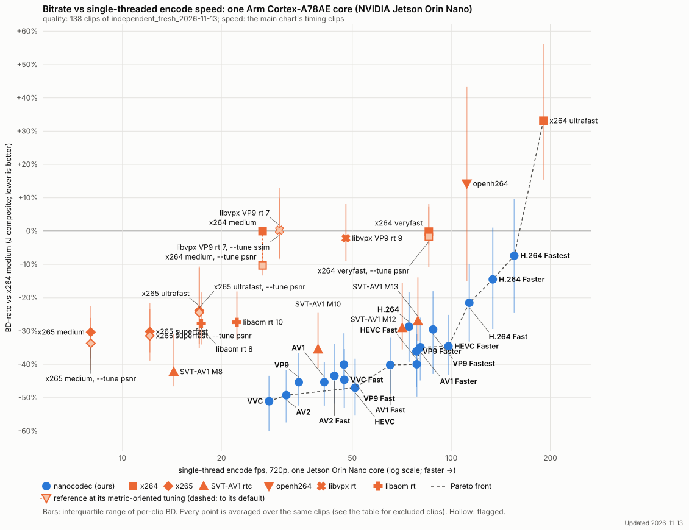
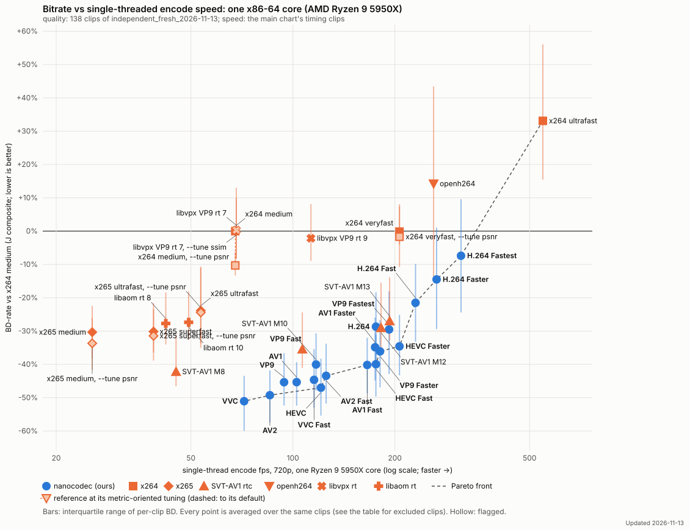

# Bitrate vs encode speed, held-out clips (independent_fresh_2026-11-13)

Updated 2026-11-13

Our encoders at the verified head 8b492382 (with the rate-control change 62788659 + 71cad753; scoring build stamped 0cdb619d, identical encoder sources); reference encoders as in the main chart. Points scored on rented machines (stock libvmaf v3.2.1 on the CPU) and here (VMAFx on the GPU); the two agree at stored precision (rate-control-audit-2026-11-13.md). Clips: [independent-2026-11-13.md](independent-2026-11-13.md).

Quality on the 138 clips of `independent_fresh_2026-11-13`. Speed is the main chart's: timed on its three timing clips (lowlight_city_night, crowd_mot17_09, bodycam_bc1; tools/dev/anchor_chart_timing.py), not on these clips.

The same on x86 (one Ryzen 9 5950X core):

| Encoder | BD-J | BD-PSNR-YUV | BD-VMAF v1 | per-clip IQR (BD-J) | fps (Jetson, 1 core) | speed vs x264 medium | fps (x86, 1 core) | x86 speed vs x264 medium | clips | notes |
|---|---:|---:|---:|---|---:|---:|---:|---:|---:|---|
| **VVC** | -51.1% | -53.0% | -56.3% | -59.9 … -43.4 | 27.9 | 1.05× | 71.8 | 1.06× | 137/137 | Pareto; Pareto x86 |
| **AV2** | -49.3% | -54.0% | -53.8% | -57.4 … -41.8 | 31.5 | 1.18× | 85.5 | 1.27× | 137/137 | Pareto; Pareto x86 |
| **HEVC** | -47.0% | -48.6% | -52.2% | -55.4 … -38.3 | 51.0 | 1.91× | 121.0 | 1.79× | 137/137 | Pareto; Pareto x86 |
| **VP9** | -45.4% | -48.5% | -48.7% | -52.3 … -36.6 | 34.4 | 1.29× | 94.2 | 1.39× | 137/137 | 2 rate-invalid pts |
| **AV1** | -45.3% | -50.0% | -48.3% | -52.4 … -39.3 | 41.1 | 1.54× | 102.6 | 1.52× | 137/137 | 1 rate-invalid pts |
| **VVC Fast** | -44.6% | -45.1% | -49.5% | -53.1 … -35.4 | 47.3 | 1.77× | 115.4 | 1.71× | 137/137 |  |
| **AV2 Fast** | -43.4% | -46.1% | -47.5% | -51.8 … -33.8 | 44.1 | 1.65× | 125.4 | 1.86× | 137/137 | Pareto x86 |
| SVT-AV1 M8 | -42.2% | -45.6% | -41.8% | -46.6 … -31.0 | 14.3 | 0.53× | 45.2 | 0.62× | 137/137 | 22 rate-invalid pts |
| **AV1 Fast** | -40.2% | -41.7% | -44.7% | -48.7 … -32.0 | 65.2 | 2.44× | 165.8 | 2.45× | 137/137 | Pareto; Pareto x86 |
| **VP9 Fast** | -40.0% | -42.2% | -44.3% | -47.8 … -30.7 | 47.2 | 1.77× | 117.0 | 1.73× | 137/137 | 1 rate-invalid pts |
| **HEVC Fast** | -40.0% | -41.4% | -45.1% | -49.6 … -31.0 | 78.5 | 2.94× | 175.8 | 2.60× | 137/137 | Pareto; Pareto x86 |
| **VP9 Faster** | -36.1% | -36.7% | -41.2% | -46.9 … -26.7 | 78.4 | 2.94× | 180.9 | 2.68× | 137/137 | Pareto x86; 1 rate-invalid pts |
| SVT-AV1 M10 | -35.5% | -37.8% | -37.2% | -41.1 … -24.4 | 39.3 | 1.47× | 106.6 | 1.58× | 137/137 | 20 rate-invalid pts |
| **AV1 Faster** | -34.8% | -35.9% | -39.3% | -44.8 … -26.0 | 80.5 | 3.02× | 174.9 | 2.59× | 137/137 | Pareto |
| **HEVC Faster** | -34.6% | -34.4% | -38.9% | -43.3 … -25.1 | 98.0 | 3.67× | 206.4 | 3.05× | 137/137 | Pareto; Pareto x86 |
| x265 medium, metric-tuned (--tune psnr) | -33.7% | -35.2% | -36.9% | -41.6 … -26.0 | 8.0 | 0.30× | 25.6 | 0.37× | 137/137 | 28 rate-invalid pts; fps of the default-tuned run; re-timing pending |
| x265 superfast, metric-tuned (--tune psnr) | -31.4% | -31.9% | -35.0% | -38.9 … -23.4 | 12.1 | 0.45× | 38.8 | 0.54× | 137/137 | 26 rate-invalid pts; fps of the default-tuned run; re-timing pending |
| x265 medium | -30.3% | -29.4% | -32.0% | -38.2 … -22.4 | 8.0 | 0.30× | 25.6 | 0.37× | 137/137 | 30 rate-invalid pts |
| x265 superfast | -30.1% | -29.3% | -34.2% | -36.4 … -21.6 | 12.1 | 0.45× | 38.8 | 0.54× | 137/137 | 27 rate-invalid pts |
| **VP9 Fastest** | -29.5% | -29.7% | -37.4% | -42.9 … -18.0 | 88.0 | 3.30× | 192.4 | 2.85× | 137/137 |  |
| SVT-AV1 M12 | -29.1% | -30.3% | -32.7% | -35.5 … -15.5 | 70.9 | 2.67× | 182.1 | 2.69× | 137/137 | 17 rate-invalid pts |
| **H.264** | -28.7% | -32.1% | -34.8% | -39.2 … -18.3 | 74.4 | 2.79× | 175.9 | 2.60× | 137/137 |  |
| libaom rt 8 | -27.7% | -26.5% | -31.6% | -34.0 … -18.4 | 17.4 | 0.65× | 42.1 | 0.61× | 137/137 | 76 rate-invalid pts |
| libaom rt 10 | -27.4% | -28.3% | -29.9% | -32.6 … -18.1 | 22.3 | 0.83× | 49.2 | 0.74× | 137/137 | 80 rate-invalid pts |
| SVT-AV1 M13 | -27.0% | -27.9% | -31.1% | -32.9 … -13.9 | 79.2 | 2.96× | 193.1 | 2.86× | 137/137 | 17 rate-invalid pts |
| x265 ultrafast, metric-tuned (--tune psnr) | -24.4% | -23.8% | -28.8% | -35.1 … -11.0 | 17.1 | 0.64× | 53.5 | 0.78× | 137/137 | 26 rate-invalid pts; fps of the default-tuned run; re-timing pending |
| x265 ultrafast | -23.9% | -21.9% | -28.6% | -33.8 … -10.6 | 17.1 | 0.64× | 53.5 | 0.78× | 137/137 | 26 rate-invalid pts |
| **H.264 Fast** | -21.5% | -24.9% | -29.1% | -33.1 … -9.8 | 113.5 | 4.25× | 230.2 | 3.41× | 137/137 | Pareto; Pareto x86 |
| **H.264 Faster** | -14.5% | -18.8% | -21.2% | -29.4 … +1.1 | 133.7 | 5.01× | 265.7 | 3.93× | 137/137 | Pareto; Pareto x86 |
| x264 medium, metric-tuned (--tune psnr) | -10.3% | -9.7% | -20.3% | -13.3 … -6.3 | 26.7 | 1.00× | 67.6 | 1.00× | 137/137 | 36 rate-invalid pts; fps of the default-tuned run; re-timing pending |
| **H.264 Fastest** | -7.4% | -11.9% | -15.3% | -24.4 … +9.6 | 155.4 | 5.83× | 313.7 | 4.64× | 137/137 | Pareto; Pareto x86 |
| libvpx VP9 rt 9 | -2.1% | +3.7% | -9.6% | -8.9 … +8.1 | 47.8 | 1.78× | 113.0 | 1.53× | 137/137 | 141 rate-invalid pts |
| x264 veryfast, metric-tuned (--tune psnr) | -1.7% | -4.0% | -14.0% | -10.8 … +8.1 | 85.4 | 3.18× | 206.4 | 3.05× | 137/137 | 1 rate-invalid pts; fps of the default-tuned run; re-timing pending |
| x264 veryfast | -0.1% | -2.9% | +0.2% | -4.0 … +7.4 | 85.4 | 3.18× | 206.4 | 3.05× | 137/137 | 1 rate-invalid pts |
| x264 medium | +0.0% | +0.0% | +0.0% | +0.0 … +0.0 | 26.7 | 1.00× | 67.6 | 1.00× | 137/137 | 33 rate-invalid pts |
| libvpx VP9 rt 7, metric-tuned (--tune ssim) | +0.3% | +5.1% | -2.5% | -8.1 … +9.9 | 30.0 | 1.12× | 68.1 | 1.06× | 137/137 | 113 rate-invalid pts; fps of the default-tuned run; re-timing pending |
| libvpx VP9 rt 7 | +0.3% | +4.7% | -7.4% | -8.4 … +13.0 | 30.0 | 1.12× | 68.1 | 1.06× | 137/137 | 133 rate-invalid pts |
| openh264 | +14.2% | +10.1% | +10.2% | -15.0 … +43.4 | 111.5 | 4.17× | 260.3 | 3.85× | 137/137 | 225 rate-invalid pts |
| x264 ultrafast | +33.1% | +43.8% | +7.3% | +15.5 … +56.1 | 190.5 | 7.11× | 547.1 | 8.09× | 137/137 | Pareto; Pareto x86; 1 rate-invalid pts |

Low rungs (40 / 75 kbps, every encoder) on: ind_bdd100k_mot_bdd_00cea101_06f21d5e, ind_bdd100k_mot_bdd_00d1bafa_1b47b41c, ind_bwc_videotext_video219, ind_bwc_videotext_video28, ind_bwc_videotext_video295, ind_bwc_videotext_video321, ind_bwc_videotext_video33, ind_bwc_videotext_video345, ind_bwc_videotext_video347, ind_bwc_videotext_video354, ind_bwc_videotext_video61, ind_bwc_videotext_video88, ind_cctv_inof_ld_out_light_ffcam_002, ind_cevo_april25_inof_ld_in_light_ffcam_002, ind_cevo_april25_inof_ld_outld_light_ffcam_001, ind_jaad_video_0018, ind_jaad_video_0019, ind_jaad_video_0042, ind_jaad_video_0051, ind_jaad_video_0076, ind_jaad_video_0102, ind_meva_2018_03_07_17_00_00_17_05_00_bus_g508, ind_meva_2018_03_07_17_05_00_17_10_00_bus_g508, ind_meva_2018_03_13_16_10_00_16_15_00_bus_g505, ind_mot_mot20_01, ind_mp4_waiting_area1, ind_otw_homes_00310, ind_otw_homes_00394, ind_personpath22_uid_vid_00106, ind_personpath22_uid_vid_00142, ind_personpath22_uid_vid_00172, ind_personpath22_uid_vid_00173, ind_personpath22_uid_vid_00177, ind_personpath22_uid_vid_00195, ind_personpath22_uid_vid_00200, ind_personpath22_uid_vid_00208, ind_personpath22_uid_vid_00216, ind_uvg_vcm_uvgvcm_jobfair. Clips left out for every encoder: 1; chained (point, clip) pairs: 0.

## Class-weighted and clip-weighted BD-J

The chart's BD-J weights every content class equally (bodycam 12, crowd 39, lowlight 8, pan 42, static 36 clips); clip-weighted counts every clip equally. Same clips and rungs; the clip-weighted mean is over the directly compared clips (no chained rows).

| Point | BD-J class-weighted | BD-J clip-weighted |
|---|---:|---:|
| H.264 | -28.7% | -29.2% |
| H.264 Fast | -21.5% | -21.6% |
| H.264 Faster | -14.5% | -14.1% |
| H.264 Fastest | -7.4% | -6.8% |
| HEVC | -47.0% | -46.7% |
| HEVC Fast | -40.0% | -40.2% |
| HEVC Faster | -34.6% | -34.1% |
| AV1 | -45.3% | -46.3% |
| AV1 Fast | -40.2% | -41.0% |
| AV1 Faster | -34.8% | -35.5% |
| VP9 | -45.4% | -45.1% |
| VP9 Fast | -40.0% | -39.6% |
| VP9 Faster | -36.1% | -35.6% |
| VP9 Fastest | -29.5% | -29.5% |
| AV2 | -49.3% | -49.3% |
| AV2 Fast | -43.4% | -42.8% |
| VVC | -51.1% | -50.9% |
| VVC Fast | -44.6% | -43.7% |
| openh264 | +14.2% | +14.2% |
| x264 ultrafast | +33.1% | +38.2% |
| x264 veryfast | -0.1% | +1.1% |
| x265 ultrafast | -23.9% | -22.2% |
| x265 superfast | -30.1% | -28.7% |
| x265 medium | -30.3% | -29.6% |
| SVT-AV1 M8 | -42.2% | -40.1% |
| SVT-AV1 M10 | -35.5% | -33.8% |
| SVT-AV1 M12 | -29.1% | -26.9% |
| SVT-AV1 M13 | -27.0% | -25.1% |
| libvpx VP9 rt 7 | +0.3% | +3.6% |
| libvpx VP9 rt 9 | -2.1% | -0.3% |
| libaom rt 8 | -27.7% | -25.6% |
| libaom rt 10 | -27.4% | -25.5% |

## Metric-tuned references

Each reference at its charted setting and at each alternative its documentation provides (x264 / x265: `--tune psnr`, `--tune ssim`; libaom / libvpx: `--tune ssim`; openh264: adaptive quantisation on), every other setting unchanged; BD-rate vs the chart's anchor (x264 medium, default tuning) on the chart's clips and rungs, and each alternative's direct paired BD-J against the charted setting with its 95% bootstrap interval. The chart also plots, per reference, the alternative with the largest direct gain whose interval excludes zero (●); the other rows are not distinguishable from the charted setting, or worse. The two calculations can differ by a few tenths: the left columns compare each row with the x264 anchor, the last column the two settings directly on the same points. Equal rows: the setting changes nothing there (x264 ultrafast already runs without psy and AQ; x265 ultrafast and superfast give identical results at both tunes; openh264's harness codes the same bytes with adaptive quantisation on).

| Encoder | BD-J | BD-PSNR-YUV | BD-VMAF v1 | BD-MS-SSIM | clips | BD-J vs its charted setting (direct, 95% interval) |
|---|---:|---:|---:|---:|---:|---|
| openh264 | +14.2% | +10.1% | +10.2% | +22.4% | 137/137 |  |
| openh264, adaptive quantisation on | +14.2% | +10.1% | +10.2% | +22.4% | 137/137 | +0.0 [+0.0, +0.0] not distinguishable |
| x264 ultrafast | +33.1% | +43.8% | +7.3% | +48.1% | 137/137 |  |
| x264 ultrafast, metric-tuned (--tune psnr) | +33.1% | +43.5% | +7.4% | +48.2% | 137/137 | -0.0 [-0.3, +0.2] not distinguishable |
| x264 ultrafast, metric-tuned (--tune ssim) | +29.4% | +40.3% | +22.3% | +25.6% | 137/137 | +0.1 [-1.3, +1.4] not distinguishable |
| x264 veryfast | -0.1% | -2.9% | +0.2% | +2.4% | 137/137 |  |
| x264 veryfast, metric-tuned (--tune psnr) ● | -1.7% | -4.0% | -14.0% | +13.0% | 137/137 | -1.8 [-2.9, -0.6] better |
| x264 veryfast, metric-tuned (--tune ssim) | +0.7% | -1.4% | +2.4% | +1.1% | 137/137 | +0.6 [+0.0, +1.2] worse |
| x264 medium | +0.0% | +0.0% | +0.0% | +0.0% | 137/137 |  |
| x264 medium, metric-tuned (--tune psnr) ● | -10.3% | -9.7% | -20.3% | -0.9% | 137/137 | -10.3 [-11.2, -9.4] better |
| x264 medium, metric-tuned (--tune ssim) | -2.2% | -1.9% | -0.5% | -4.1% | 137/137 | -2.2 [-2.9, -1.4] better |
| x265 ultrafast | -23.9% | -21.9% | -28.6% | -21.0% | 137/137 |  |
| x265 ultrafast, metric-tuned (--tune psnr) ● | -24.4% | -23.8% | -28.8% | -20.7% | 137/137 | -1.0 [-1.3, -0.6] better |
| x265 ultrafast, metric-tuned (--tune ssim) | -24.4% | -23.8% | -28.8% | -20.7% | 137/137 | -1.0 [-1.3, -0.6] better |
| x265 superfast | -30.1% | -29.3% | -34.2% | -26.9% | 137/137 |  |
| x265 superfast, metric-tuned (--tune psnr) ● | -31.4% | -31.9% | -35.0% | -27.4% | 137/137 | -2.1 [-2.5, -1.7] better |
| x265 superfast, metric-tuned (--tune ssim) | -31.4% | -31.9% | -35.0% | -27.4% | 137/137 | -2.1 [-2.5, -1.7] better |
| x265 medium | -30.3% | -29.4% | -32.0% | -29.6% | 137/137 |  |
| x265 medium, metric-tuned (--tune psnr) ● | -33.7% | -35.2% | -36.9% | -28.9% | 137/137 | -5.5 [-6.2, -4.8] better |
| x265 medium, metric-tuned (--tune ssim) | -31.6% | -31.9% | -32.8% | -30.2% | 137/137 | -2.0 [-2.4, -1.8] better |
| libvpx VP9 rt 7 | +0.3% | +4.7% | -7.4% | +3.6% | 137/137 |  |
| libvpx VP9 rt 7, metric-tuned (--tune ssim) ● | +0.3% | +5.1% | -2.5% | -1.7% | 137/137 | -0.9 [-1.4, -0.4] better |
| libvpx VP9 rt 9 | -2.1% | +3.7% | -9.6% | -0.6% | 137/137 |  |
| libvpx VP9 rt 9, metric-tuned (--tune ssim) | -2.1% | +4.2% | -8.8% | -1.8% | 137/137 | -0.3 [-0.7, +0.2] not distinguishable |
| libaom rt 8 | -27.7% | -26.5% | -31.6% | -25.1% | 137/137 |  |
| libaom rt 8, metric-tuned (--tune ssim) | -27.7% | -25.2% | -27.1% | -30.7% | 137/137 | +0.8 [+0.2, +1.6] worse |
| libaom rt 10 | -27.4% | -28.3% | -29.9% | -23.8% | 137/137 |  |
| libaom rt 10, metric-tuned (--tune ssim) | -27.5% | -26.8% | -26.5% | -29.0% | 137/137 | +0.6 [-0.0, +1.3] not distinguishable |

## Against x264 medium, metric-tuned (--tune psnr)

The same points with x264 medium, metric-tuned (--tune psnr) as the zero line instead of the chart's default-tuned x264 medium: direct BD-rate on the chart's clips and rungs (a clip without a direct overlap is left out of that row).

| Encoder | BD-J | BD-PSNR-YUV | BD-VMAF v1 | BD-MS-SSIM | clips |
|---|---:|---:|---:|---:|---:|
| **VVC** | -44.3% | -44.3% | -43.6% | -44.7% | 135/137 |
| **AV2** | -42.3% | -45.5% | -40.5% | -40.7% | 136/137 |
| **HEVC** | -39.8% | -39.8% | -38.4% | -40.9% | 135/137 |
| **AV1** | -37.9% | -41.8% | -33.7% | -38.2% | 136/137 |
| **VP9** | -37.8% | -39.8% | -34.0% | -39.5% | 135/137 |
| **VVC Fast** | -36.8% | -35.4% | -34.7% | -40.0% | 135/137 |
| **AV2 Fast** | -35.5% | -36.7% | -32.4% | -37.2% | 136/137 |
| SVT-AV1 M8 | -34.0% | -36.0% | -25.7% | -40.1% | 136/137 |
| **AV1 Fast** | -32.0% | -32.2% | -29.0% | -34.6% | 135/137 |
| **VP9 Fast** | -31.6% | -32.5% | -28.2% | -34.0% | 136/137 |
| **HEVC Fast** | -31.6% | -31.7% | -29.2% | -33.8% | 136/137 |
| **VP9 Faster** | -27.1% | -26.4% | -24.3% | -30.5% | 136/137 |
| SVT-AV1 M10 | -26.2% | -26.9% | -19.4% | -32.1% | 136/137 |
| **AV1 Faster** | -26.0% | -26.1% | -22.2% | -29.7% | 136/137 |
| **HEVC Faster** | -25.4% | -24.1% | -21.2% | -30.7% | 136/137 |
| x265 medium, metric-tuned (--tune psnr) | -24.8% | -25.4% | -19.5% | -29.6% | 137/137 |
| x265 medium, metric-tuned (--tune ssim) | -22.1% | -21.4% | -14.0% | -30.8% | 137/137 |
| x265 superfast, metric-tuned (--tune psnr) | -22.0% | -21.2% | -16.8% | -28.1% | 137/137 |
| x265 superfast, metric-tuned (--tune ssim) | -22.0% | -21.2% | -16.8% | -28.1% | 137/137 |
| x265 medium | -20.5% | -18.5% | -12.8% | -30.2% | 137/137 |
| x265 superfast | -20.4% | -18.0% | -15.7% | -27.6% | 137/137 |
| **VP9 Fastest** | -19.8% | -19.1% | -19.2% | -21.1% | 136/137 |
| SVT-AV1 M12 | -19.1% | -18.9% | -13.8% | -24.5% | 137/137 |
| **H.264** | -19.1% | -21.8% | -16.5% | -18.9% | 136/137 |
| libaom rt 8 | -17.0% | -15.2% | -11.7% | -25.0% | 136/137 |
| SVT-AV1 M13 | -16.8% | -16.3% | -11.8% | -22.2% | 137/137 |
| libaom rt 8, metric-tuned (--tune ssim) | -16.6% | -13.8% | -6.4% | -30.5% | 136/137 |
| libaom rt 10 | -16.4% | -16.7% | -9.4% | -23.7% | 136/137 |
| libaom rt 10, metric-tuned (--tune ssim) | -16.3% | -15.1% | -5.5% | -29.1% | 136/137 |
| x265 ultrafast, metric-tuned (--tune psnr) | -14.0% | -12.2% | -8.7% | -21.0% | 137/137 |
| x265 ultrafast, metric-tuned (--tune ssim) | -14.0% | -12.2% | -8.7% | -21.0% | 137/137 |
| x265 ultrafast | -13.3% | -10.1% | -8.4% | -21.3% | 137/137 |
| **H.264 Fast** | -11.2% | -14.1% | -9.5% | -9.9% | 137/137 |
| **H.264 Faster** | -3.3% | -7.7% | +0.4% | -2.6% | 137/137 |
| **H.264 Fastest** | +4.5% | -0.6% | +7.8% | +6.2% | 137/137 |
| x264 veryfast, metric-tuned (--tune psnr) | +10.1% | +6.9% | +9.3% | +14.1% | 137/137 |
| x264 medium, metric-tuned (--tune ssim) | +10.9% | +8.9% | +26.9% | -3.1% | 137/137 |
| libvpx VP9 rt 9, metric-tuned (--tune ssim) | +11.7% | +19.0% | +17.4% | -1.4% | 137/137 |
| libvpx VP9 rt 9 | +11.7% | +18.7% | +16.5% | -0.2% | 137/137 |
| x264 medium | +13.4% | +11.5% | +27.3% | +1.4% | 137/137 |
| libvpx VP9 rt 7, metric-tuned (--tune ssim) | +13.4% | +18.3% | +22.7% | -0.7% | 137/137 |
| x264 veryfast | +13.5% | +8.2% | +29.1% | +3.3% | 137/137 |
| libvpx VP9 rt 7 | +13.7% | +18.5% | +18.0% | +4.6% | 137/137 |
| x264 veryfast, metric-tuned (--tune ssim) | +14.6% | +10.0% | +31.9% | +1.9% | 137/137 |
| openh264 | +30.9% | +27.2% | +41.7% | +23.7% | 137/137 |
| openh264, adaptive quantisation on | +30.9% | +27.2% | +41.7% | +23.7% | 137/137 |
| x264 ultrafast, metric-tuned (--tune ssim) | +47.8% | +55.6% | +60.0% | +27.7% | 137/137 |
| x264 ultrafast, metric-tuned (--tune psnr) | +49.3% | +58.4% | +38.5% | +51.1% | 137/137 |
| x264 ultrafast | +49.4% | +58.6% | +38.5% | +51.0% | 137/137 |

## Excluded clips

Left out for every encoder, so that all points are averaged over the same clips: on these, some encoders' curves have no reliable overlap with x264 medium's (even with its extra rungs, which the 50% source cap limits).

- **ind_bwc_videotext_video88** (bodycam): no reliable overlap for libaom rt 8.

Direct BD-J vs x264 medium on them, where it exists:

| Encoder | ind_bwc_videotext_video88 |
|---|---:|
| VVC | -63.5% |
| AV2 | -64.4% |
| HEVC | -53.0% |
| VP9 | -57.9% |
| AV1 | -55.8% |
| VVC Fast | -63.8% |
| AV2 Fast | -65.8% |
| SVT-AV1 M8 | -60.8% |
| AV1 Fast | -57.9% |
| VP9 Fast | -58.2% |
| HEVC Fast | -51.9% |
| VP9 Faster | -58.3% |
| SVT-AV1 M10 | -56.2% |
| AV1 Faster | -56.7% |
| HEVC Faster | -50.8% |
| x265 medium, metric-tuned (--tune psnr) | n/a |
| x265 superfast, metric-tuned (--tune psnr) | n/a |
| x265 medium | -35.4% |
| x265 superfast | -47.1% |
| VP9 Fastest | -52.4% |
| SVT-AV1 M12 | -50.6% |
| H.264 | -24.2% |
| libaom rt 8 | n/a |
| libaom rt 10 | -38.6% |
| SVT-AV1 M13 | -49.0% |
| x265 ultrafast, metric-tuned (--tune psnr) | n/a |
| x265 ultrafast | -45.2% |
| H.264 Fast | -21.7% |
| H.264 Faster | -16.9% |
| x264 medium, metric-tuned (--tune psnr) | n/a |
| H.264 Fastest | -8.6% |
| libvpx VP9 rt 9 | -19.2% |
| x264 veryfast, metric-tuned (--tune psnr) | n/a |
| x264 veryfast | -3.5% |
| libvpx VP9 rt 7, metric-tuned (--tune ssim) | n/a |
| libvpx VP9 rt 7 | -13.6% |
| openh264 | +32.2% |
| x264 ultrafast | +10.5% |

## Selected pairs

Direct BD-rate of our encoders against the reference encoders and against each other, on the same points (no anchor in between; ours vs ours drops the rungs either arm overshot, as on the board).

| nanocodec | vs | BD-J | BD-PSNR-YUV | BD-VMAF v1 | per-clip IQR (BD-J) | clips |
|---|---|---:|---:|---:|---|---:|
| H.264 | openh264 | -32.2% | -33.0% | -35.8% | -44.5 … -23.2 | 138/138 |
| H.264 | x264 veryfast | -33.4% | -35.2% | -39.8% | -41.0 … -27.2 | 138/138 |
| H.264 | x264 medium | -28.7% | -32.1% | -34.7% | -39.2 … -18.6 | 138/138 |
| H.264 Fast | x264 veryfast | -26.5% | -28.3% | -34.5% | -34.6 … -19.5 | 138/138 |
| H.264 Fast | openh264 | -23.9% | -25.1% | -29.3% | -36.9 … -13.9 | 138/138 |
| H.264 Fast | H.264 | +11.9% | +11.8% | +9.8% | +9.3 … +15.2 | 138/138 |
| H.264 Faster | x264 ultrafast | -40.6% | -49.8% | -32.2% | -49.1 … -35.5 | 127/138 |
| H.264 Faster | H.264 Fast | +10.8% | +8.8% | +13.0% | +5.2 … +15.9 | 138/138 |
| H.264 Fastest | x264 ultrafast | -34.5% | -44.8% | -25.8% | -45.5 … -28.9 | 128/138 |
| H.264 Fastest | H.264 Faster | +11.0% | +10.6% | +9.0% | +8.6 … +13.6 | 138/138 |
| HEVC | x265 medium | -24.3% | -27.6% | -30.3% | -34.9 … -16.5 | 138/138 |
| HEVC Fast | x265 superfast | -13.5% | -17.1% | -16.4% | -27.1 … -7.8 | 138/138 |
| HEVC | SVT-AV1 M12 | -26.2% | -27.2% | -29.5% | -35.4 … -25.0 | 138/138 |
| HEVC Fast | HEVC | +16.5% | +16.7% | +17.6% | +11.0 … +19.4 | 138/138 |
| AV1 | openh264 | -49.1% | -51.6% | -49.9% | -62.4 … -40.4 | 130/138 |
| AV1 Fast | openh264 | -43.4% | -42.8% | -45.8% | -58.7 … -32.4 | 135/138 |
| AV1 | SVT-AV1 M8 | -2.7% | -7.6% | -8.2% | -16.0 … -2.6 | 138/138 |
| AV1 | SVT-AV1 M12 | -24.1% | -30.2% | -23.5% | -34.0 … -24.0 | 138/138 |
| AV1 Fast | SVT-AV1 M12 | -15.6% | -16.4% | -17.9% | -27.3 … -15.4 | 138/138 |
| AV1 | libaom rt 8 | -21.7% | -29.1% | -22.2% | -34.3 … -18.9 | 138/138 |
| AV1 Fast | AV1 | +12.3% | +21.3% | +8.6% | +9.7 … +18.2 | 138/138 |
| AV1 Faster | SVT-AV1 M12 | -6.7% | -6.8% | -9.4% | -22.7 … -3.7 | 138/138 |
| AV1 Faster | AV1 Fast | +11.0% | +12.7% | +11.2% | +6.7 … +15.9 | 138/138 |
| HEVC Faster | SVT-AV1 M13 | -8.6% | -7.0% | -10.3% | -18.4 … -3.6 | 138/138 |
| HEVC Faster | HEVC Fast | +11.2% | +14.1% | +13.8% | +7.8 … +17.8 | 138/138 |
| VP9 | libvpx VP9 rt 7 | -42.2% | -46.4% | -40.6% | -50.1 … -37.2 | 138/138 |
| VP9 Fast | libvpx VP9 rt 9 | -37.5% | -42.9% | -37.1% | -45.7 … -32.7 | 138/138 |
| VP9 Fast | VP9 | +12.1% | +15.0% | +10.3% | +8.2 … +15.7 | 138/138 |
| VP9 Faster | libvpx VP9 rt 9 | -32.7% | -36.6% | -33.5% | -42.5 … -26.5 | 138/138 |
| VP9 Faster | VP9 Fast | +8.4% | +12.0% | +6.2% | +3.6 … +12.0 | 138/138 |
| VP9 Fastest | libvpx VP9 rt 9 | -23.4% | -28.3% | -27.3% | -34.5 … -17.5 | 138/138 |
| VP9 Fastest | VP9 Faster | +15.6% | +14.9% | +9.4% | +5.6 … +19.0 | 138/138 |
| AV2 | SVT-AV1 M8 | -9.8% | -13.6% | -18.8% | -20.7 … -8.9 | 138/138 |
| AV2 | AV1 | -7.1% | -6.5% | -10.6% | -8.9 … -1.8 | 138/138 |
| AV2 Fast | AV2 | +14.6% | +20.4% | +15.9% | +12.3 … +21.9 | 138/138 |
| VVC | x265 medium | -30.6% | -34.1% | -36.9% | -41.4 … -24.4 | 138/138 |
| VVC | HEVC | -9.3% | -9.5% | -10.0% | -11.6 … -7.1 | 138/138 |
| VVC Fast | VVC | +16.0% | +19.7% | +18.3% | +13.5 … +21.2 | 138/138 |
