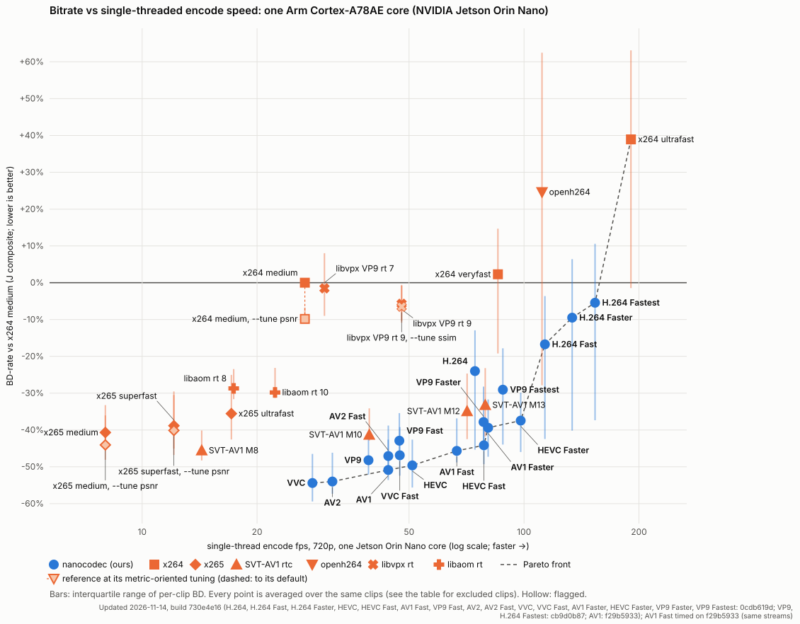
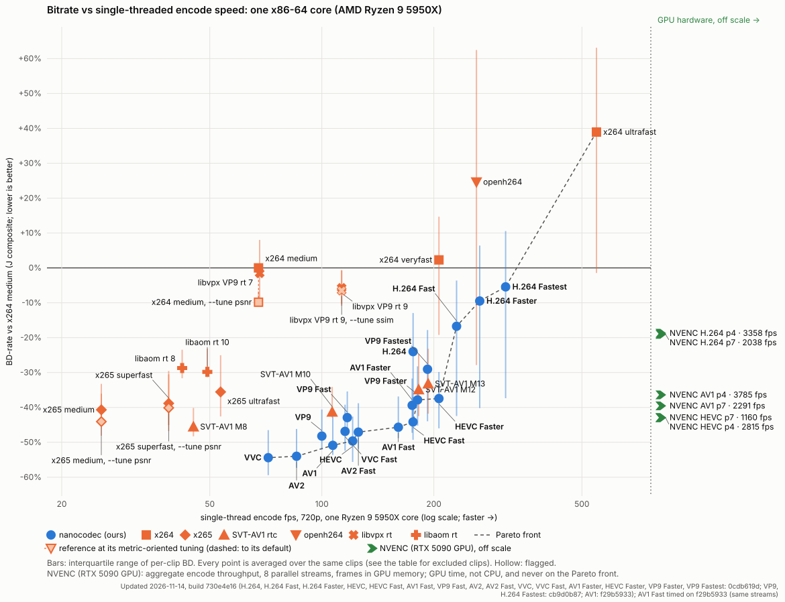

# Bitrate vs encode speed

Updated 2026-11-13, build 730e4e16 (H.264: 399e5c44; VP9 Faster, VP9 Fastest: 7abbc815; H.264 Fast, VP9, VP9 Fast: 7eb909e8; AV2 Fast: a566db89; VVC, VVC Fast: cba4292f; AV1 Fast: de63c65f; H.264 Faster, HEVC, HEVC Fast, AV1, AV1 Faster, HEVC Faster, H.264 Fastest: e122b42b; AV2: ee584d1c); AV2 timed on 3a3d48f5 (same streams); H.264 Faster, H.264 Fastest, HEVC, HEVC Fast, HEVC Faster, AV1, AV1 Faster, H.264 Fast, VP9, VP9 Fast timed on 5a825a5b (same streams)

The same on x86 (one Ryzen 9 5950X core):

| Encoder | BD-J | BD-PSNR-YUV | BD-VMAF v1 | per-clip IQR (BD-J) | fps (Jetson, 1 core) | speed vs x264 medium | fps (x86, 1 core) | x86 speed vs x264 medium | clips | notes |
|---|---:|---:|---:|---|---:|---:|---:|---:|---:|---|
| **VVC** | -54.0% | -55.0% | -60.2% | -59.3 … -45.9 | 27.9 | 1.05× | 71.8 | 1.06× | 11/11 | Pareto; Pareto x86 |
| **AV2** | -53.7% | -57.7% | -59.7% | -57.7 … -45.6 | 31.5 | 1.18× | 85.5 | 1.27× | 11/11 | Pareto; Pareto x86 |
| **AV1** | -50.9% | -55.0% | -54.8% | -53.3 … -43.5 | 41.1 | 1.54× | 102.6 | 1.52× | 11/11 | Pareto; Pareto x86 |
| **HEVC** | -49.3% | -50.1% | -55.7% | -55.6 … -42.2 | 51.0 | 1.91× | 121.0 | 1.79× | 11/11 | Pareto; Pareto x86 |
| **VP9** | -48.1% | -51.9% | -50.9% | -52.8 … -40.3 | 34.4 | 1.29× | 94.2 | 1.39× | 11/11 |  |
| **VVC Fast** | -46.4% | -45.8% | -53.2% | -52.2 … -38.6 | 47.3 | 1.77× | 115.4 | 1.71× | 11/11 |  |
| **AV2 Fast** | -46.2% | -48.4% | -51.8% | -51.8 … -38.0 | 44.1 | 1.65× | 125.4 | 1.86× | 11/11 | Pareto x86 |
| SVT-AV1 M8 | -45.5% | -49.4% | -44.5% | -48.3 … -40.1 | 14.3 | 0.53× | 45.2 | 0.62× | 11/11 | 2 rate-invalid pts |
| **AV1 Fast** | -44.9% | -46.2% | -51.1% | -48.8 … -36.3 | 65.2 | 2.44× | 165.8 | 2.45× | 11/11 | Pareto; Pareto x86 |
| **HEVC Fast** | -43.4% | -43.7% | -50.4% | -49.2 … -36.4 | 78.5 | 2.94× | 175.8 | 2.60× | 11/11 | Pareto; Pareto x86 |
| **VP9 Fast** | -42.4% | -45.1% | -47.3% | -47.1 … -34.7 | 47.2 | 1.77× | 117.0 | 1.73× | 11/11 |  |
| SVT-AV1 M10 | -41.3% | -43.9% | -43.0% | -42.9 … -34.1 | 39.3 | 1.47× | 106.6 | 1.58× | 11/11 | 2 rate-invalid pts |
| x265 medium | -40.7% | -40.2% | -43.2% | -43.3 … -33.2 | 8.0 | 0.30× | 25.6 | 0.37× | 11/11 |  |
| x265 superfast | -38.8% | -38.1% | -43.8% | -45.0 … -29.5 | 12.1 | 0.45× | 38.8 | 0.54× | 11/11 |  |
| **AV1 Faster** | -38.7% | -38.9% | -45.3% | -47.0 … -30.1 | 80.5 | 3.02× | 174.9 | 2.59× | 11/11 | Pareto |
| **VP9 Faster** | -37.1% | -36.5% | -44.1% | -45.2 … -27.4 | 78.4 | 2.94× | 180.9 | 2.68× | 11/11 | Pareto x86 |
| **HEVC Faster** | -36.0% | -34.2% | -41.8% | -44.2 … -28.7 | 98.0 | 3.67× | 206.4 | 3.05× | 11/11 | Pareto; Pareto x86 |
| x265 ultrafast | -35.6% | -33.8% | -41.2% | -42.6 … -25.0 | 17.1 | 0.64× | 53.5 | 0.78× | 11/11 |  |
| SVT-AV1 M12 | -34.9% | -35.7% | -39.8% | -42.5 … -24.7 | 70.9 | 2.67× | 182.1 | 2.69× | 11/11 | 2 rate-invalid pts |
| SVT-AV1 M13 | -33.2% | -33.7% | -38.8% | -41.8 … -23.2 | 79.2 | 2.96× | 193.1 | 2.86× | 11/11 | 1 rate-invalid pts |
| libaom rt 10 | -29.8% | -29.9% | -32.3% | -31.3 … -23.1 | 22.3 | 0.83× | 49.2 | 0.74× | 11/11 | 8 rate-invalid pts |
| libaom rt 8 | -28.7% | -26.8% | -32.1% | -31.6 … -23.5 | 17.4 | 0.65× | 42.1 | 0.61× | 11/11 | 6 rate-invalid pts |
| **VP9 Fastest** | -27.8% | -25.0% | -39.0% | -44.6 … -16.7 | 88.0 | 3.30× | 192.4 | 2.85× | 11/11 |  |
| **H.264** | -23.0% | -24.8% | -31.1% | -42.3 … -12.2 | 74.4 | 2.79× | 175.9 | 2.60× | 11/11 |  |
| **H.264 Fast** | -16.2% | -17.7% | -26.9% | -39.4 … -2.9 | 113.5 | 4.25× | 230.2 | 3.41× | 11/11 | Pareto; Pareto x86 |
| **H.264 Faster** | -8.5% | -11.1% | -18.5% | -38.3 … +7.6 | 133.7 | 5.01× | 265.7 | 3.93× | 11/11 | Pareto; Pareto x86 |
| libvpx VP9 rt 9 | -5.7% | -1.2% | -11.9% | -10.3 … -0.8 | 47.8 | 1.78× | 113.0 | 1.53× | 11/11 | 16 rate-invalid pts |
| libvpx VP9 rt 7 | -1.5% | +1.6% | -7.7% | -9.0 … +8.0 | 30.0 | 1.12× | 68.1 | 1.06× | 11/11 | 15 rate-invalid pts |
| **H.264 Fastest** | -0.8% | -3.1% | -12.4% | -34.2 … +17.2 | 155.4 | 5.83× | 313.7 | 4.64× | 11/11 | Pareto; Pareto x86 |
| x264 medium | +0.0% | +0.0% | +0.0% | +0.0 … +0.0 | 26.7 | 1.00× | 67.6 | 1.00× | 11/11 | 4 rate-invalid pts |
| x264 veryfast | +2.3% | +1.8% | -2.2% | -19.2 … +14.7 | 85.4 | 3.18× | 206.4 | 3.05× | 11/11 |  |
| openh264 | +24.6% | +22.2% | +21.8% | -27.9 … +62.5 | 111.5 | 4.17× | 260.3 | 3.85× | 11/11 | 22 rate-invalid pts |
| x264 ultrafast | +38.9% | +53.4% | +8.5% | -1.5 … +63.1 | 190.5 | 7.11× | 547.1 | 8.09× | 11/11 | Pareto; Pareto x86 |

Low rungs (40 / 75 kbps, every encoder) on: static_otw_homes390, static_cam29, static_london_bus, bodycam_airport. Clips left out for every encoder: 0; chained (point, clip) pairs: 0.

## Hardware encoders

NVIDIA NVENC (NVIDIA GeForce RTX 5090 NVENC, driver 610.57.04, ffmpeg 7.1.1) through ffmpeg, in low-delay CBR on the same clips, rungs and buffer as every point above, no B-frames; scored the same way; p4 is preset P4 with `-tune ll`, p7 preset P7 with `-tune hq`. Speeds are GPU wall-clock frames per second at 720p (fixed-function hardware, not CPU time; tools/dev/nvenc_timing.py): the aggregate throughput of N parallel streams (the best of 1, 2, 4 and 8) and one stream, both encoding frames already in GPU memory, and one stream through ffmpeg's read-convert-upload pipeline (the earlier figure, bound by that pipeline). The x86 chart plots the aggregate, never on the Pareto front; the Jetson chart leaves them out.

| Encoder | BD-J | BD-PSNR-YUV | BD-VMAF v1 | per-clip IQR (BD-J) | aggregate fps (N streams) | 1-stream encode fps | 1-stream fps via ffmpeg pipeline | clips | notes |
|---|---:|---:|---:|---|---:|---:|---:|---:|---|
| NVENC HEVC p4 | -43.0% | -43.7% | -47.1% | -45.0 … -37.1 | 2815 (8) | 798 | 328 | 11/11 | 3 rate-invalid pts |
| NVENC HEVC p7 | -42.9% | -43.9% | -46.9% | -45.8 … -36.5 | 1160 (8) | 336 | 224 | 11/11 | 3 rate-invalid pts |
| NVENC AV1 p7 | -39.6%‡ | -43.1% | -39.0% | -45.6 … -32.3 | 2291 (8) | 679 | 202 | 11/11 | ‡ 1 clip chained; 8 rate-invalid pts |
| NVENC AV1 p4 | -36.4%‡ | -40.0% | -35.9% | -43.2 … -25.3 | 3785 (8) | 1065 | 249 | 11/11 | ‡ 1 clip chained; 9 rate-invalid pts |
| NVENC H.264 p7 | -19.1% | -19.0% | -26.9% | -26.2 … -6.5 | 2038 (8) | 548 | 319 | 11/11 | 8 rate-invalid pts |
| NVENC H.264 p4 | -18.7% | -18.5% | -26.7% | -26.7 … -5.6 | 3358 (8) | 949 | 352 | 11/11 | 8 rate-invalid pts |

## Selected pairs

Direct BD-rate of our encoders against the reference encoders and against each other, on the same points (no anchor in between; ours vs ours drops the rungs either arm overshot, as on the board).

| nanocodec | vs | BD-J | BD-PSNR-YUV | BD-VMAF v1 | per-clip IQR (BD-J) | clips |
|---|---|---:|---:|---:|---|---:|
| H.264 | openh264 | -33.6% | -33.7% | -40.5% | -40.7 … -24.6 | 11/11 |
| H.264 | x264 veryfast | -29.2% | -30.3% | -34.6% | -37.3 … -20.2 | 11/11 |
| H.264 | x264 medium | -23.0% | -24.8% | -31.1% | -42.3 … -12.2 | 11/11 |
| H.264 Fast | x264 veryfast | -23.0% | -23.6% | -30.9% | -33.2 … -12.4 | 11/11 |
| H.264 Fast | openh264 | -25.6% | -25.8% | -36.3% | -32.4 … -14.3 | 11/11 |
| H.264 Fast | H.264 | +10.3% | +10.9% | +6.4% | +6.5 … +12.4 | 11/11 |
| H.264 Faster | x264 ultrafast | -39.7% | -47.8% | -31.1% | -45.7 … -33.8 | 11/11 |
| H.264 Faster | H.264 Fast | +10.7% | +9.1% | +11.4% | +4.0 … +15.1 | 11/11 |
| H.264 Fastest | x264 ultrafast | -33.7% | -42.2% | -25.7% | -42.4 … -27.9 | 11/11 |
| H.264 Fastest | H.264 Faster | +10.5% | +11.2% | +7.3% | +8.4 … +10.9 | 11/11 |
| HEVC | x265 medium | -17.1% | -18.3% | -26.2% | -33.8 … -2.0 | 11/11 |
| HEVC Fast | x265 superfast | -9.7% | -10.6% | -15.3% | -20.6 … +2.6 | 11/11 |
| HEVC | SVT-AV1 M12 | -25.4% | -24.5% | -30.5% | -33.1 … -19.7 | 11/11 |
| HEVC Fast | HEVC | +14.9% | +15.7% | +14.8% | +13.3 … +17.8 | 11/11 |
| AV1 | openh264 | -57.3% | -59.3% | -59.8% | -67.7 … -45.6 | 11/11 |
| AV1 Fast | openh264 | -51.7% | -50.3% | -56.1% | -63.7 … -37.3 | 11/11 |
| AV1 | SVT-AV1 M8 | -9.2% | -9.0% | -19.6% | -14.0 … -4.6 | 11/11 |
| AV1 | SVT-AV1 M12 | -28.9% | -33.2% | -29.3% | -31.4 … -26.6 | 11/11 |
| AV1 Fast | SVT-AV1 M12 | -18.1% | -18.0% | -21.8% | -21.0 … -15.5 | 11/11 |
| AV1 | libaom rt 8 | -29.7% | -33.7% | -34.7% | -35.4 … -25.0 | 11/11 |
| AV1 Fast | AV1 | +15.3% | +23.8% | +10.1% | +12.1 … +17.7 | 11/11 |
| AV1 Faster | SVT-AV1 M12 | -7.4% | -5.3% | -11.6% | -19.1 … +5.4 | 11/11 |
| AV1 Faster | AV1 Fast | +14.9% | +18.4% | +15.0% | +5.0 … +19.0 | 11/11 |
| HEVC Faster | SVT-AV1 M13 | -4.4% | +1.0% | -6.8% | -13.3 … -0.2 | 11/11 |
| HEVC Faster | HEVC Fast | +17.1% | +20.8% | +21.2% | +8.7 … +23.4 | 11/11 |
| VP9 | libvpx VP9 rt 7 | -44.9% | -49.0% | -43.6% | -58.8 … -38.8 | 11/11 |
| VP9 Fast | libvpx VP9 rt 9 | -38.5% | -43.7% | -39.9% | -46.6 … -31.1 | 11/11 |
| VP9 Fast | VP9 | +14.3% | +17.7% | +8.5% | +10.1 … +18.9 | 11/11 |
| VP9 Faster | libvpx VP9 rt 9 | -32.2% | -34.5% | -35.8% | -45.3 … -18.5 | 11/11 |
| VP9 Faster | VP9 Fast | +11.3% | +18.3% | +6.8% | +2.9 … +19.1 | 11/11 |
| VP9 Fastest | libvpx VP9 rt 9 | -18.8% | -20.3% | -28.0% | -34.4 … -1.7 | 11/11 |
| VP9 Fastest | VP9 Faster | +24.4% | +27.2% | +11.1% | +13.5 … +24.9 | 11/11 |
| AV2 | SVT-AV1 M8 | -16.1% | -15.7% | -30.6% | -25.5 … -9.2 | 11/11 |
| AV2 | AV1 | -7.0% | -6.7% | -12.2% | -10.9 … -3.6 | 11/11 |
| AV2 Fast | AV2 | +24.4% | +28.4% | +23.2% | +15.8 … +24.9 | 11/11 |
| VVC | x265 medium | -26.4% | -27.7% | -34.8% | -39.4 … -15.4 | 11/11 |
| VVC | HEVC | -11.6% | -11.8% | -11.3% | -14.0 … -9.6 | 11/11 |
| VVC Fast | VVC | +21.3% | +25.3% | +21.0% | +18.6 … +22.6 | 11/11 |

## Method

- **Anchor:** x264 0.165 `--preset medium --tune zerolatency --bframes 0
  --rc-lookahead 0 --no-scenecut --threads 1`, ABR with a 1 s VBV at each target.
  BD 0 % and speed 1× by definition.
- **Points:** every encoder in its own real-time rate control at the same targets:
  ours in CBR (`--bitrate`, 1 s buffer; build 730e4e16 (H.264: 399e5c44; VP9 Faster, VP9 Fastest: 7abbc815; H.264 Fast, VP9, VP9 Fast: 7eb909e8; AV2 Fast: a566db89; VVC, VVC Fast: cba4292f; AV1 Fast: de63c65f; H.264 Faster, HEVC, HEVC Fast, AV1, AV1 Faster, HEVC Faster, H.264 Fastest: e122b42b; AV2: ee584d1c); AV2 timed on 3a3d48f5 (same streams); H.264 Faster, H.264 Fastest, HEVC, HEVC Fast, HEVC Faster, AV1, AV1 Faster, H.264 Fast, VP9, VP9 Fast timed on 5a825a5b (same streams), its presets), openh264
  realtime (medium complexity, CAVLC), SVT-AV1 v4.3.0 `--rtc --rc 2` (CBR, 1 s buffer),
  x264 / x265 4.2 as the anchor (zero latency, no B-frames, one thread / no pools),
  libvpx v1.16.0 VP9 and libaom v3.15.3 AV1 in realtime CBR (`--rt --end-usage=cbr
  --lag-in-frames=0 --threads=1`, `--cpu-used` as named, 1 s buffer, frame dropping off).
  A point is counted as rate-invalid (it stays on its curve) when its 1 s leaky bucket,
  drained at the target, peaks above 1.5x the buffer, or its average rate exceeds the
  target by more than 10% plus the buffer's share of the window (+30% at 150 frames);
  ours are judged without the first key frame's outstanding loan (up to about 1.4
  buffers, repaid over the following seconds), the references with a strict 1 s VBV.
  The BD axis uses every bit. No encoder here drops frames; ours do not code input
  frames that would not change the picture (holds: no bits, scored as the repeated
  picture), the references code every frame.
- **Ladder and clips:** 150 / 300 / 600 / 1200 kbps at 720p30, scaled by pixel rate and
  capped at half the source bitrate; 11 natural VAL clips in 5 content
  classes, 150 frames, one key frame. Metrics are scored on our encoder's
  reconstruction (the references' on their standard-decoded output); the build passed
  the landing conformance check (short streams of every shipped preset decoded by two
  standard decoders and ours, bit-exact with the reconstruction); the chart streams
  themselves are not each decoded.
- **Quality axis:** BD-rate on the achieved-rate curves (PCHIP, reliable-overlap rule).
  BD-J = (CB(Q_full) + CB(Q_low)) / 2, Q = mean BD-rate over PSNR-YUV, VMAF v1 and MS-SSIM,
  CB = mean over content classes of the class means, Q_low = the lower-rate half of
  the overlap (the J_real quality composite, eval/nceval/jreal.py). BD-PSNR-YUV and BD-VMAF v1 are the
  same with PSNR-YUV or VMAF v1 alone. The bars are the interquartile
  range of the per-clip BD-J. **Low rungs:** x264 medium undershoots its targets and has
  lower quality than most points at a given rate, so on some clips (static,
  bodycam_airport) their whole curves lay above its quality range, with no reliable
  overlap. On every clip where some point has no reliable overlap on the ladder above,
  EVERY encoder (ours and the references, the anchor too) also runs 40 / 75 kbps (720p30,
  scaled the same way), which reaches down into the anchor's range; BD is then direct
  over the overlap. **One clip set for all:** every point is averaged over the same clips,
  those on which every point overlaps the anchor directly; a clip where some point still
  has none is left out for every point (listed, with each point's direct BD there, under
  "Excluded clips"), unless that would remove a whole content class: then its clips are
  kept by chaining (‡) every unscored point through ONE intermediate encoder that
  overlaps both, BD(point→anchor) = (1 + BD(point→intermediate)) × (1 + BD(intermediate→
  anchor)) − 1, per metric and term, the second leg always direct (never two hops), the
  intermediate of the point's own codec lineage first, then of its own side, then the best
  overlap, then by name, and only when every unscored point chains.
  Nothing is extrapolated; a point with BD on fewer than 50% of the clips is
  flagged.
- **Speed axis:** Jetson Orin Nano, Cortex-A78AE core 3 at 1.728 GHz, one thread, encode CPU time per frame (rusage), median of three
  rotated rounds after a warm-up, the anchor timed in the same lock window as the point
  or, since the core's clock is locked and the anchor repeats within ~0.3 ms/frame
  across lock windows, one fresh anchor timing reused for several points; fixed
  quantizer chosen on the PC to land each encoder at about 600 kbps
  (150 frames, 720p) on lowlight_city_night, crowd_mot17_09 and bodycam_bc1;
  fps = 1000 / geometric-mean ms per frame; speed = geometric mean of the per-clip
  anchor / point time ratios.
- **x86 speed (`bd-vs-speed-x86.svg`, `.csv`):** the same streams (same quantizers and
  binaries' x86 builds) on a Ryzen 9 5950X, a shared machine, so each run is pinned
  to one logical CPU (one per physical core) and every point is paired with an x264
  medium run on the same CPU in interleaved rounds (machine load slows both); the
  minimum of 5 rounds per clip, after a warm-up.
  Refresh of 2026-11-11: only our points were re-timed (the reference encoders' timings
  are from the earlier session). The PC ran about 9% faster that night (paired x264 medium
  73 vs 67.6 fps), so each of our per-clip times is scaled by the reference session's x264
  medium time over its paired x264 medium time; speed ratios are unchanged and the raw
  times are kept in `bd-vs-speed-timing-x86.json` (`raw_ms_per_frame`).
- **Caveats:** our VVC and AV2 are young (rate control and quality work are
  ongoing); the main speed axis is single-core on one ARM core (x86 ratios differ,
  mostly in SIMD coverage); fixed-QP timing switches x264/x265 adaptive quantisation off
  (cheaper than their CBR mode by a few percent); the quality axis is 11 short clips,
  so differences of a few percent are within the per-clip spread, and these VAL clips
  were also used to rank our candidate changes (see heldout-chart-*.md for 71 other
  clips); the reference encoders' real-time modes are tuned for latency, not for these
  metrics, x264 / x265 keep their default psychovisual settings (no `--tune psnr` /
  `ssim`), and their other modes (threads, lookahead, B-frames) may do better.
