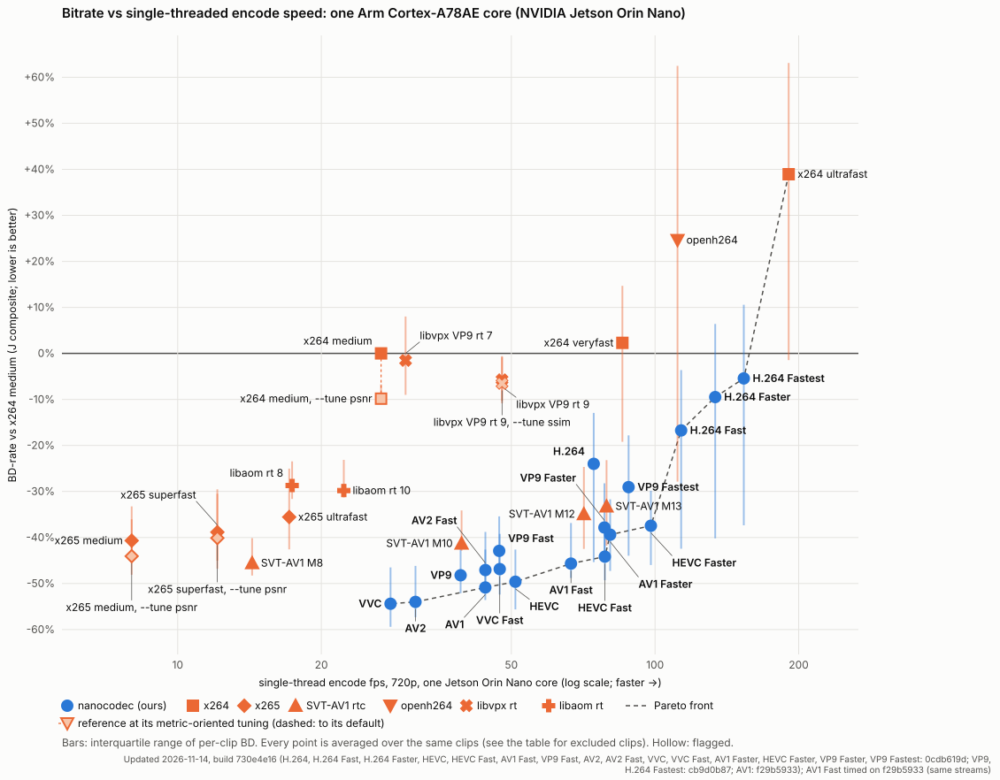
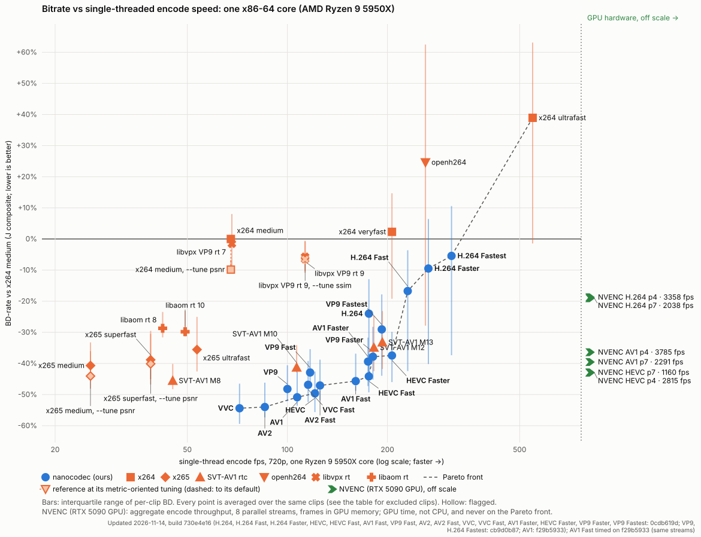

# Development chart: the clips we tune beside

This is the chart that used to lead the README. Its 11 natural camera clips (our VAL set: bodycam, crowd, low
light, pan, static) were used to rank candidate changes during development, so it is **not independent of the
tuning**. The README's headline is the [held-out chart](bd-vs-speed-independent_fresh_2026-11-13.md) on 138 clips
from sources nothing had used. This page is kept for development: it is quick to refresh after each change
(about 50 points per encoder instead of about 1,200).

For most of our presets the numbers here are **more favourable** than on the held-out clips (for example AV1
Default −50.7% here, −45.3% on the 137 fresh clips); for our H.264 presets they are less favourable. Read every
number on this page as an upper estimate for our newer-codec presets.

Same method, ladder, window (150 frames, one key frame), metric (BD-J: PSNR-YUV, VMAF v1, MS-SSIM in thirds)
and speed axis as the held-out chart; builds and every command line: [bd-vs-speed.md](bd-vs-speed.md).

| Encoder | BD-J, 11 development clips | BD-J, 137 fresh held-out clips | vs x264 `medium --tune psnr`, 11 development clips |
|---|---:|---:|---:|
| VVC | −54.4% | −51.1% | −47.5% |
| AV2 | −54.0% | −49.2% | −47.2% |
| HEVC | −49.6% | −47.0% | −42.1% |
| VP9 | −48.5% | −45.4% | −40.6% |
| AV1 | −50.7% | −45.3% | −43.3% |
| AV1 Fast | −45.7% | −40.2% | −37.6% |
| HEVC Fast | −44.2% | −40.0% | −35.9% |
| SVT-AV1 M8 | −45.5% | −42.2% | −37.1% |
| x265 medium | −40.7% | −30.3% | −31.6% |
| SVT-AV1 M12 | −34.9% | −29.1% | −25.1% |
| H.264 | −24.0% | −28.7% | −14.5% |
| H.264 Fast | −16.7% | −21.5% | −6.6% |
| H.264 Faster | −9.5% | −14.5% | +1.3% |
| H.264 Fastest | −2.0% | −7.4% | +9.1% |
| x264 medium | 0 | 0 | +13.0% |
| openh264 | +24.6% | +14.2% | +42.8% |

BD-J vs x264 `medium` (default tuning) unless the column says otherwise; development-clip values from
[bd-vs-speed.md](bd-vs-speed.md), held-out values from
[bd-vs-speed-independent_fresh_2026-11-13.md](bd-vs-speed-independent_fresh_2026-11-13.md). The development
chart's per-metric tables, selected pairs and metric-tuned references are on [bd-vs-speed.md](bd-vs-speed.md).
