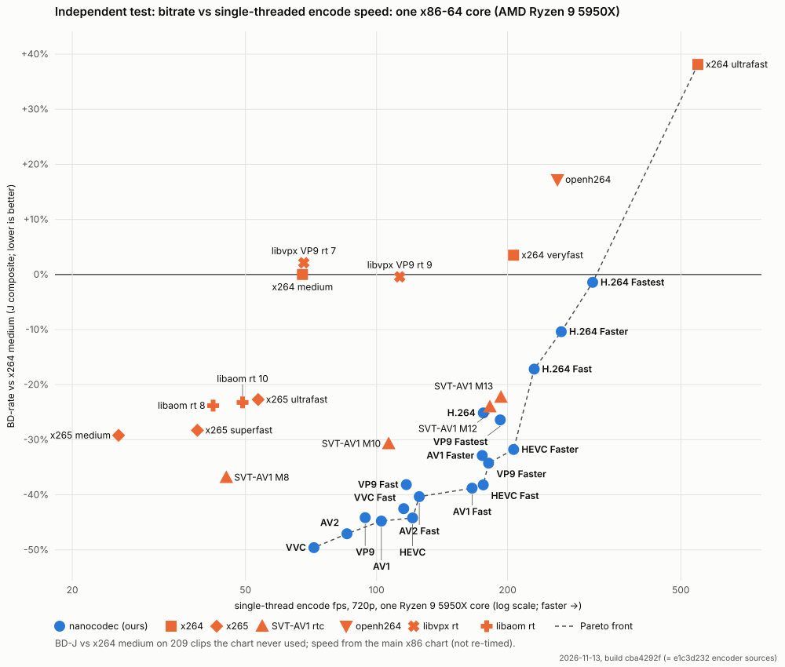

# Independent test (2026-11-13)

Every encoder of the published chart, re-measured at the current code on 209 clips that the chart never used:

- 138 clips from sources that no clip set, tuning study or screen has ever touched;
- 71 clips from the screening pool (the 2026-11-12 held-out set).

Each family is compared with x264 `medium` on PSNR-Y, PSNR-YUV, VMAF v1 and MS-SSIM separately, and on BD-J, with
95% bootstrap intervals. The encodes ran on rented machines; the scoring is described under
[How it was run](#how-it-was-run).

This page says what was measured, not more. The results describe these 209 clips, coded at low-delay CBR, one
thread, 150 frames from frame 0, one key frame, at the real-use ladder (150–1200 kbps at 720p30, pixel-rate
scaled, at most half the source rate, plus 40/75 kbps on clips that need them), against the stated encoder
versions and settings. They are not a statement about the encoders in general. The companion
[rate-control audit](rate-control-audit-2026-11-13.md) covers rate, buffer, frames, reference settings and window
length; read it with this page. Previous check: [heldout-chart-2026-11-12.md](heldout-chart-2026-11-12.md).

## Findings, unfavourable first

1. **"Held-out" was not fully independent.** The 71 clips of the 2026-11-12 check come from the screening pool,
   which the adoption screens and tune studies have used since 2026-11-11. This run therefore adds 138 clips from
   sources nothing has used, and reports both groups separately.
2. **Our gaps against x264 medium are smaller here than on the chart.** BD-J on the 209 clips vs on the chart's
   11 clips:

   | | here | chart |
   |---|---:|---:|
   | VVC | −49.6 [−51.6, −47.7] | −54.0 |
   | AV2 | −47.1 [−48.8, −45.3] | −53.7 |
   | AV1 | −44.8 [−46.9, −42.9] | −50.9 |
   | HEVC | −44.2 [−45.7, −42.6] | −49.3 |
   | VP9 | −44.1 [−45.8, −42.5] | −48.1 |
   | H.264 | −25.1 [−27.9, −22.3] | −23.0 (better here) |

   Our presets other than H.264 lose 1.4–6.6 points; our H.264 presets gain 0.6–2.1. The reference encoders lose
   more: SVT-AV1 M12 −24.0 vs −34.9, x265 medium −29.2 vs −40.7, SVT-AV1 M8 −36.8 vs −45.6. So against x264
   medium, the chart's 11 clips favour almost every encoder, and the references most.
3. **Against x264 medium with `--tune psnr` the gaps are 6–10 points smaller.** That setting turns off x264's
   psycho-visual optimisations, which cost it on all three metrics (see the [audit](rate-control-audit-2026-11-13.md#1-reference-settings-x264-and-x265-lose-bits-to-their-psycho-visual-defaults-unfavourable)).
   BD-J on the 209 clips:

   | | vs x264 medium `--tune psnr` |
   |---|---:|
   | VVC | −42.9 [−45.2, −40.9] |
   | AV2 | −40.2 [−42.1, −38.4] |
   | AV1 | −37.5 [−39.8, −35.5] |
   | HEVC | −36.9 [−38.4, −35.5] |
   | VP9 | −36.8 [−38.7, −35.0] |
   | H.264 | −15.6 [−18.4, −12.8] |
   | H.264 Fast | −6.9 [−10.4, −3.2] |
   | H.264 Faster | +0.7 [−2.7, +4.3] |
   | H.264 Fastest | +10.7 [+6.1, +15.3] |
   | references: SVT-AV1 M8 / x265 medium `--tune psnr` / SVT-AV1 M12 | −27.9 / −23.7 / −13.8 |

   On these clips our H.264 Faster does not use fewer bits than a PSNR-tuned x264 medium, and H.264 Fastest uses
   more.
4. **H.264 Fastest's MS-SSIM is worse than x264 medium's.** +10.1% [+4.8, +15.3] on these clips. Its BD-J is
   −1.4 [−5.9, +2.9], which is not different from zero.
5. **Our rate overshoots and our first key frame exceeds a strict 1 s buffer on many points** (at the build
   measured; see the note at the end of this item).
   - On these clips 24–43% of each preset's ladder points peak above one buffer (max 1.44), against ≤ 2% for
     x264, x265 and SVT-AV1.
   - Our strict buffer settings cost 6.8–9.1% bits and move BD-J by 3–4 points (30-clip subset).
   - Over 150 frames our streams land a median 4–5% above target; x264 lands 8% below.
   - BD uses the achieved bytes for every encoder, so the overshoot is counted on the rate axis. Details in the
     audit.
   - These buffer and rate figures are at the build measured (cba4292f). Since then (62788659, 71cad753) the long-run rate is held at or under the target and the key loan is repaid within 5 s instead of 10 s; key frames are still not capped at one buffer, so key-second peaks of up to about 1.4 buffers remain.
6. **Other reference settings change some reference gaps by large amounts** (30-clip subset; the audit has the
   details):
   - **Better:** x264/x265 with lookahead and B-frames (not low delay) need 30% / 27% fewer bits.
   - **Worse:** x264 with 4 sliced threads needs 18% more bits; SVT-AV1's default low-delay hierarchy needs 4%
     more, so flat P is the better of the two for SVT.
   - **WebRTC rate-control settings for libvpx/libaom:** BD-J 12% better, but they miss their targets (median
     1.3–1.6×, up to 29×) and fail the rate-valid rule on 57–65% of points.
   - **libvpx `--good`:** 36% fewer bits than x264 medium, against −1.5% for rt cpu 7. It is not a real-time
     setting.
7. **The 5 s window and the low rates favour our numbers** (audit sections 3 and 5).
   - **Longer window.** Over 600 frames on 5 longer clips (not independent: 3 are TRAIN clips), our BD-J vs x264
     medium is 4–9 points less favourable than over 150 frames.
   - **Higher rates.** On 10–11 clips with room above the ladder, our gaps over the upper range (the top two
     ladder rungs, 600 and 1200 kbps, plus 2,400 and 4,000 kbps at 720p30) are about half those at the chart's
     rates (AV1 −24.8% vs −47.2% on the same 30-clip subset).

## Update (2026-11-13, later): the new rate control, and a 20 s window

**What was re-measured.** Our encoders at the verified head 8b492382, which carries the rate-control change
62788659 + 71cad753 (long-run rate at or under target; a key's loan is repaid in 5 s). They ran on the same 209
clips, scored as above. Reference points were reused, since their tools did not change. The tables above are the
earlier build, cba4292f. The held-out chart pages at this build are
[bd-vs-speed-independent_fresh_2026-11-13.md](bd-vs-speed-independent_fresh_2026-11-13.md) (the 138 fresh
clips) and [bd-vs-speed-independent_2026-11-13.md](bd-vs-speed-independent_2026-11-13.md) (all 209). CSVs:
`independent-2026-11-13/heldout-8b492382-*.csv`.

**150 frames, one key.** BD-J vs x264 medium on all 209 clips, at 8b492382 (and at cba4292f):

| | all 209 | fresh 138 | vs x264 medium `--tune psnr` (209) |
|---|---:|---:|---:|
| VVC | −49.2 [−50.8, −47.6] (−49.6) | −51.3 [−53.6, −48.9] | −42.4 [−44.2, −40.8] (−42.9) |
| AV2 | −47.2 [−49.0, −45.5] (−47.1) | −49.5 [−51.9, −47.1] | −40.3 [−42.1, −38.5] (−40.2) |
| AV1 | −44.5 [−46.7, −42.7] (−44.8) | −45.6 [−47.6, −43.5] | −37.1 [−39.5, −35.0] (−37.5) |
| HEVC | −44.3 [−45.9, −42.6] (−44.2) | −47.1 [−49.3, −44.9] | −37.0 [−38.6, −35.5] (−36.9) |
| VP9 | −44.0 [−45.6, −42.3] (−44.1) | −45.6 [−48.0, −43.2] | −36.5 [−38.3, −34.8] (−36.8) |
| H.264 | −25.0 [−27.8, −22.2] (−25.1) | −28.7 [−31.0, −26.4] | −15.5 [−18.3, −12.7] (−15.6) |
| H.264 Faster | −9.3 [−13.7, −4.7] (−10.4) | −14.6 [−17.9, −11.4] | +1.9 [−2.6, +6.7] (+0.7) |
| H.264 Fastest | −1.6 [−6.1, +2.9] (−1.4) | −7.4 [−11.1, −3.7] | +10.6 [+5.9, +15.4] (+10.7) |

The change moves every preset by at most 1.1 points, inside the intervals.

Rate, our Defaults:

- Our median achieved rate is now 0.98–0.99 of target (it was 1.04–1.05). x264 medium's is 0.92.
- Points peaking above the strict 1 s buffer: 176–253 of 778 per Default (23–33%), still against ≤ 2% for x264,
  x265 and SVT-AV1.
- The highest peak is still 1.34–1.41 buffers.

**600 frames, a key every 10 s** (`--frames 600 --key-seconds 10`). The 71 fresh sources long enough for it,
re-cut as 21 s excerpts (`eval/clipset/independent_long.json`): crowd 19, pan 17, static 16, body-cam 13, low
light 6. Our 6 Defaults and the main references, beside the same 71 sources at 150 frames with one key. BD-J vs
x264 medium:

| | 150 frames | 600 frames | vs x264 `--tune psnr`, 150 → 600 | achieved ÷ target at 600 (median) |
|---|---:|---:|---:|---:|
| VVC | −52.8 [−55.2, −50.0] | −45.3 [−47.8, −42.7] | −45.3 → −36.6 | 0.988 |
| AV2 | −51.1 [−53.8, −48.1] | −43.7 [−46.3, −41.0] | −43.5 → −34.8 | 0.989 |
| HEVC | −48.3 [−50.7, −45.6] | −40.9 [−43.3, −38.5] | −40.4 → −31.7 | 0.988 |
| AV1 | −47.1 [−49.3, −44.6] | −40.8 [−43.1, −38.4] | −39.1 → −31.6 | 0.989 |
| VP9 | −47.4 [−49.9, −44.5] | −40.1 [−42.5, −37.6] | −39.3 → −30.6 | 0.989 |
| H.264 | −29.8 [−32.7, −26.8] | −19.8 [−22.0, −17.7] | −19.6 → −8.2 | 0.988 |
| SVT-AV1 M8 | −43.8 [−45.9, −41.5] | −41.1 [−43.2, −39.0] | −34.7 → −31.4 | 1.004 |
| SVT-AV1 M12 | −31.6 [−34.8, −27.9] | −27.1 [−30.2, −23.9] | −21.0 → −15.6 | 1.004 |
| x265 medium `--tune psnr` | −34.1 [−36.5, −31.4] | −36.3 [−38.7, −33.7] | −24.4 → −26.7 | 0.986 |
| x265 medium | −30.4 [−32.6, −28.1] | −32.2 [−34.5, −29.6] | −19.7 → −21.3 | 0.989 |
| libaom rt 8 | −29.4 [−31.3, −27.5] | −21.2 [−23.3, −18.8] | −18.1 → −9.2 | 1.009 |
| libvpx VP9 rt 9 | −4.6 [−6.6, −2.4] | +2.4 [−0.0, +5.0] | +10.1 → +17.6 | 1.005 |
| x264 medium `--tune psnr` | −10.9 [−12.3, −9.6] | −11.4 [−12.8, −9.9] | | 0.963 |
| x264 medium | 0 | 0 | | 0.962 |

**Unfavourable, first.**

- Over 20 s our gaps against x264 medium are 6–10 points smaller than over 5 s: AV1 −47.1 → −40.8,
  H.264 −29.8 → −19.8.
- The references move less (SVT-AV1 M8 2.7 points), or gain (x265 medium 1.8). Against x264 `--tune psnr`, our
  Defaults are −31 to −37 at 600 frames (H.264 −8.2).
- The ordering among the AV1/HEVC/VP9-class encoders changes: at 600 frames SVT-AV1 M8 (−41.1) is level with our
  AV1, HEVC and VP9 Defaults (−40.1 to −40.9). Its speed is 0.62× x264 medium on x86, ours 1.4–1.8×.
- 74–94 of our 252 points per Default still peak above the strict 1 s buffer at 600 frames (keys every 10 s),
  against 10 for x264 and 20–27 for SVT-AV1.

**What this cannot show.** It covers 71 sources from 5 classes. The key period differs between the two columns:
one key at 150 frames, one every 10 s at 600. Presets were tuned on 150-frame windows. The 600-frame points'
low rungs ran on 9 clips only.

## Results

All numbers are BD vs x264 medium in %, negative = fewer bits for the same quality, with [95% bootstrap over
clips, within class]. "clips (J)" counts the clips with a BD-J (enough curve overlap). The "chart" column is the
published chart's BD-J on its own 11 clips, at that page's builds. Rows marked `~` or not on the chart are
references added for this run. CSV: [independent-2026-11-13.csv](independent-2026-11-13.csv) (every family ×
group × metric with intervals), and the audit tables in [independent-2026-11-13/](independent-2026-11-13/).

The speed axis is copied from the main x86 chart (Ryzen 9 5950X); it was not re-timed for this run. Families
without an x86 time are not drawn: x264 faster, SVT-AV1 M9/M11 and the metric-tuned rows.

### Every family, all 209 clips

| Family | BD-J | PSNR-Y | PSNR-YUV | VMAF v1 | MS-SSIM | clips (J) | chart BD-J |
|---|---|---|---|---|---|---|---|
| VVC | -49.6 [-51.6, -47.7] | -51.2 [-53.5, -48.9] | -51.5 [-53.7, -49.5] | -52.9 [-54.5, -51.3] | -44.4 [-46.9, -42.1] | 209/209 | -53.98 |
| AV2 | -47.1 [-48.8, -45.3] | -46.7 [-49.5, -43.9] | -52.1 [-54.2, -50.0] | -49.4 [-50.8, -47.9] | -39.7 [-42.6, -36.9] | 208/209 | -53.67 |
| AV1 | -44.8 [-46.9, -42.9] | -46.0 [-48.8, -43.4] | -49.6 [-52.1, -47.4] | -45.5 [-47.2, -43.8] | -39.2 [-42.0, -36.6] | 209/209 | -50.87 |
| HEVC | -44.2 [-45.7, -42.6] | -44.9 [-47.2, -42.5] | -46.2 [-48.2, -44.0] | -47.2 [-49.0, -45.1] | -39.2 [-41.3, -37.0] | 209/209 | -49.26 |
| VP9 | -44.1 [-45.8, -42.5] | -45.3 [-47.0, -43.6] | -47.1 [-48.7, -45.4] | -45.9 [-47.5, -44.3] | -39.4 [-41.7, -37.4] | 209/209 | -48.13 |
| VVC Fast | -42.5 [-44.6, -40.5] | -46.0 [-48.5, -43.6] | -42.6 [-45.1, -40.3] | -44.9 [-46.5, -43.2] | -40.0 [-42.6, -37.5] | 209/209 | -46.45 |
| AV2 Fast | -40.3 [-42.2, -38.4] | -44.4 [-47.1, -41.7] | -43.6 [-46.2, -41.3] | -41.2 [-43.3, -38.9] | -36.1 [-39.0, -33.3] | 209/209 | -46.23 |
| AV1 Fast | -38.8 [-41.4, -36.5] | -37.4 [-41.0, -34.0] | -39.5 [-43.1, -36.5] | -41.0 [-42.8, -39.2] | -35.8 [-38.9, -33.0] | 209/209 | -44.90 |
| HEVC Fast | -38.2 [-40.0, -36.3] | -39.0 [-41.3, -36.6] | -39.4 [-41.3, -37.2] | -41.3 [-42.9, -39.6] | -33.9 [-36.0, -31.7] | 209/209 | -43.40 |
| VP9 Fast | -38.1 [-39.9, -36.3] | -36.6 [-38.6, -34.5] | -39.5 [-41.4, -37.3] | -40.9 [-42.6, -39.1] | -34.1 [-36.3, -31.7] | 209/209 | -42.36 |
| SVT-AV1 M8 | -36.8 [-38.8, -34.8] | -47.8 [-48.8, -46.7] | -41.9 [-43.4, -40.2] | -34.3 [-38.6, -30.3] | -36.4 [-38.1, -34.6] | 208/209 | -45.55 |
| VP9 Faster | -34.2 [-36.5, -31.9] | -35.4 [-38.1, -32.5] | -34.5 [-37.5, -31.5] | -37.3 [-39.3, -35.2] | -30.9 [-33.4, -28.4] | 209/209 | -37.12 |
| svtav1-m9 | -33.2 [-35.8, -30.5] | -43.8 [-45.4, -42.1] | -37.6 [-39.9, -35.2] | -31.6 [-36.0, -27.0] | -32.3 [-34.7, -30.0] | 208/209 |  |
| AV1 Faster | -32.9 [-35.4, -30.4] | -30.8 [-34.2, -27.7] | -33.3 [-36.3, -30.4] | -34.5 [-36.6, -32.5] | -30.8 [-33.7, -27.9] | 209/209 | -38.75 |
| x265-medium~psnr | -32.3 [-35.0, -29.7] | -39.2 [-40.6, -37.6] | -34.7 [-37.6, -32.1] | -33.8 [-37.2, -30.3] | -28.4 [-30.6, -26.5] | 209/209 |  |
| HEVC Faster | -31.8 [-33.6, -29.8] | -35.2 [-37.4, -32.8] | -31.7 [-33.8, -29.5] | -33.4 [-35.7, -30.8] | -30.3 [-32.2, -28.2] | 209/209 | -36.03 |
| x265-medium~ssim | -30.8 [-33.6, -28.2] | -36.0 [-37.7, -34.3] | -32.2 [-35.2, -29.5] | -29.8 [-33.4, -26.1] | -30.5 [-32.5, -28.7] | 209/209 |  |
| SVT-AV1 M10 | -30.7 [-33.1, -28.3] | -40.0 [-41.5, -38.3] | -34.1 [-36.3, -31.8] | -30.1 [-34.1, -26.1] | -29.8 [-31.8, -27.7] | 208/209 | -41.30 |
| svtav1-m11 | -30.5 [-32.7, -28.5] | -36.7 [-38.6, -34.8] | -32.1 [-34.5, -29.9] | -29.8 [-32.5, -27.2] | -29.6 [-31.5, -27.8] | 209/209 |  |
| x265 medium | -29.2 [-32.0, -26.6] | -33.6 [-35.4, -32.0] | -29.3 [-32.3, -26.6] | -28.6 [-32.3, -24.8] | -29.7 [-31.6, -28.0] | 209/209 | -40.68 |
| x265 superfast | -28.3 [-30.9, -25.9] | -32.8 [-34.5, -30.8] | -27.9 [-30.2, -25.9] | -30.2 [-33.4, -27.0] | -26.8 [-29.3, -24.4] | 209/209 | -38.84 |
| VP9 Fastest | -26.4 [-29.1, -23.6] | -27.0 [-30.2, -23.8] | -26.1 [-29.5, -22.7] | -32.8 [-34.9, -30.7] | -20.3 [-23.2, -17.2] | 209/209 | -27.84 |
| H.264 | -25.1 [-27.9, -22.3] | -25.1 [-28.0, -22.4] | -29.2 [-32.0, -26.5] | -28.6 [-31.9, -24.6] | -17.5 [-20.5, -14.6] | 209/209 | -23.04 |
| SVT-AV1 M12 | -24.0 [-27.5, -20.9] | -31.9 [-34.5, -29.5] | -25.6 [-29.3, -22.3] | -23.4 [-27.4, -19.5] | -23.1 [-26.0, -20.5] | 209/209 | -34.91 |
| libaom rt 8 | -23.8 [-25.5, -22.2] | -34.0 [-35.6, -32.5] | -22.9 [-24.7, -20.9] | -25.9 [-27.5, -24.3] | -22.7 [-24.6, -20.7] | 208/209 | -28.70 |
| libaom-av1-cpu8~ssim | -23.6 [-25.4, -21.8] | -30.4 [-32.1, -28.7] | -21.2 [-23.1, -19.3] | -21.1 [-23.1, -19.0] | -28.5 [-30.2, -26.8] | 209/209 |  |
| libaom rt 10 | -23.2 [-24.7, -21.6] | -33.7 [-35.1, -32.3] | -24.1 [-26.0, -22.2] | -24.0 [-25.5, -22.5] | -21.5 [-23.4, -19.5] | 209/209 | -29.81 |
| x265 ultrafast | -22.7 [-25.6, -20.1] | -26.1 [-28.1, -23.9] | -21.6 [-24.1, -19.2] | -25.0 [-28.4, -21.6] | -21.6 [-24.5, -19.0] | 209/209 | -35.55 |
| SVT-AV1 M13 | -22.3 [-26.0, -19.0] | -29.6 [-32.6, -26.9] | -23.3 [-27.4, -19.7] | -21.8 [-26.0, -17.8] | -21.7 [-24.7, -19.2] | 209/209 | -33.23 |
| H.264 Fast | -17.2 [-20.6, -13.6] | -17.1 [-20.3, -13.8] | -21.7 [-24.9, -18.4] | -21.0 [-25.9, -14.4] | -8.9 [-12.4, -5.6] | 209/209 | -16.17 |
| H.264 Faster | -10.4 [-13.9, -7.0] | -8.1 [-12.3, -4.1] | -14.9 [-18.6, -11.1] | -14.9 [-18.1, -11.7] | -1.3 [-5.4, +2.7] | 209/209 | -8.48 |
| x264-medium~psnr | -9.8 [-10.8, -8.7] | -14.1 [-15.4, -12.7] | -9.1 [-10.9, -6.8] | -19.5 [-20.9, -18.1] | -0.9 [-2.1, +0.3] | 209/209 |  |
| H.264 Fastest | -1.4 [-5.9, +2.9] | +1.1 [-4.0, +6.0] | -7.2 [-11.4, -3.0] | -7.1 [-11.4, -2.6] | +10.1 [+4.8, +15.3] | 209/209 | -0.76 |
| x264-medium~ssim | -1.2 [-2.9, +1.1] | -4.7 [-5.4, -4.0] | -2.7 [-3.3, -2.1] | +3.4 [-0.6, +10.1] | -4.3 [-5.0, -3.8] | 209/209 |  |
| libvpx VP9 rt 9 | -0.4 [-1.7, +0.8] | -13.4 [-14.7, -12.2] | +5.3 [+3.9, +6.7] | -6.4 [-8.3, -4.4] | -0.9 [-2.2, +0.4] | 208/209 | -5.72 |
| x264-faster | +0.0 [-0.9, +0.9] | -3.3 [-4.4, -2.2] | -1.2 [-2.4, -0.0] | +2.1 [+1.1, +3.1] | -0.8 [-1.6, +0.0] | 209/209 |  |
| libvpx-vp9-cpu7~ssim | +1.4 [-0.0, +2.8] | -9.3 [-10.9, -7.8] | +6.1 [+4.7, +7.5] | +0.5 [-1.5, +2.5] | -2.5 [-4.1, -0.8] | 209/209 |  |
| libvpx VP9 rt 7 | +2.1 [+0.7, +3.7] | -11.9 [-13.4, -10.4] | +6.5 [+5.0, +8.1] | -3.9 [-5.9, -1.8] | +3.8 [+1.7, +5.8] | 209/209 | -1.52 |
| x264 veryfast | +3.5 [+2.0, +5.0] | -0.8 [-2.9, +1.5] | +1.2 [-0.5, +3.0] | +4.5 [+2.8, +6.2] | +4.8 [+3.2, +6.5] | 209/209 | 2.28 |
| openh264 | +17.2 [+10.2, +24.9] | +9.4 [+2.9, +15.8] | +12.5 [+5.6, +19.7] | +15.5 [+9.2, +22.2] | +23.7 [+15.3, +32.6] | 209/209 | 24.62 |
| x264 ultrafast | +38.1 [+34.6, +41.7] | +48.3 [+43.9, +53.1] | +50.8 [+45.9, +55.9] | +14.6 [+11.8, +17.3] | +48.9 [+44.5, +53.3] | 209/209 | 38.93 |

### By clip group (BD-J): never-used sources vs screening-pool clips

Against x264 medium, the fresh sources favour almost every family a little more than the pool clips do, ours and
references alike. Our presets differ between the groups by 2.2 (AV1) to 14.1 points (H.264 Fastest), our four H.264
presets the most (8.7–14.1). The references differ by 0.6 (x264 medium `--tune psnr`) to 15.1 (x264
ultrafast). Each group is class-balanced over its own clips, so the class mix differs between them too.

| Family | all | fresh | pool | chart |
|---|---|---|---|---|
| VVC | -49.58 [-51.61, -47.72] | -51.14 [-53.55, -48.67] | -47.59 [-50.00, -45.41] | -53.98 |
| AV2 | -47.06 [-48.82, -45.25] | -49.17 [-51.58, -46.48] | -45.40 [-47.60, -43.25] | -53.67 |
| AV1 | -44.76 [-46.91, -42.89] | -45.62 [-47.76, -43.46] | -43.44 [-45.95, -41.16] | -50.87 |
| HEVC | -44.19 [-45.70, -42.56] | -46.88 [-49.17, -44.56] | -41.93 [-43.92, -40.00] | -49.26 |
| VP9 | -44.14 [-45.85, -42.48] | -45.41 [-47.82, -42.93] | -42.43 [-44.50, -40.40] | -48.13 |
| VVC Fast | -42.50 [-44.60, -40.50] | -44.74 [-47.62, -41.80] | -39.93 [-42.44, -37.67] | -46.45 |
| AV2 Fast | -40.32 [-42.17, -38.37] | -43.21 [-46.45, -39.93] | -37.93 [-40.30, -35.62] | -46.23 |
| AV1 Fast | -38.78 [-41.42, -36.46] | -40.43 [-43.55, -37.37] | -36.82 [-39.86, -34.11] | -44.90 |
| HEVC Fast | -38.19 [-39.95, -36.31] | -39.99 [-42.55, -37.28] | -35.65 [-37.99, -33.44] | -43.40 |
| VP9 Fast | -38.14 [-39.94, -36.25] | -40.19 [-43.34, -37.03] | -35.66 [-37.85, -33.49] | -42.36 |
| SVT-AV1 M8 | -36.85 [-38.83, -34.80] | -42.73 [-45.00, -40.51] | -35.45 [-37.72, -33.12] | -45.55 |
| VP9 Faster | -34.24 [-36.47, -31.91] | -36.14 [-39.74, -32.46] | -31.33 [-34.13, -28.57] | -37.12 |
| svtav1-m9 | -33.16 [-35.77, -30.50] | -38.99 [-41.63, -36.20] | -31.94 [-34.83, -29.09] |  |
| AV1 Faster | -32.86 [-35.38, -30.37] | -34.78 [-38.56, -30.91] | -30.43 [-33.53, -27.59] | -38.75 |
| x265-medium~psnr | -32.31 [-35.03, -29.72] | -33.89 [-35.82, -31.78] | -32.58 [-35.52, -29.61] |  |
| HEVC Faster | -31.77 [-33.64, -29.80] | -34.06 [-37.23, -30.76] | -28.74 [-31.33, -26.33] | -36.03 |
| x265-medium~ssim | -30.82 [-33.62, -28.20] | -31.86 [-33.61, -29.91] | -31.16 [-34.07, -28.30] |  |
| SVT-AV1 M10 | -30.72 [-33.05, -28.27] | -36.09 [-38.88, -33.15] | -29.23 [-31.89, -26.62] | -41.30 |
| svtav1-m11 | -30.54 [-32.67, -28.47] | -34.41 [-37.38, -31.46] | -28.61 [-31.33, -26.05] |  |
| x265 medium | -29.20 [-32.05, -26.58] | -30.62 [-32.40, -28.69] | -29.24 [-32.22, -26.28] | -40.68 |
| x265 superfast | -28.28 [-30.89, -25.86] | -30.63 [-32.88, -28.18] | -27.61 [-30.36, -24.87] | -38.84 |
| VP9 Fastest | -26.39 [-29.07, -23.64] | -29.54 [-33.15, -25.91] | -21.88 [-25.44, -18.54] | -27.84 |
| H.264 | -25.12 [-27.89, -22.31] | -28.51 [-30.85, -26.26] | -19.81 [-23.82, -16.26] | -23.04 |
| SVT-AV1 M12 | -24.02 [-27.46, -20.93] | -29.74 [-32.83, -26.61] | -22.02 [-25.88, -18.45] | -34.91 |
| libaom rt 8 | -23.80 [-25.47, -22.16] | -27.69 [-29.36, -25.99] | -22.47 [-24.59, -20.27] | -28.70 |
| libaom-av1-cpu8~ssim | -23.60 [-25.41, -21.83] | -27.67 [-29.35, -26.15] | -21.88 [-23.96, -19.69] |  |
| libaom rt 10 | -23.21 [-24.75, -21.63] | -27.62 [-29.49, -25.83] | -21.67 [-23.89, -19.49] | -29.81 |
| x265 ultrafast | -22.70 [-25.62, -20.08] | -24.56 [-27.48, -21.41] | -21.97 [-25.19, -18.78] | -35.55 |
| SVT-AV1 M13 | -22.29 [-25.98, -19.03] | -27.76 [-31.14, -24.37] | -19.97 [-23.91, -16.12] | -33.23 |
| H.264 Fast | -17.18 [-20.65, -13.61] | -21.10 [-23.85, -18.43] | -11.16 [-15.94, -6.85] | -16.17 |
| H.264 Faster | -10.38 [-13.91, -7.03] | -14.32 [-17.61, -11.13] | -3.02 [-7.83, 1.69] | -8.48 |
| x264-medium~psnr | -9.82 [-10.85, -8.70] | -10.20 [-11.10, -9.23] | -9.58 [-10.92, -8.25] |  |
| H.264 Fastest | -1.42 [-5.85, 2.89] | -6.83 [-10.57, -3.18] | 7.23 [1.30, 12.97] | -0.76 |
| x264-medium~ssim | -1.21 [-2.90, 1.13] | -2.15 [-2.95, -1.40] | -0.99 [-2.71, 1.39] |  |
| libvpx VP9 rt 9 | -0.43 [-1.66, 0.83] | -2.39 [-4.11, -0.64] | -0.05 [-1.96, 1.82] | -5.72 |
| x264-faster | 0.03 [-0.92, 0.91] | 0.12 [-1.00, 1.22] | 1.28 [0.22, 2.32] |  |
| libvpx-vp9-cpu7~ssim | 1.37 [-0.04, 2.76] | 0.48 [-1.36, 2.29] | 1.53 [-0.64, 3.72] |  |
| libvpx VP9 rt 7 | 2.13 [0.65, 3.69] | 0.40 [-1.61, 2.29] | 2.23 [-0.08, 4.47] | -1.52 |
| x264 veryfast | 3.51 [2.04, 5.00] | -0.76 [-2.87, 1.64] | 8.17 [6.09, 10.21] | 2.28 |
| openh264 | 17.22 [10.22, 24.85] | 14.30 [9.45, 19.74] | 23.37 [14.38, 32.24] | 24.62 |
| x264 ultrafast | 38.13 [34.61, 41.68] | 31.89 [26.83, 37.19] | 47.01 [42.59, 51.32] | 38.93 |

### By content class (BD-J, class means)

| Family | bodycam (23) | crowd (57) | drone (3) | lowlight (15) | pan (53) | static (55) | texture (3) |
|---|---|---|---|---|---|---|---|
| H.264 | -7.0 | -26.8 | -35.0 | -27.5 | -20.1 | -37.7 | -21.8 |
| H.264 Fast | +0.9 | -19.0 | -28.6 | -19.5 | -10.7 | -30.3 | -13.2 |
| H.264 Faster | +8.3 | -12.1 | -19.9 | -11.8 | +0.7 | -24.3 | -13.5 |
| H.264 Fastest | +18.9 | -4.1 | -12.2 | -0.8 | +9.4 | -18.2 | -2.9 |
| HEVC | -38.5 | -44.5 | -43.1 | -50.0 | -43.6 | -48.7 | -41.0 |
| HEVC Fast | -31.9 | -38.4 | -34.9 | -41.9 | -36.6 | -41.6 | -42.0 |
| HEVC Faster | -27.3 | -32.5 | -30.3 | -36.2 | -27.0 | -35.3 | -33.8 |
| AV1 | -39.9 | -45.4 | -43.3 | -46.6 | -44.4 | -48.1 | -45.5 |
| AV1 Fast | -34.8 | -40.2 | -36.3 | -39.2 | -38.2 | -42.5 | -40.2 |
| AV1 Faster | -31.0 | -33.8 | -27.9 | -30.5 | -31.6 | -37.2 | -38.0 |
| VP9 | -39.8 | -43.0 | -41.6 | -49.6 | -42.2 | -46.4 | -46.5 |
| VP9 Fast | -35.5 | -38.2 | -35.6 | -42.0 | -35.3 | -40.2 | -40.2 |
| VP9 Faster | -30.6 | -35.3 | -32.5 | -36.2 | -28.2 | -38.1 | -38.7 |
| VP9 Fastest | -20.2 | -29.3 | -23.3 | -22.4 | -21.3 | -33.7 | -34.6 |
| AV2 | -44.6 | -47.3 | -40.4 | -51.3 | -46.6 | -50.1 | -48.9 |
| AV2 Fast | -40.8 | -41.1 | -33.4 | -43.8 | -38.1 | -42.8 | -42.2 |
| VVC | -45.7 | -48.9 | -47.2 | -52.7 | -48.2 | -52.4 | -51.9 |
| VVC Fast | -40.1 | -42.2 | -38.8 | -47.4 | -38.6 | -45.3 | -45.2 |
| openh264 | +40.3 | +16.9 | -12.4 | +7.3 | +42.1 | -12.5 | +38.9 |
| x264 ultrafast | +36.3 | +39.0 | +45.5 | +30.7 | +59.9 | +31.5 | +23.8 |
| x264 veryfast | +6.0 | +2.4 | +8.4 | -1.4 | +9.1 | -1.1 | +1.3 |
| x265 ultrafast | -32.1 | -20.6 | -7.1 | -28.9 | -22.9 | -17.4 | -29.8 |
| x265 superfast | -35.8 | -26.4 | -14.5 | -35.2 | -29.3 | -25.7 | -31.0 |
| x265 medium | -33.8 | -25.4 | -16.9 | -37.3 | -34.2 | -25.3 | -31.5 |
| SVT-AV1 M8 | -45.3 | -36.5 | -28.3 | -50.1 | -38.8 | -38.9 | -20.1 |
| SVT-AV1 M10 | -38.2 | -30.6 | -24.3 | -41.9 | -33.1 | -31.8 | -15.1 |
| SVT-AV1 M12 | -28.1 | -24.2 | -15.0 | -37.0 | -25.4 | -26.3 | -12.3 |
| SVT-AV1 M13 | -26.1 | -22.7 | -16.1 | -32.7 | -22.9 | -25.0 | -10.6 |
| libvpx VP9 rt 7 | -4.1 | +2.1 | +18.1 | -7.0 | +0.2 | +12.7 | -7.1 |
| libvpx VP9 rt 9 | -4.9 | -0.7 | +14.0 | -9.5 | +0.0 | +3.8 | -5.8 |
| libaom rt 8 | -27.9 | -25.1 | -7.0 | -32.1 | -26.2 | -21.5 | -26.8 |
| libaom rt 10 | -28.4 | -23.6 | -6.0 | -32.2 | -25.6 | -22.9 | -23.7 |
| x264-faster | +3.3 | +1.3 | +1.2 | -0.4 | +1.6 | +0.0 | -6.8 |
| svtav1-m9 | -41.0 | -33.6 | -26.1 | -45.5 | -35.7 | -35.6 | -14.7 |
| svtav1-m11 | -32.2 | -29.3 | -23.8 | -39.6 | -30.9 | -32.6 | -25.5 |
| x264-medium~psnr | -9.4 | -8.3 | -6.6 | -13.6 | -8.8 | -10.3 | -11.6 |
| x264-medium~ssim | -1.1 | -0.3 | -0.9 | -6.2 | -2.2 | -0.3 | +2.6 |
| x265-medium~psnr | -37.3 | -28.3 | -20.6 | -40.7 | -37.1 | -30.1 | -32.1 |
| x265-medium~ssim | -34.5 | -26.2 | -20.9 | -38.7 | -35.9 | -28.0 | -31.5 |
| libaom-av1-cpu8~ssim | -26.5 | -25.7 | -6.1 | -28.5 | -28.4 | -21.1 | -28.8 |
| libvpx-vp9-cpu7~ssim | -2.3 | +1.4 | +11.4 | -3.5 | -2.9 | +12.8 | -7.2 |

### BD-J by the chart's own method

`nceval.chart.quality_points` chains clips through an intermediate encoder and leaves out clips without direct
overlap, where the tables above leave a clip out per family. Its BD-J is within 1.3 points of the tables above for our
presets and within 2 points for the references, except openh264 (3.4); see `heldout-chart_method.csv`. It drops 3
clips for every family.

## Clips

**The fresh set (138 clips).** `eval/clipset/select_independent.py` drew it from the source inventory
(2,621 videos under `/mldata`). The rules are fixed in that file:

- **Never used.** A source qualifies only if neither its path nor its family key appears in any clip set under
  the data root (TRAIN, VAL, TEST, adv12, the screening pool, the layer-gate fits, long, quick, smoke) or in any
  selection file in `eval/`.
- **Camera recordings only.** Derived composites, edited or re-uploaded content, and sources with a hard cut in
  the inventory's sample are excluded.
- **Gradeable bitrate.** The source's bits per pixel must allow the pool's grading at native size or downscaled 2×.
- **One clip per source.** The draw goes round robin over the classes and, within a class, over datasets, in a
  SHA-256 order seeded with `independent-2026-11-13`.

The draw was capped at 150 clips. 611 sources qualified; lowlight and bodycam had only 10 and 13 sources, and all
of them are in. `eval/clipset/build_pool.py` then stored a 5.5–16.5 s excerpt from 2 s into each source, at
≤ 720 lines, as an x264 CRF 16 encode. 145 built: 5 sources were too short at their frame rate.
`eval/clipset/grade.py` graded them (53 A, 92 B). The screening pool's source-quality rule and the ≥ 3-rung rule
(`aws_heldout_chart.py select --source-set independent`) kept 138.

- By class: pan 42, crowd 39, static 36, bodycam 13, lowlight 8.
- 17 datasets; largest: PersonPath22 35, JAAD 26, BDD100K-MOT 24, BWC-videotext 16.
- Sizes: 960×540 (66), 1280×720 (36), and smaller.

**Independence caveats.**

- **Shared datasets.** 16 of the fresh set's 17 datasets also supply clips to TRAIN, VAL or the pool: other
  videos from the same cameras or collections. Only uvg_vcm appears nowhere else.
- **Re-encoded sources.** The sources are themselves compressed (H.264 mostly), stored again at CRF 16.

**The pool part (71 clips).** This is the 2026-11-12 held-out set: one clip per source family outside
TRAIN/VAL/TEST/chart/adv12. These clips are not independent of tuning. They belong to the screening pool, which
the daily adoption screens (L1/L2/L3) and the tune studies have drawn from since 2026-11-11, so presets adopted
since then have seen some of them. Today's `select` would return 72 clips, 69 of them the same: the pool's
grading has changed since 2026-11-12.

Never used: TEST and adv12 (sealed for milestones).

Clip list with sources, sizes, frame rates, source rates, grades and the stored files' SHA-256:
[independent-2026-11-13-clips.csv](independent-2026-11-13-clips.csv).

## Families and settings

| | |
|---|---|
| Ours | every shipped preset: H.264 Default/Fast/Faster/Fastest, HEVC Default/Fast/Faster, AV1 Default/Fast/Faster, VP9 Default/Fast/Faster/Fastest, AV2 Default/Fast, VVC Default/Fast. Verified head e1c3d232; the scoring build is `charts/builds/cba4292f`, whose encoder sources are identical (the one commit between them touches `tools/` only), `gate` profile; streams are byte-identical to the release/PGO builds (checked) |
| References (chart settings) | x264 0.165 ultrafast / veryfast / **faster** / medium, x265 4.2 ultrafast / superfast / medium, SVT-AV1 v4.3.0 M8 / **M9** / M10 / **M11** / M12 / M13 `--rtc`, libvpx v1.16.0 VP9 rt cpu 7 / 9, libaom v3.15.3 rt cpu 8 / 10, openh264 v2.7.0 (bold: not on the chart) |
| References (metric-tuned) | x264 medium `--tune zerolatency,psnr` / `,ssim`; x265 medium `--tune psnr` / `ssim` (with explicit low-delay flags); libaom cpu 8 and libvpx cpu 7 `--tune=ssim` |
| Extras, 30 clips (class round robin) | our Default of each codec with strict buffer settings, and with frame hold off; x264 / x265 medium with lookahead and B-frames, and with 4 threads; SVT-AV1 M8 / M12 with its default low-delay hierarchy; libvpx / libaom with WebRTC's rate-control settings; libvpx VP9 `--good`; openh264 with AQ; every family at 2,400 and 4,000 kbps (720p30-scaled, within the source cap) |
| Not run | NVENC (local GPU only: its metric-tuning check is in the audit, on the chart clips) |

Command lines: `eval/nceval/cbr.py` `Family.command`, profiles in `ANCHOR_PROFILES`.

## How it was run

**Encode.** Three AWS spot sessions on c7a.metal-48xl (AMD EPYC 9R14, 192 vCPU), eu-north-1, 50,142 + 4,848
encodes. Our encoder's displayed reconstruction was reduced to per-frame xxh3 digests on the instance; only
bitstreams, rate logs, coded-frame times and digests came back. Two clips' remote source decodes were checked
against local decodes.

**Score.** AWS spot sessions with stock libvmaf v3.2.1 (CPU) + `nceval.msssim`, checkpointed every 10 minutes.
Every point is scored on the first standard decoder's output (ffmpeg's libavcodec, or dav1d/dav2d/VVdeC as
`nceval.conformance` picks). For our streams, the decoded frames must equal the encoder's reconstruction digests
frame by frame.

- 200 points re-scored here on the GPU path agree with the cloud's: VMAF identical, PSNR within 1e-14,
  MS-SSIM within 4e-6.
- Two scoring sessions were lost to spot reclaims and run again.

**Analysis.** `tools/dev/independent_report.py` (BD per metric, bootstrap, audit tables) and
`eval/nceval/independent.py`.

**Cost and time** (AWS spot, eu-north-1; the ledger is `~/nanocodec-data/work/aws/ledger.md`):

- encodes: three sessions on c7a.metal-48xl, 69 min of instance time in all, $2.45;
- scoring: six sessions (two lost to spot reclaims), $5.39;
- CBR-vs-QP timing: c7i.metal-24xl, $0.17;
- total $8.01.

Local work on the Ryzen 9 5950X + RTX 5090: the chart-clip extras, the decode check, the GPU cross-check, the
window-length runs and the clean-clone run.

**Speed** is not part of this run. Cloud CPUs differ from the chart's machines, and nothing here was timed on
them except the CBR-vs-QP check in the audit.

## What this run cannot show

- **Not a random sample.** 209 clips from 26 datasets of mostly surveillance, traffic, body-cam and pedestrian
  video, all re-encoded sources, mostly ≤ 720p.
- **Other uses untested.** Film, sport, screen content, 1080p+ capture, and lossless sources beyond the few in
  the pool part.
- **One mode.** Low-delay CBR, one thread, a 5 s window with one key frame. Section 7 of the audit shows the gaps
  shrink over 20 s.
- **Metrics only.** VMAF v1 at native geometry is our internal relative metric (not the 1080p protocol). No
  subjective test was run.
- **Reference settings.** They are the chart's, plus the metric-tuned and "natural" variants listed. Other
  settings of the references may score differently.
