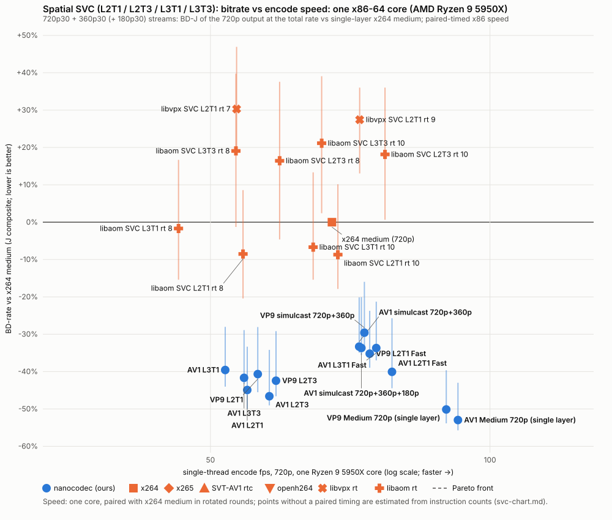

# Spatial scalability (SVC): 720p30 + 360p30 (+ 180p30)

Updated 2026-11-19, build c9cff89f; libaom svc_encoder_rtc v3.15.3, libvpx vp9_spatial_svc_encoder v1.16.0; speed partly estimated from instruction counts (see the notes)

Two-layer AV1 and VP9 streams (360p base, operating point 1; 720p, operating point 0) and three-layer AV1 streams (180p, operating point 2; 360p, 1; 720p, 0) on the main chart's clips, rungs, length and key interval. **Rate is the total stream rate (every layer); quality is J_real of the 720p output**, so BD-J is against single-layer x264 medium at 720p, on the same scale as [the main chart](bd-vs-speed.md). The single-layer AV1 and VP9 Default lines show what the lower layers cost at 720p.

| Encoder | BD-J op 0 | BD-PSNR-YUV | BD-VMAF v1 | per-clip IQR (BD-J) | 360p op BD-J | 360p op share of rate | fps (Jetson, 1 core) | fps (x86, 1 core) | x86 speed vs x264 medium | clips |
|---|---:|---:|---:|---|---:|---:|---:|---:|---:|---:|
| **AV1 Medium 720p (single layer)** | -55.9% | -59.8% | -61.2% | -63.8 … -43.8 |  |  | 45.0 | 193.4 | 1.72× | 8/8 |
| **VP9 Medium 720p (single layer)** | -51.9% | -56.2% | -55.5% | -57.0 … -40.5 |  |  | 43.2 | 216.0 | 1.92× | 8/8 |
| **AV1 L2T1** | -48.0% | -52.3% | -53.4% | -55.0 … -34.3 | -3.1% | 21% | 30.2 | 114.0 | 1.01× | 8/8 |
| **AV1 L2T3** | -47.8% | -51.8% | -53.0% | -54.8 … -34.4 | -2.7% | 22% | 31.6 | 124.4 | 1.10× | 8/8 |
| **AV1 L2T1_KEY** | -47.3% | -51.5% | -53.0% | -54.5 … -34.0 | -3.1% | 21% | 34.9 | 125.0 | 1.11× | 8/8 |
| **AV1 L2T3_KEY** | -46.0% | -49.8% | -51.8% | -54.3 … -32.3 | -4.1% | 22% | 38.7 | 126.7 | 1.12× | 8/8 |
| **VP9 L2T3** | -44.4% | -48.3% | -48.6% | -51.9 … -30.6 | -2.9% | 21% | 28.0 | 122.9 | 1.09× | 8/8 |
| **AV1 L3T3** | -43.9% | -47.6% | -49.8% | -50.0 … -29.8 | +23.9% | 28% | 28.1 | 111.3 | 0.99× | 8/8 |
| **VP9 L2T1** | -43.4% | -47.3% | -48.0% | -50.6 … -29.2 | -0.6% | 21% | 27.6 | 105.1 | 0.93× | 8/8 |
| **AV1 L3T1_KEY** | -43.2% | -47.0% | -49.6% | -49.7 … -29.5 | +0.5% | 20% | 32.1 | 116.8 | 1.04× | 8/8 |
| **VP9 L2T1_KEY** | -43.1% | -47.2% | -46.9% | -52.3 … -29.3 | -1.7% | 21% | 31.4 | 117.5 | 1.04× | 8/8 |
| **VP9 L2T3_KEY** | -43.1% | -47.1% | -46.9% | -50.4 … -30.5 | -2.9% | 21% | 33.9 | 130.4 | 1.16× | 8/8 |
| **AV1 L3T1** | -42.8% | -47.0% | -48.4% | -50.1 … -29.3 | +23.5% | 27% | 26.7 | 109.1 | 0.97× | 8/8 |
| **AV1 L3T3_KEY** | -42.2% | -45.5% | -49.0% | -49.9 … -28.2 | +0.8% | 21% | 35.7 | 125.7 | 1.12× | 8/8 |
| **VP9 L3T3_KEY** | -40.8% | -44.7% | -44.7% | -48.8 … -26.2 | -2.0% | 21% | 31.5 | 120.8 | 1.07× | 8/8 |
| **VP9 L3T3** | -40.4% | -44.2% | -45.4% | -45.8 … -25.9 | +19.8% | 28% | 25.2 | 96.8 | 0.86× | 8/8 |
| **AV1 L2T1 Fast** | -40.1% | -41.7% | -46.5% | -44.4 … -26.9 | +13.6% | 22% | 49.1 | 141.6 | 1.26× | 8/8 |
| **VP9 L3T1_KEY** | -39.8% | -43.8% | -43.9% | -46.2 … -25.3 | +1.2% | 21% | 29.2 | 116.5 | 1.03× | 8/8 |
| **VP9 L3T1** | -39.3% | -43.0% | -44.5% | -49.3 … -24.2 | +22.0% | 27% | 24.9 | 100.3 | 0.89× | 8/8 |
| **AV1 L2T1_KEY Fast** | -39.1% | -40.5% | -46.1% | -41.7 … -25.8 | +14.6% | 20% | 58.9 | 174.0 | 1.54× | 8/8 |
| **AV1 simulcast 720p+360p** | -37.8% | -41.9% | -44.0% | -45.3 … -22.5 |  | 35% | 36.0* | 164.2 | 1.46× | 8/8 |
| **AV1 simulcast 720p+360p+180p** | -37.8% | -42.1% | -43.7% | -43.5 … -23.4 |  | 26% | 34.8* | 135.3 | 1.20× | 8/8 |
| **VP9 L2T1 Fast** | -36.5% | -39.1% | -41.6% | -40.4 … -25.1 | +20.3% | 22% | 39.3 | 134.3 | 1.19× | 8/8 |
| **VP9 L2T1_KEY Fast** | -34.7% | -37.5% | -40.6% | -37.5 … -23.7 | +22.1% | 20% | 45.3 | 139.1 | 1.23× | 8/8 |
| **AV1 L3T1 Fast** | -33.8% | -35.4% | -40.7% | -34.0 … -22.3 | +50.5% | 27% | 45.4 | 142.7 | 1.27× | 8/8 |
| **AV1 L3T1_KEY Fast** | -33.4% | -35.0% | -41.3% | -33.8 … -22.0 | +21.8% | 20% | 55.9 | 161.1 | 1.43× | 8/8 |
| **VP9 simulcast 720p+360p** | -32.4% | -36.6% | -36.6% | -38.1 … -18.3 |  | 35% | 35.3* | 167.5 | 1.49× | 8/8 |
| **VP9 simulcast 720p+360p+180p** | -32.4% | -36.7% | -36.5% | -36.2 … -18.9 |  | 26% | n/a* | 151.3 | 1.34× | 8/8 |
| **VP9 L3T1 Fast** | -30.9% | -33.9% | -35.9% | -35.8 … -20.3 | +52.0% | 27% | 36.7 | 115.1 | 1.02× | 8/8 |
| **VP9 L3T1_KEY Fast** | -29.9% | -33.1% | -35.4% | -33.4 … -18.6 | +26.7% | 20% | 43.1 | 134.0 | 1.19× | 8/8 |
| libaom SVC L2T1 rt 10 | -8.7% | -14.0% | -11.4% | -17.9 … +10.1 | +49.8% | 32% | 30.6 | 114.4 | 1.01× | 8/8 |
| libaom SVC L2T1 rt 8 | -8.5% | -12.5% | -10.1% | -20.4 … +8.6 | +54.4% | 31% | 24.0 | 90.4 | 0.80× | 8/8 |
| libaom SVC L3T1 rt 10 | -6.7% | -12.7% | -9.3% | -15.4 … +13.3 | +90.0% | 33% | 27.6 | 107.6 | 0.95× | 8/8 |
| libaom SVC L3T1 rt 8 | -1.7% | -5.1% | -4.0% | -15.4 … +16.7 | +97.1% | 32% | 20.3 | 77.1 | 0.68× | 8/8 |
| x264 medium (720p) | +0.0% | +0.0% | +0.0% | +0.0 … +0.0 |  |  | 26.7 | 112.8 | 1.00× | 8/8 |
| libaom SVC L2T3 rt 8 | +16.4% | +14.4% | +12.1% | -4.6 … +37.6 | +70.0% | 31% | 26.0 | 99.0 | 0.88× | 8/8 |
| libaom SVC L2T3 rt 10 | +18.1% | +15.1% | +14.9% | +0.6 … +36.0 | +69.6% | 30% | 32.8 | 128.6 | 1.14× | 8/8 |
| libaom SVC L3T3 rt 8 | +19.1% | +16.3% | +15.6% | -1.3 … +39.7 | +135.7% | 32% | 24.1 | 88.9 | 0.79× | 8/8 |
| libaom SVC L3T3_KEY rt 8 | +19.1% | +16.3% | +15.6% | -1.3 … +39.7 | +81.8% | 25% | n/a* | n/a* | n/a* | 8/8 |
| libaom SVC L3T3 rt 10 | +21.1% | +17.5% | +17.3% | +2.4 … +39.1 | +139.5% | 32% | 30.2 | 109.9 | 0.97× | 8/8 |
| libaom SVC L3T3_KEY rt 10 | +21.1% | +17.5% | +17.3% | +2.4 … +39.1 | +84.4% | 25% | n/a* | n/a* | n/a* | 8/8 |
| libvpx SVC L2T1 rt 9 | +27.4% | +29.6% | +17.8% | +13.1 … +36.0 | +115.0% | 30% | 37.6 | 120.8 | 1.07× | 8/8 |
| libvpx SVC L2T1_KEY rt 9 | +28.6% | +31.2% | +18.0% | +12.7 … +39.7 | +114.3% | 30% | n/a* | n/a* | n/a* | 8/8 |
| libvpx SVC L3T1 rt 9 | +30.0% | +30.1% | +22.4% | +5.6 … +43.3 | +164.2% | 33% | n/a* | n/a* | n/a* | 8/8 |
| libvpx SVC L2T1 rt 7 | +30.3% | +31.3% | +20.6% | +18.2 … +46.9 | +122.8% | 31% | 22.9 | 89.0 | 0.79× | 8/8 |
| libvpx SVC L3T1_KEY rt 9 | +30.7% | +31.4% | +23.5% | +7.6 … +46.3 | +108.1% | 25% | n/a* | n/a* | n/a* | 8/8 |
| libvpx SVC L3T1 rt 7 | +30.8% | +31.2% | +23.6% | +22.2 … +47.8 | +197.5% | 33% | n/a* | n/a* | n/a* | 8/8 |
| libvpx SVC L3T1_KEY rt 7 | +31.7% | +31.8% | +24.8% | +21.7 … +49.1 | +127.8% | 25% | n/a* | n/a* | n/a* | 8/8 |

Speed: x264 medium's timed fps (the main chart's) over the point's median per-round time ratio to x264 medium, timed in pairs on one reserved core (`time-host`, the 600 kbps rung, lowlight_city_night, crowd_mot17_09, bodycam_bc1; the Jetson's with the same pairing on its core 3).

\* Estimated, not timed (no paired timing on that platform yet). Each point's fps is the main chart's timed fps of the same program coded single-layer (ours: the codec's Default, or its Fast for an SVC Fast point; libaom: libaom rt at the same speed, aomenc; libvpx: vpxenc rt at the same speed) times that command's instructions over the point's (callgrind instructions per frame (x86-64, AVX2 build), both layers; ours and the references at the 600 kbps rung in CBR, the single-layer commands the main chart's rate-matched fixed-QP ones; lowlight_city_night, crowd_mot17_09, bodycam_bc1). Ratios within one program carry across machines far better than between programs; the Jetson column applies the x86 ratio to the Jetson's timed fps.

## 360p operating point (operating point 1)

360p output against the source downscaled to 360p (ffmpeg Lanczos), at the operating point's own rate (what a 360p receiver gets: the base layer of two; the 180p and 360p layers of three in full SVC, or `{S0, S1}` on key units and `{S1}` alone on non-key units in KEY modes), as BD-J against the same codec's Default coded alone at 360p (the two-layer simulcast's low stream): AV1 points against AV1 Default, VP9 points against VP9 Default.

| Encoder | base BD-J | base BD-PSNR-YUV | base BD-VMAF v1 | base share of total rate | mean base PSNR-YUV | mean base VMAF v1 | clips |
|---|---:|---:|---:|---:|---:|---:|---:|
| AV1 L2T3_KEY | -4.1% | -3.8% | -3.3% | 22% | 31.72 dB | 53.9 | 8/8 |
| AV1 L2T1 | -3.1% | -4.2% | -1.2% | 21% | 31.64 dB | 53.3 | 8/8 |
| AV1 L2T1_KEY | -3.1% | -4.6% | -0.7% | 21% | 31.63 dB | 53.1 | 8/8 |
| AV1 L2T3 | -2.7% | -2.5% | -2.1% | 22% | 31.72 dB | 53.8 | 8/8 |
| AV1 L3T1_KEY | +0.5% | +1.3% | -0.3% | 20% | 31.43 dB | 51.9 | 8/8 |
| AV1 L3T3_KEY | +0.8% | +2.4% | +0.2% | 21% | 31.48 dB | 52.0 | 8/8 |
| AV1 L2T1 Fast | +13.6% | +21.7% | +12.9% | 22% | 30.80 dB | 51.5 | 8/8 |
| AV1 L2T1_KEY Fast | +14.6% | +21.8% | +15.7% | 20% | 30.57 dB | 49.6 | 8/8 |
| AV1 L3T1_KEY Fast | +21.8% | +31.2% | +22.4% | 20% | 30.27 dB | 47.5 | 8/8 |
| AV1 L3T1 | +23.5% | +23.7% | +25.1% | 27% | 31.67 dB | 53.2 | 8/8 |
| AV1 L3T3 | +23.9% | +24.3% | +25.9% | 28% | 31.74 dB | 53.6 | 8/8 |
| libaom SVC L2T1 rt 10 | +49.8% | +55.7% | +58.8% | 32% | 32.55 dB | 63.3 | 8/8 |
| AV1 L3T1 Fast | +50.5% | +62.1% | +52.9% | 27% | 30.53 dB | 49.5 | 8/8 |
| libaom SVC L2T1 rt 8 | +54.4% | +61.3% | +62.4% | 31% | 32.47 dB | 63.6 | 8/8 |
| libaom SVC L2T3 rt 10 | +69.6% | +73.9% | +79.2% | 30% | 32.13 dB | 61.7 | 8/8 |
| libaom SVC L2T3 rt 8 | +70.0% | +76.2% | +76.1% | 31% | 32.09 dB | 61.8 | 8/8 |
| libaom SVC L3T3_KEY rt 8 | +81.8% | +83.9% | +97.1% | 25% | 31.33 dB | 56.6 | 8/8 |
| libaom SVC L3T3_KEY rt 10 | +84.4% | +84.5% | +101.4% | 25% | 31.35 dB | 56.5 | 8/8 |
| libaom SVC L3T1 rt 10 | +90.0% | +92.6% | +110.2% | 33% | 31.98 dB | 58.5 | 8/8 |
| libaom SVC L3T1 rt 8 | +97.1% | +102.4% | +115.5% | 32% | 31.99 dB | 59.1 | 8/8 |
| libaom SVC L3T3 rt 8 | +135.7% | +138.4% | +155.5% | 32% | 31.33 dB | 56.6 | 8/8 |
| libaom SVC L3T3 rt 10 | +139.5% | +139.5% | +161.6% | 32% | 31.35 dB | 56.5 | 8/8 |
| AV1 Medium, 360p alone | +0.0% | +0.0% | +0.0% | 35% | 33.31 dB | 63.5 | |
| VP9 L2T3_KEY | -2.9% | -3.6% | +0.0% | 21% | 31.61 dB | 53.5 | 8/8 |
| VP9 L2T3 | -2.9% | -3.5% | +0.1% | 21% | 31.49 dB | 52.5 | 8/8 |
| VP9 L3T3_KEY | -2.0% | -1.7% | -1.6% | 21% | 31.49 dB | 53.1 | 8/8 |
| VP9 L2T1_KEY | -1.7% | -2.6% | +0.7% | 21% | 31.45 dB | 53.0 | 8/8 |
| VP9 L2T1 | -0.6% | -1.5% | +2.5% | 21% | 31.37 dB | 52.6 | 8/8 |
| VP9 L3T1_KEY | +1.2% | +1.2% | +2.7% | 21% | 31.34 dB | 52.8 | 8/8 |
| VP9 L3T3 | +19.8% | +19.4% | +20.1% | 28% | 31.75 dB | 55.1 | 8/8 |
| VP9 L2T1 Fast | +20.3% | +22.9% | +22.2% | 22% | 30.78 dB | 50.7 | 8/8 |
| VP9 L3T1 | +22.0% | +21.9% | +23.0% | 27% | 31.51 dB | 54.4 | 8/8 |
| VP9 L2T1_KEY Fast | +22.1% | +24.6% | +25.3% | 20% | 30.59 dB | 49.0 | 8/8 |
| VP9 L3T1_KEY Fast | +26.7% | +30.7% | +27.6% | 20% | 30.37 dB | 47.8 | 8/8 |
| VP9 L3T1 Fast | +52.0% | +57.2% | +53.1% | 27% | 30.59 dB | 49.7 | 8/8 |
| libvpx SVC L3T1_KEY rt 9 | +108.1% | +127.0% | +117.8% | 25% | 31.94 dB | 65.1 | 8/8 |
| libvpx SVC L2T1_KEY rt 9 | +114.3% | +138.9% | +122.4% | 30% | 32.39 dB | 68.0 | 8/8 |
| libvpx SVC L2T1 rt 9 | +115.0% | +138.0% | +124.4% | 30% | 32.39 dB | 67.9 | 8/8 |
| libvpx SVC L2T1 rt 7 | +122.8% | +140.4% | +131.3% | 31% | 32.41 dB | 68.2 | 7/8 |
| libvpx SVC L3T1_KEY rt 7 | +127.8% | +141.0% | +143.3% | 25% | 31.86 dB | 65.2 | 8/8 |
| libvpx SVC L3T1 rt 9 | +164.2% | +188.2% | +176.4% | 33% | 31.94 dB | 65.1 | 8/8 |
| libvpx SVC L3T1 rt 7 | +197.5% | +213.6% | +217.9% | 33% | 31.81 dB | 64.8 | 8/8 |
| VP9 Medium, 360p alone | +0.0% | +0.0% | +0.0% | 35% | 33.21 dB | 63.3 | |

## 180p operating point of three layers (operating point 2)

180p output against the source downscaled to 180p (ffmpeg Lanczos), at the 180p layer's own rate (what a thumbnail receiver gets), as BD-J against the same codec's Default coded alone at 180p (the three-way simulcast's lowest stream): AV1 points against AV1 Default, VP9 points against VP9 Default.

| Encoder | 180p BD-J | 180p BD-PSNR-YUV | 180p BD-VMAF v1 | 180p share of total rate | mean 180p PSNR-YUV | mean 180p VMAF v1 | clips |
|---|---:|---:|---:|---:|---:|---:|---:|
| AV1 L3T3_KEY | -0.1% | +0.1% | +0.6% | 7% | 29.12 dB | 41.2 | 8/8 |
| AV1 L3T3 | +0.2% | +0.4% | +0.6% | 7% | 29.12 dB | 41.2 | 8/8 |
| AV1 L3T1_KEY | +2.8% | +1.8% | +4.8% | 7% | 29.00 dB | 40.3 | 8/8 |
| AV1 L3T1 | +2.8% | +2.1% | +4.4% | 7% | 29.00 dB | 40.3 | 8/8 |
| AV1 L3T1_KEY Fast | +12.4% | +16.6% | +11.5% | 7% | 27.95 dB | 35.5 | 8/8 |
| AV1 L3T1 Fast | +12.6% | +16.7% | +11.6% | 7% | 27.94 dB | 35.5 | 8/8 |
| libaom SVC L3T1 rt 8 | +46.6% | +64.3% | +38.8% | 8% | 29.23 dB | 51.9 | 8/8 |
| libaom SVC L3T3 rt 8 | +50.4% | +65.5% | +43.7% | 8% | 29.07 dB | 50.9 | 8/8 |
| libaom SVC L3T3_KEY rt 8 | +50.4% | +65.5% | +43.7% | 8% | 29.07 dB | 50.9 | 8/8 |
| libaom SVC L3T1 rt 10 | +50.6% | +70.1% | +43.1% | 8% | 29.07 dB | 51.4 | 8/8 |
| libaom SVC L3T3 rt 10 | +56.4% | +72.7% | +50.4% | 8% | 28.93 dB | 50.4 | 8/8 |
| libaom SVC L3T3_KEY rt 10 | +56.4% | +72.7% | +50.4% | 8% | 28.93 dB | 50.4 | 8/8 |
| AV1 Medium, 180p alone | +0.0% | +0.0% | +0.0% | 9% | 30.20 dB | 48.0 | |
| VP9 L3T1 | -1.0% | -1.5% | +1.5% | 7% | 29.08 dB | 42.4 | 8/8 |
| VP9 L3T1_KEY | -0.7% | -1.3% | +1.9% | 7% | 29.06 dB | 42.4 | 8/8 |
| VP9 L3T3_KEY | +0.4% | +0.2% | +2.3% | 7% | 29.12 dB | 42.6 | 8/8 |
| VP9 L3T3 | +0.5% | -0.1% | +2.9% | 7% | 29.13 dB | 42.6 | 8/8 |
| VP9 L3T1_KEY Fast | +12.6% | +14.2% | +14.9% | 7% | 28.16 dB | 36.7 | 8/8 |
| VP9 L3T1 Fast | +13.5% | +15.1% | +15.8% | 7% | 28.16 dB | 36.7 | 8/8 |
| libvpx SVC L3T1_KEY rt 9 | +82.4% | +99.6% | +77.5% | 8% | 30.32 dB | 61.8 | 8/8 |
| libvpx SVC L3T1 rt 9 | +82.6% | +99.5% | +78.6% | 8% | 30.32 dB | 61.8 | 8/8 |
| libvpx SVC L3T1 rt 7 | +90.6% | +107.9% | +87.9% | 8% | 30.39 dB | 63.3 | 8/8 |
| libvpx SVC L3T1_KEY rt 7 | +91.3% | +109.1% | +88.1% | 8% | 30.39 dB | 63.3 | 8/8 |
| VP9 Medium, 180p alone | +0.0% | +0.0% | +0.0% | 9% | 30.14 dB | 48.8 | |

## 720p receiver view (operating point 0 at its own downloaded rate)

720p output against the source at the wire rate a 720p receiver downloads (all layers in full SVC; `{S0..=S_top}` on key units and `{S_top}` alone on non-key units in KEY modes), as BD-J against the same codec's single-layer Default at 720p.

| Encoder | 720p view BD-J | 720p view BD-PSNR-YUV | 720p view BD-VMAF v1 | 720p share of total rate | mean 720p PSNR-YUV | mean 720p VMAF v1 | clips |
|---|---:|---:|---:|---:|---:|---:|---:|
| AV1 L2T1_KEY | +5.0% | +4.3% | +5.0% | 83% | 34.59 dB | 63.0 | 8/8 |
| AV1 L3T1_KEY | +5.1% | +5.7% | +3.3% | 77% | 34.34 dB | 61.7 | 8/8 |
| AV1 L2T3_KEY | +8.3% | +9.1% | +7.5% | 82% | 34.40 dB | 62.4 | 8/8 |
| AV1 L3T3_KEY | +8.6% | +10.6% | +5.3% | 76% | 34.15 dB | 61.3 | 8/8 |
| AV1 L2T1 | +22.6% | +21.6% | +23.9% | 100% | 34.65 dB | 63.2 | 8/8 |
| AV1 L2T3 | +24.4% | +24.1% | +25.9% | 100% | 34.56 dB | 63.1 | 8/8 |
| AV1 L2T1_KEY Fast | +27.2% | +35.9% | +24.2% | 83% | 33.69 dB | 60.6 | 8/8 |
| AV1 L3T1_KEY Fast | +31.5% | +40.6% | +25.9% | 77% | 33.42 dB | 59.0 | 8/8 |
| AV1 L3T3 | +35.7% | +36.1% | +35.7% | 100% | 34.30 dB | 61.6 | 8/8 |
| AV1 L3T1 | +37.5% | +36.5% | +39.1% | 100% | 34.34 dB | 61.4 | 8/8 |
| AV1 L2T1 Fast | +48.6% | +57.3% | +47.6% | 100% | 33.79 dB | 60.7 | 8/8 |
| AV1 L3T1 Fast | +67.8% | +77.9% | +66.9% | 100% | 33.50 dB | 58.9 | 8/8 |
| libaom SVC L3T3_KEY rt 10 | +101.1% | +106.2% | +141.0% | 68% | 32.92 dB | 57.7 | 6/8 |
| libaom SVC L3T3_KEY rt 8 | +114.8% | +106.5% | +136.0% | 68% | 32.89 dB | 57.7 | 8/8 |
| libaom SVC L2T1 rt 8 | +138.4% | +128.9% | +168.1% | 100% | 33.80 dB | 61.2 | 8/8 |
| libaom SVC L2T1 rt 10 | +138.9% | +129.2% | +163.7% | 100% | 33.87 dB | 61.4 | 8/8 |
| libaom SVC L3T1 rt 10 | +141.0% | +128.9% | +164.9% | 100% | 33.84 dB | 61.1 | 8/8 |
| libaom SVC L3T1 rt 8 | +143.4% | +134.7% | +171.0% | 100% | 33.62 dB | 60.1 | 8/8 |
| libaom SVC L3T3 rt 10 | +199.2% | +207.3% | +260.9% | 100% | 32.92 dB | 57.7 | 6/8 |
| libaom SVC L2T3 rt 8 | +213.0% | +205.5% | +242.1% | 100% | 32.94 dB | 58.2 | 8/8 |
| libaom SVC L2T3 rt 10 | +219.5% | +198.9% | +253.0% | 100% | 32.98 dB | 58.2 | 7/8 |
| libaom SVC L3T3 rt 8 | +221.8% | +210.5% | +253.3% | 100% | 32.89 dB | 57.7 | 8/8 |
| AV1 Medium 720p (single layer) | +0.0% | +0.0% | +0.0% | 100% | | | |
| VP9 L3T3_KEY | +0.8% | +2.3% | +0.8% | 78% | 34.09 dB | 60.1 | 8/8 |
| VP9 L3T1_KEY | +2.1% | +2.8% | +1.3% | 78% | 34.09 dB | 60.0 | 8/8 |
| VP9 L2T3_KEY | +2.7% | +3.9% | +3.4% | 83% | 34.27 dB | 61.0 | 8/8 |
| VP9 L2T1_KEY | +2.7% | +3.1% | +3.1% | 84% | 34.28 dB | 60.9 | 8/8 |
| VP9 L2T3 | +20.0% | +21.5% | +19.9% | 100% | 34.42 dB | 62.1 | 8/8 |
| VP9 L2T1 | +22.5% | +23.3% | +21.2% | 100% | 34.36 dB | 61.6 | 8/8 |
| VP9 L2T1_KEY Fast | +22.5% | +26.9% | +16.6% | 83% | 33.64 dB | 58.7 | 8/8 |
| VP9 L3T1_KEY Fast | +25.4% | +28.8% | +19.8% | 78% | 33.39 dB | 57.2 | 8/8 |
| VP9 L3T3 | +30.2% | +31.9% | +28.6% | 100% | 34.17 dB | 60.9 | 8/8 |
| VP9 L3T1 | +33.1% | +34.2% | +30.1% | 100% | 34.08 dB | 60.2 | 8/8 |
| VP9 L2T1 Fast | +43.2% | +48.4% | +38.2% | 100% | 33.77 dB | 59.1 | 8/8 |
| VP9 L3T1 Fast | +59.6% | +64.2% | +55.2% | 100% | 33.50 dB | 57.4 | 8/8 |
| libvpx SVC L2T1_KEY rt 9 | +93.1% | +116.5% | +88.7% | 71% | 33.98 dB | 68.2 | 8/8 |
| libvpx SVC L3T1_KEY rt 9 | +94.6% | +115.0% | +94.1% | 69% | 34.00 dB | 67.6 | 8/8 |
| libvpx SVC L3T1_KEY rt 7 | +94.7% | +112.5% | +98.2% | 68% | 34.07 dB | 68.8 | 8/8 |
| libvpx SVC L2T1 rt 9 | +178.4% | +209.9% | +173.2% | 100% | 34.00 dB | 68.2 | 8/8 |
| libvpx SVC L3T1 rt 7 | +181.9% | +207.3% | +187.3% | 100% | 34.07 dB | 68.6 | 8/8 |
| libvpx SVC L3T1 rt 9 | +182.2% | +209.7% | +182.3% | 100% | 34.00 dB | 67.6 | 8/8 |
| libvpx SVC L2T1 rt 7 | +182.6% | +207.5% | +181.0% | 100% | 33.95 dB | 68.0 | 8/8 |
| VP9 Medium 720p (single layer) | +0.0% | +0.0% | +0.0% | 100% | | | |

## Method

- Every two-layer point targets the total rung with 35% for the base layer (our `spatial.base_rate_share` default; our encoder adapts it per frame, libaom and simulcast keep it); every three-layer point with 8% for 180p and 26% for 360p (our `spatial.s0_rate_share` / `spatial.s1_rate_share` defaults: caps our encoder passes unspent bits up from).
- Three layers (AV1): `presets/av1/l3-medium.toml` (AV1 Default plus `spatial.layers = 3`, 2:1 steps) in L3T1 and L3T3 (`layers.adaptive=0`), `presets/av1/l3-fast.toml` (l2-fast's levers) in L3T1; libaom layering modes 6 (L3T1) and 9 (L3T3), its own 4:2:1 downscales; simulcast three independent AV1 Default streams. The 360p operating point is decoded at operating point 1 (dav1d), the 180p at operating point 2, each equal to the encoder's reconstruction of that layer (aomdec's for libaom).
- Ours: `presets/av1/l2-medium.toml` / `presets/vp9/l2-medium.toml` (the codec's Default plus `spatial.layers = 2`), `--temporal-layers 1` (L2T1) or `3` (L2T3, with `layers.adaptive=0`), and `presets/av1/l2-fast.toml` / `presets/vp9/l2-fast.toml` (the codec's Fast levers, a 2x2-mean base downscale and a bilinear search proxy) in L2T1; CBR, 1 s buffer. Our temporal layers have no fixed rate split: the rate controller sets each temporal layer's quantizer step relative to the base from a tuned ladder (`layers.cbr_base_step_ratio`, `layers.cbr_middle_step_ratio`). Operating point 0 is scored from the encoder's reconstruction; the base layer is decoded at operating point 1 (AV1: dav1d; VP9: vpxdec on `nanocodec extract --base-only`'s stream) and must equal the encoder's base reconstruction.
- libaom: `examples/svc_encoder_rtc` of the pinned libaom (tools/anchors `aomsvc`), layering mode 5 (L2T1) or 7 (L2T3), CBR with its 1 s buffer (600 ms start/optimal), no lag, cyclic-refresh AQ (`-aq 1`, as WebRTC), no frame drops, one thread, its own 2:1 downscale; L2T3 and L3T3 temporal split 60/80/100 (cumulative, libaom's own test allocation). Decoded by dav1d (scored) and aomdec (equal hashes) at each operating point.
- libvpx: `examples/vp9_spatial_svc_encoder` of the pinned libvpx v1.16.0 (tools/anchors `vpxsvc`), L2T1 only (`-sl 2 -r 1/2,1/1`; no temporal split), one-pass CBR (`--rc-end-usage=1`), no lag, cyclic-refresh AQ (`-aq 3`, as WebRTC's VP9), no frame drops, inter-layer prediction on, one thread, quantizer 2-63. Its layers are all shown frames, so the base-only stream is each superframe's first frame. Decoded by vpxdec (scored) and ffmpeg (equal hashes) at each operating point.
- Simulcast: the codec's Default at 720p and, on the ffmpeg-Lanczos 360p downscale, at 360p, two independent streams with the rate summed per frame.
- Rate validity flags (realuse.rate_valid) are not shown: our points carry no key-loan adjustment here.
- Clips left out for every point (no reliable overlap): static_cam29, pan_bdd_00cef86b, handheld_mot17_10.
- Low rungs (40/75 kbps at 720p30, every point) on: static_otw_homes390, static_cam29, static_london_bus, pan_bdd_00cef86b, bodycam_airport, handheld_mot17_10.
