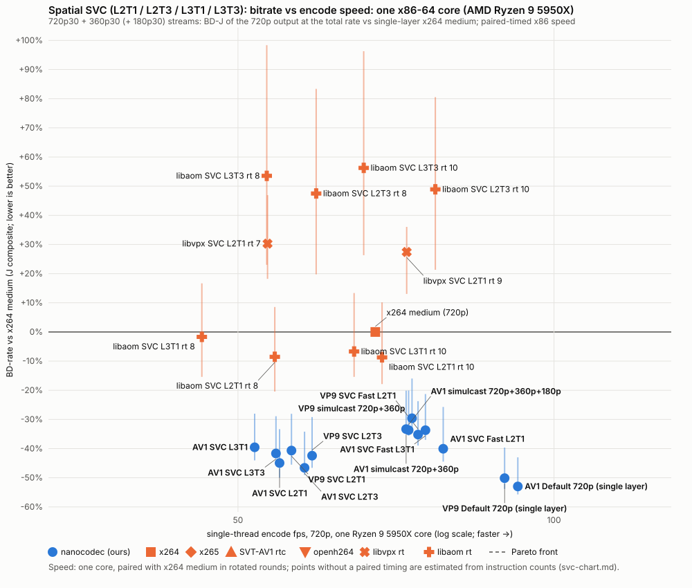

# Spatial scalability (SVC): 720p30 + 360p30 (+ 180p30)

Updated 2026-11-13, build 52903ab1, vp9-svc at 53890097, vp9-svc+L2T3 at 53890097, vp9-svc-fast at 53890097, av1-svc3 at 4594ae65, av1-svc3+L3T3 at 4594ae65, av1-svc3-fast at 4594ae65; libaom svc_encoder_rtc v3.15.3, libvpx vp9_spatial_svc_encoder v1.16.0; paired-timed x86 speed (see the notes)

Two-layer AV1 and VP9 streams (360p base, operating point 1; 720p, operating point 0) and three-layer AV1 streams (180p, operating point 2; 360p, 1; 720p, 0) on the main chart's clips, rungs, length and key interval. **Rate is the total stream rate (every layer); quality is J_real of the 720p output**, so BD-J is against single-layer x264 medium at 720p, on the same scale as [the main chart](bd-vs-speed.md). The single-layer AV1 and VP9 Default lines show what the lower layers cost at 720p.

| Encoder | BD-J op 0 | BD-PSNR-YUV | BD-VMAF v1 | per-clip IQR (BD-J) | 360p op BD-J | 360p op share of rate | fps (Jetson, 1 core) | fps (x86, 1 core) | x86 speed vs x264 medium | clips |
|---|---:|---:|---:|---|---:|---:|---:|---:|---:|---:|
| **AV1 Default 720p (single layer)** | -53.0% | -57.3% | -57.7% | -55.7 … -43.0 |  |  | 41.1 | 92.4 | 1.37× | 8/8 |
| **VP9 Default 720p (single layer)** | -50.1% | -54.4% | -53.6% | -53.8 … -39.6 |  |  | 34.4 | 89.7 | 1.33× | 8/8 |
| **AV1 SVC L2T3** | -46.6% | -50.7% | -52.2% | -49.0 … -34.2 | -8.6% | 23% | 25.5 | 57.9 | 0.86× | 8/8 |
| **AV1 SVC L2T1** | -44.9% | -49.6% | -50.1% | -50.0 … -33.3 | -6.5% | 22% | 24.0 | 54.8 | 0.81× | 8/8 |
| **VP9 SVC L2T3** | -42.4% | -46.2% | -46.8% | -46.6 … -29.2 | -3.1% | 21% | 23.4 | 58.8 | 0.87× | 8/8 |
| **AV1 SVC L3T3** | -41.7% | -45.9% | -48.0% | -43.3 … -28.9 | +17.5% | 28% | 23.3 | 54.3 | 0.80× | 8/8 |
| **VP9 SVC L2T1** | -40.7% | -44.5% | -45.1% | -45.5 … -28.1 | -0.7% | 21% | 22.3 | 56.2 | 0.83× | 8/8 |
| **AV1 SVC Fast L2T1** | -40.1% | -41.7% | -46.7% | -44.5 … -25.7 | +7.0% | 22% | 42.4 | 78.4 | 1.16× | 8/8 |
| **AV1 SVC L3T1** | -39.6% | -44.3% | -45.8% | -44.0 … -28.0 | +20.5% | 27% | 22.3 | 51.9 | 0.77× | 8/8 |
| **VP9 SVC Fast L2T1** | -35.2% | -37.9% | -40.5% | -39.0 … -23.7 | +16.4% | 23% | 33.7 | 74.2 | 1.10× | 8/8 |
| **AV1 SVC Fast L3T1** | -33.7% | -35.5% | -40.6% | -37.0 … -21.3 | +37.2% | 27% | 39.9 | 75.4 | 1.12× | 8/8 |
| **AV1 simulcast 720p+360p+180p** | -33.7% | -38.3% | -39.1% | -35.5 … -20.1 |  | 26% | 31.8* | 72.7 | 1.08× | 8/8 |
| **AV1 simulcast 720p+360p** | -33.3% | -37.9% | -38.8% | -34.9 … -20.1 |  | 35% | 32.9* | 72.3 | 1.07× | 8/8 |
| **VP9 simulcast 720p+360p** | -29.6% | -34.1% | -33.2% | -33.2 … -16.0 |  | 35% | 28.1* | 73.2 | 1.08× | 8/8 |
| libaom SVC L2T1 rt 10 | -8.7% | -14.0% | -11.4% | -17.9 … +10.1 | +42.6% | 32% | 30.6 | 68.6 | 1.01× | 8/8 |
| libaom SVC L2T1 rt 8 | -8.5% | -12.5% | -10.1% | -20.4 … +8.6 | +47.4% | 31% | 24.0 | 54.2 | 0.80× | 8/8 |
| libaom SVC L3T1 rt 10 | -6.7% | -12.7% | -9.3% | -15.4 … +13.3 | +80.3% | 33% | 27.6 | 64.5 | 0.95× | 8/8 |
| libaom SVC L3T1 rt 8 | -1.7% | -5.1% | -4.0% | -15.4 … +16.7 | +87.5% | 32% | 20.3 | 46.2 | 0.68× | 8/8 |
| x264 medium (720p) | +0.0% | +0.0% | +0.0% | +0.0 … +0.0 |  |  | 26.7 | 67.6 | 1.00× | 8/8 |
| libvpx SVC L2T1 rt 9 | +27.4% | +29.6% | +17.8% | +13.1 … +36.0 | +108.2% | 30% | 37.6 | 72.4 | 1.07× | 8/8 |
| libvpx SVC L2T1 rt 7 | +30.3% | +31.3% | +20.6% | +18.2 … +46.9 | +114.8% | 31% | 22.9 | 53.3 | 0.79× | 8/8 |
| libaom SVC L2T3 rt 8 | +47.5% | +47.1% | +42.3% | +19.8 … +83.4 | +104.7% | 30% | 26.0 | 59.4 | 0.88× | 8/8 |
| libaom SVC L2T3 rt 10 | +48.9% | +47.4% | +42.3% | +21.3 … +80.5 | +101.9% | 30% | 32.8 | 77.1 | 1.14× | 8/8 |
| libaom SVC L3T3 rt 8 | +53.5% | +51.5% | +49.6% | +23.0 … +98.4 | +173.4% | 32% | 24.1 | 53.3 | 0.79× | 8/8 |
| libaom SVC L3T3 rt 10 | +56.3% | +53.1% | +51.2% | +26.3 … +96.3 | +169.4% | 32% | 30.2 | 65.9 | 0.97× | 8/8 |

Speed: x264 medium's timed fps (the main chart's) over the point's median per-round time ratio to x264 medium, timed in pairs on one reserved core (`time-host`, the 600 kbps rung, lowlight_city_night, crowd_mot17_09, bodycam_bc1; the Jetson's with the same pairing on its core 3).

\* Estimated, not timed (no paired timing on that platform yet). Each point's fps is the main chart's timed fps of the same program coded single-layer (ours: the codec's Default, or its Fast for an SVC Fast point; libaom: libaom rt at the same speed, aomenc; libvpx: vpxenc rt at the same speed) times that command's instructions over the point's (callgrind instructions per frame (x86-64, AVX2 build), both layers; ours and the references at the 600 kbps rung in CBR, the single-layer commands the main chart's rate-matched fixed-QP ones; lowlight_city_night, crowd_mot17_09, bodycam_bc1). Ratios within one program carry across machines far better than between programs; the Jetson column applies the x86 ratio to the Jetson's timed fps.

## 360p operating point (operating point 1)

360p output against the source downscaled to 360p (ffmpeg Lanczos), at the operating point's own rate (what a 360p receiver gets: the base layer of two, the 180p and 360p layers of three), as BD-J against the same codec's Default coded alone at 360p (the two-layer simulcast's low stream): AV1 points against AV1 Default, VP9 points against VP9 Default.

| Encoder | base BD-J | base BD-PSNR-YUV | base BD-VMAF v1 | base share of total rate | mean base PSNR-YUV | mean base VMAF v1 | clips |
|---|---:|---:|---:|---:|---:|---:|---:|
| AV1 SVC L2T3 | -8.6% | -7.4% | -9.9% | 23% | 31.96 dB | 55.5 | 8/8 |
| AV1 SVC L2T1 | -6.5% | -7.0% | -6.3% | 22% | 31.82 dB | 55.0 | 8/8 |
| AV1 SVC Fast L2T1 | +7.0% | +14.6% | +6.2% | 22% | 31.02 dB | 53.0 | 8/8 |
| AV1 SVC L3T3 | +17.5% | +18.3% | +16.5% | 28% | 31.73 dB | 53.8 | 8/8 |
| AV1 SVC L3T1 | +20.5% | +20.8% | +20.1% | 27% | 31.54 dB | 53.3 | 8/8 |
| AV1 SVC Fast L3T1 | +37.2% | +48.3% | +37.4% | 27% | 30.72 dB | 51.0 | 8/8 |
| libaom SVC L2T1 rt 10 | +42.6% | +48.2% | +51.4% | 32% | 32.55 dB | 63.3 | 8/8 |
| libaom SVC L2T1 rt 8 | +47.4% | +53.3% | +56.0% | 31% | 32.47 dB | 63.6 | 8/8 |
| libaom SVC L3T1 rt 10 | +80.3% | +82.9% | +98.5% | 33% | 31.98 dB | 58.5 | 8/8 |
| libaom SVC L3T1 rt 8 | +87.5% | +92.0% | +105.1% | 32% | 31.99 dB | 59.1 | 8/8 |
| libaom SVC L2T3 rt 10 | +101.9% | +106.4% | +116.7% | 30% | 31.46 dB | 57.9 | 8/8 |
| libaom SVC L2T3 rt 8 | +104.7% | +113.1% | +114.5% | 30% | 31.40 dB | 58.0 | 8/8 |
| libaom SVC L3T3 rt 10 | +169.4% | +175.7% | +179.9% | 32% | 30.74 dB | 52.8 | 6/8 |
| libaom SVC L3T3 rt 8 | +173.4% | +177.7% | +185.6% | 32% | 30.70 dB | 53.0 | 7/8 |
| AV1 Default, 360p alone | +0.0% | +0.0% | +0.0% | 35% | 33.30 dB | 63.2 | |
| VP9 SVC L2T3 | -3.1% | -3.2% | -1.4% | 21% | 31.57 dB | 53.3 | 8/8 |
| VP9 SVC L2T1 | -0.7% | -1.1% | +0.8% | 21% | 31.36 dB | 52.9 | 8/8 |
| VP9 SVC Fast L2T1 | +16.4% | +19.1% | +17.3% | 23% | 31.02 dB | 52.5 | 8/8 |
| libvpx SVC L2T1 rt 9 | +108.2% | +130.3% | +115.2% | 30% | 32.39 dB | 67.9 | 8/8 |
| libvpx SVC L2T1 rt 7 | +114.8% | +131.7% | +119.2% | 31% | 32.41 dB | 68.2 | 7/8 |
| VP9 Default, 360p alone | +0.0% | +0.0% | +0.0% | 35% | 33.25 dB | 63.8 | |

## 180p operating point of three layers (operating point 2)

180p output against the source downscaled to 180p (ffmpeg Lanczos), at the 180p layer's own rate (what a thumbnail receiver gets), as BD-J against AV1 Default coded alone at 180p (the three-way simulcast's lowest stream).

| Encoder | 180p BD-J | 180p BD-PSNR-YUV | 180p BD-VMAF v1 | 180p share of total rate | mean 180p PSNR-YUV | mean 180p VMAF v1 | clips |
|---|---:|---:|---:|---:|---:|---:|---:|
| AV1 SVC L3T3 | +0.8% | +1.4% | +0.5% | 7% | 29.02 dB | 40.8 | 8/8 |
| AV1 SVC L3T1 | +4.9% | +4.8% | +4.9% | 7% | 28.85 dB | 39.8 | 8/8 |
| AV1 SVC Fast L3T1 | +12.4% | +17.2% | +11.1% | 7% | 28.23 dB | 37.6 | 8/8 |
| libaom SVC L3T1 rt 8 | +38.1% | +57.8% | +30.4% | 8% | 29.23 dB | 51.9 | 8/8 |
| libaom SVC L3T1 rt 10 | +42.2% | +64.1% | +34.1% | 8% | 29.07 dB | 51.4 | 8/8 |
| libaom SVC L3T3 rt 8 | +63.4% | +85.9% | +51.8% | 8% | 28.73 dB | 48.2 | 8/8 |
| libaom SVC L3T3 rt 10 | +71.0% | +99.1% | +55.8% | 8% | 28.58 dB | 47.7 | 8/8 |
| AV1 Default, 180p alone | +0.0% | +0.0% | +0.0% | 9% | 30.05 dB | 46.6 | |

## Method

- Every two-layer point targets the total rung with 35% for the base layer (our `spatial.base_rate_share` default; our encoder adapts it per frame, libaom and simulcast keep it); every three-layer point with 8% for 180p and 26% for 360p (our `spatial.s0_rate_share` / `spatial.s1_rate_share` defaults: caps our encoder passes unspent bits up from).
- Three layers (AV1): `presets/av1-svc3.toml` (AV1 Default plus `spatial.layers = 3`, 2:1 steps) in L3T1 and L3T3 (`layers.adaptive=0`), `presets/av1-svc3-fast.toml` (av1-svc-fast's levers) in L3T1; libaom layering modes 6 (L3T1) and 9 (L3T3), its own 4:2:1 downscales; simulcast three independent AV1 Default streams. The 360p operating point is decoded at operating point 1 (dav1d), the 180p at operating point 2, each equal to the encoder's reconstruction of that layer (aomdec's for libaom).
- Ours: `presets/av1-svc.toml` / `presets/vp9-svc.toml` (the codec's Default plus `spatial.layers = 2`), `--temporal-layers 1` (L2T1) or `3` (L2T3, with `layers.adaptive=0`), and `presets/av1-svc-fast.toml` / `presets/vp9-svc-fast.toml` (the codec's Fast levers, a 2x2-mean base downscale and a bilinear search proxy) in L2T1; CBR, 1 s buffer. Operating point 0 is scored from the encoder's reconstruction; the base layer is decoded at operating point 1 (AV1: dav1d; VP9: vpxdec on `nanocodec extract --base-only`'s stream) and must equal the encoder's base reconstruction.
- libaom: `examples/svc_encoder_rtc` of the pinned libaom (tools/anchors `aomsvc`), layering mode 5 (L2T1) or 7 (L2T3), CBR with its 1 s buffer (600 ms start/optimal), no lag, cyclic-refresh AQ (`-aq 1`, as WebRTC), no frame drops, one thread, its own 2:1 downscale; L2T3 temporal split 40/20/40. Decoded by dav1d (scored) and aomdec (equal hashes) at each operating point.
- libvpx: `examples/vp9_spatial_svc_encoder` of the pinned libvpx v1.16.0 (tools/anchors `vpxsvc`), L2T1 (`-sl 2 -r 1/2,1/1`), one-pass CBR (`--rc-end-usage=1`), no lag, cyclic-refresh AQ (`-aq 3`, as WebRTC's VP9), no frame drops, inter-layer prediction on, one thread, quantizer 2-63. Its layers are all shown frames, so the base-only stream is each superframe's first frame. Decoded by vpxdec (scored) and ffmpeg (equal hashes) at each operating point.
- Simulcast: the codec's Default at 720p and, on the ffmpeg-Lanczos 360p downscale, at 360p, two independent streams with the rate summed per frame.
- Rate validity flags (realuse.rate_valid) are not shown: our points carry no key-loan adjustment here.
- Clips left out for every point (no reliable overlap): static_cam29, pan_bdd_00cef86b, handheld_mot17_10.
- Low rungs (40/75 kbps at 720p30, every point) on: static_otw_homes390, static_cam29, static_london_bus, pan_bdd_00cef86b, bodycam_airport, handheld_mot17_10.
